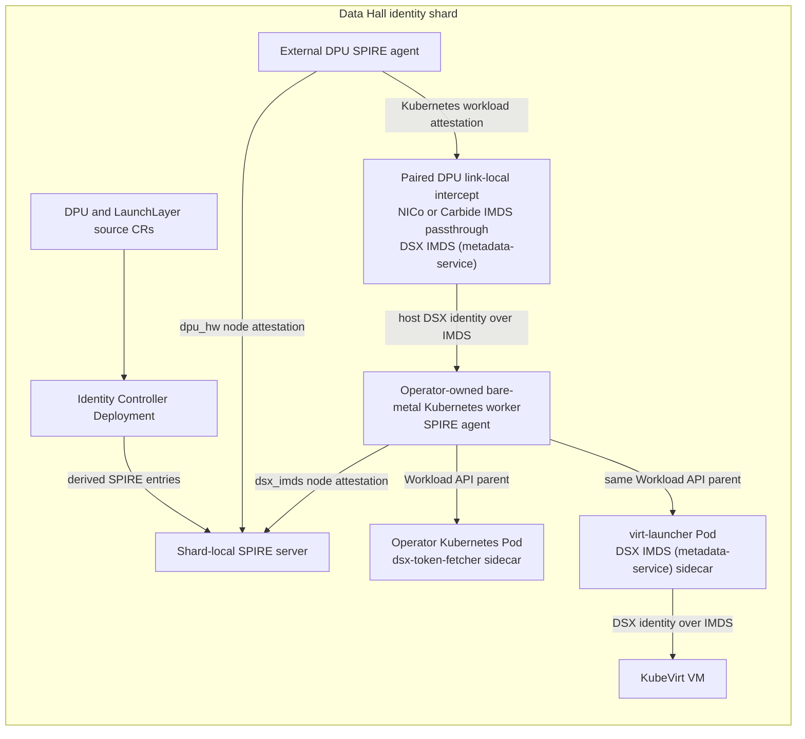
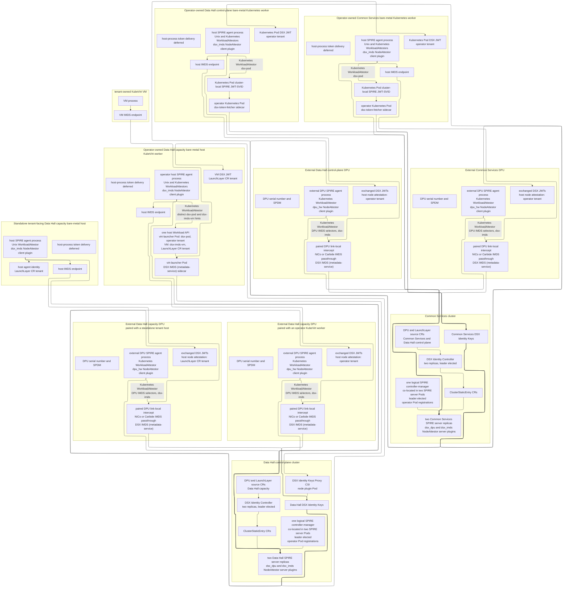
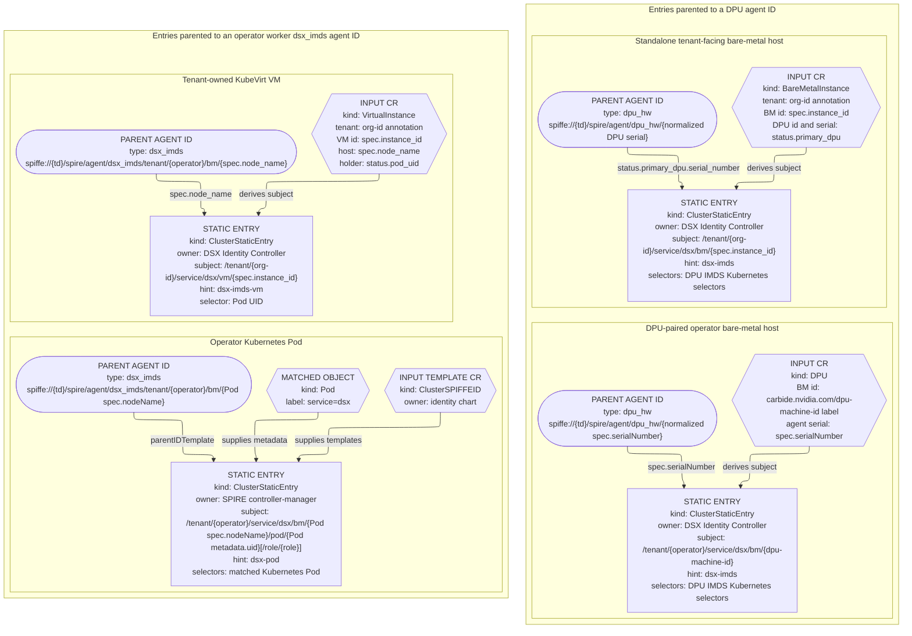
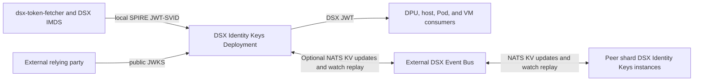
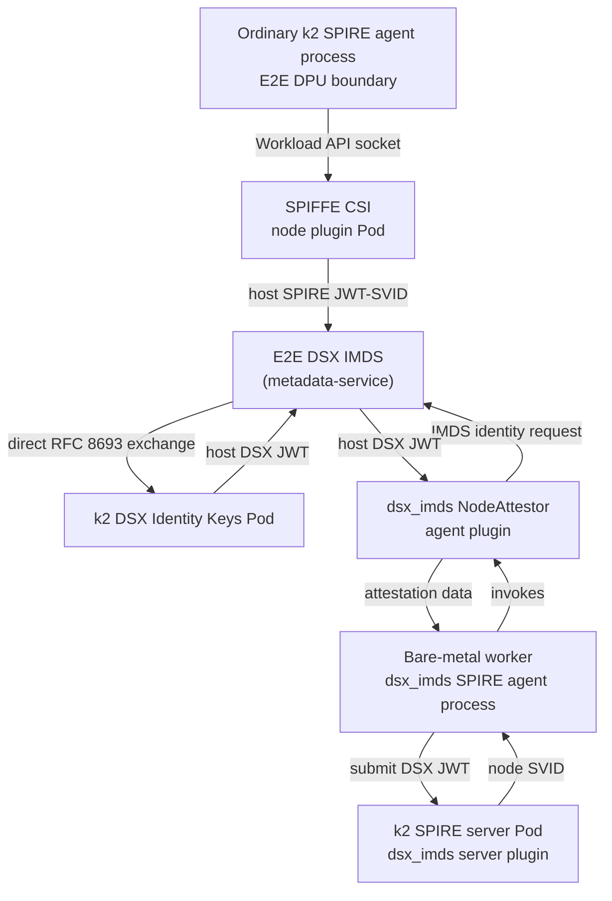
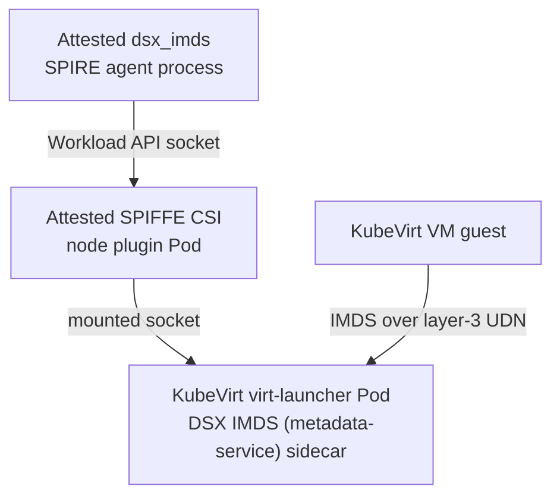
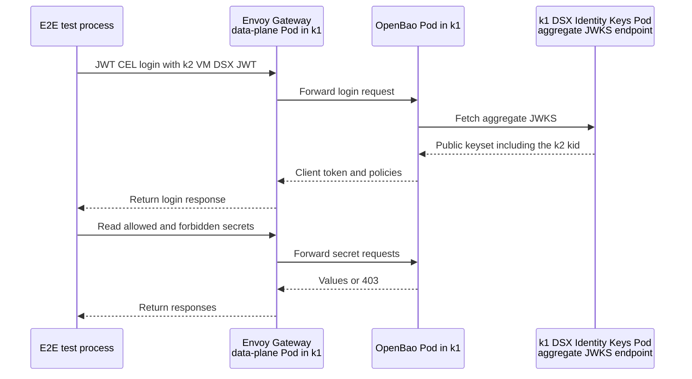

# DSX identity

DSX Identity turns shard-local SPIRE identities into DSX JWTs that relying
parties can validate across shards. An identity shard contains an independent
SPIRE deployment and a co-located DSX Identity Keys deployment. DSX Identity Keys validates only its
local SPIRE JWT-SVIDs, issues DSX JWTs, and distributes its public signing keys
through the external DSX Event Bus.

There is no SPIRE federation between shards. Cross-shard trust starts after
token exchange, when another shard or relying party validates a DSX JWT with
the aggregate public keys served by any DSX Identity Keys instance.

## User guide

See the [examples user guide](examples/README.md) to acquire and consume DSX
JWTs through token-fetcher injection or the link-local IMDS endpoint.

For release maintainers, see [Release candidates](#release-candidates).

Component commands and runtime configuration:

- [DSX Identity Controller](cmd/dsx-identity-controller/README.md)
- [DSX IMDS Network Setup](cmd/dsx-imds-network-setup/README.md)
- [`dsx_imds` NodeAttestor agent plugin](cmd/dsx-imds-node-attestor-agent/README.md)
- [`dsx_imds` NodeAttestor server plugin](cmd/dsx-imds-node-attestor-server/README.md)
- [`dpu_hw` NodeAttestor server plugin](third-party/doca-platform-foundation/cmd/dpu-hw-server)
- [DSX Token Fetcher](cmd/dsx-token-fetcher/README.md)
- [DSX Identity Keys Proxy CSI Driver](cmd/dsx-identity-keys-proxy-csi/README.md)
- [Generate Signing Keyset](cmd/generate-signing-keyset/README.md)
- [DSX IMDS](cmd/metadata-service/README.md)
- [DSX Identity Keys](cmd/dsx-identity-keys/README.md)
- [Kata UDS Proxy](kata-uds-proxy/README.md)

## Release candidates

1. Send feature PRs to `master`.
2. When ready for QA, cut protected `release/1.15.0` from a tested `master` commit.
3. Send release fixes to `release/1.15.0`, then cherry-pick them back to `master` through PRs.

Release-worthy merges create `v1.15.0-rc.N`. The [RC workflow](.github/workflows/release-rc.yml)
publishes matching images and charts directly to NGC, without a GitLab mirror.
PRs only run validation. This workflow does not publish from `master` or promote RCs to stable.

[One-time setup](https://github.com/dsx-ai-factory/dsx-github-actions/blob/main/docs/release-candidate-publishing.md#prerequisites-and-scope):
configure the runner, protected release environment, NGC key, and release permissions.

## CI

PRs to `master` and `release/**`, and pushes to those branches, run `make validate`,
the full [local E2E lifecycle](#local-e2e), secret detection, and container scans.
The shared build action scans both image platforms with Syft and Grype, uploads
SBOMs and reports, and fails on Critical vulnerabilities or scanner errors.
These scans do not submit results to Pulse.

All product jobs use the event's commit and read-only repository permissions,
without release secrets. The RC workflow calls product CI once and waits on
`needs: dsx-component-ci`, without listing individual jobs. The [image inventory](.github/images.json) is shared by scanning
and publishing. E2E requires a Linux Docker host with OVN and KubeVirt kernel
support. Missing prerequisites fail the job rather than skipping tests.

## Architecture

Local SPIRE identities are hierarchical. The DPU identity comes first, the
bare-metal host identity is attested through the DPU, and VM identity is served
from the attested host path.



Common Services owns the identity shard for Common Services and Data Hall
control-plane resources. Each Data Hall owns the shard for its capacity
resources. Both shards derive entries from their local DPU and LaunchLayer
source CRs, and their Pods register beneath local `dsx_imds` agents.



The parent association is an attested SPIRE agent, not a resource-ownership
hierarchy. DPUs are Kubernetes workers in their Kamaji clusters, not in this
management cluster.
Every Kubernetes worker is an operator-owned bare-metal host, and every Pod
uses the configured operator tenant and a `/bm/<node-name>/pod/<pod-uid>`
subject. A tenant-facing bare-metal host is standalone and never becomes a
Kubernetes node. A KubeVirt VM runs in an operator-owned virt-launcher Pod, so
the Pod keeps its operator identity while its metadata sidecar selects the
dynamically tenant-supplied VM SVID from the same operator host Workload API.

### Static entry parentage

The repository produces four static entry forms. The DSX Identity Controller
owns the DPU, standalone host, and VM `ClusterStaticEntry` objects. The official
SPIRE controller-manager derives each Pod `ClusterStaticEntry` from the
chart-owned `ClusterSPIFFEID` template and the matched Kubernetes Pod.

This diagram shows registration data only. Hexagons are input objects,
stadiums are parent agent IDs, and rectangles are actual
`ClusterStaticEntry` objects. Parent agent IDs are established separately
through node attestation. They are not registration entries.



The DPU resource supplies the worker-to-DPU relationship. Its IMDS registration
allows DPU-hosted DSX IMDS to obtain the paired worker's SPIRE JWT-SVID and
exchange it for the DSX JWT returned through link-local IMDS. The worker uses
that DSX JWT to attest its local SPIRE agent through `dsx_imds`.

For a tenant-assigned host, the `BareMetalInstance` supplies the host-to-DPU
relationship. Its entry replaces the operator fallback derived from the DPU
resource.

Local consumers exchange local SPIRE JWT-SVIDs with their shard's DSX Identity Keys for
DSX JWTs. DSX Identity Keys instances share only public signing keys across shards.



A SPIRE JWT-SVID is a cluster-local credential obtained from the local SPIRE
Workload API. A DSX JWT is the credential returned by the local DSX Identity Keys.
SPIRE JWT-SVIDs never establish trust between shards.

Install the identity chart once per shard. Each regular management cluster that
owns DPU or LaunchLayer source CRs runs the Identity Controller for its shard.
Every DSX Identity Keys instance validates only local SPIRE JWT-SVIDs through
its node-local Workload API. It serves aggregate public keys received through
the Event Bus when NATS is enabled, or only local public keys when NATS is
disabled.

The Event Bus, OAuth2 provider, and relying parties are external to the
identity chart.

### Identity delivery

| Consumer | SPIRE trust path | DSX JWT delivery |
|---|---|---|
| [Kubernetes Pod](cmd/dsx-token-fetcher/README.md) | Kubernetes WorkloadAttestor under the worker's `dsx_imds`-attested host agent. The registration uses the operator tenant and worker host subject | The `dsx-token-fetcher` sidecar selects `dsx-pod`, exchanges the local SPIRE JWT-SVID, and writes the DSX JWT to a Pod-private volume mounted read-only in application containers |
| DPU service Pod | DPF exposes the DPU SPIRE agent through `csi.spiffe.io` | Native admission injects the standard token-fetcher sidecar and token volume |
| DPU IMDS | The external DPU agent attests through the `dpu_hw` NodeAttestor agent and server. Its Kubernetes WorkloadAttestor binds the paired BM identity to the IMDS Pod | SPIFFE CSI exposes the DPU agent Workload API socket. DSX IMDS selects `dsx-imds`, exchanges the local SPIRE JWT-SVID, and serves the BM DSX JWT through IMDS |
| [Bare-metal host process](cmd/dsx-imds-node-attestor-agent/README.md) | The DPU agent is attested through `dsx_dpu`. The host agent is attested through the repository `dsx_imds` NodeAttestor agent and server, then can serve local processes through the Unix WorkloadAttestor | The paired DPU intercept carries link-local IMDS to NICo or Carbide IMDS, which passes identity requests to DSX IMDS. DPU-hosted DSX IMDS exchanges directly with its reachable shard-local DSX Identity Keys. The host agent uses the returned DSX JWT for node attestation. A host-process-specific token delivery contract is not currently defined |
| [Kata Containers Pod](kata-uds-proxy/README.md) | The guest is a VM, so `kata-uds-proxy` forwards the host Workload API over vsock | A guest sidecar independently serves the standard Workload API socket path |
| [KubeVirt VM](cmd/metadata-service/README.md) | The controller derives the VM subject from the dynamically supplied tenant ID and parents it to the operator-owned worker host's `dsx_imds` agent. The Kubernetes WorkloadAttestor serves the operator-owned virt-launcher Pod, and SPIFFE CSI exposes that same agent's Workload API socket | The DSX IMDS sidecar selects the VM SPIRE JWT-SVID by its exact `dsx-imds-vm` hint, exchanges it through DSX Identity Keys Proxy CSI, and serves the DSX JWT through IMDS |

## Deployment

Install [`charts/dsx-identity`](charts/dsx-identity/README.md) once per identity
shard with Helm. When enabled, the parent chart creates DPF DPUService resources
that reference the [DSX IMDS](charts/dsx-imds/README.md), [DSX SPIFFE
CSI](charts/dsx-spiffe-csi/README.md), and [DPU token-fetcher
admission](charts/dsx-token-fetcher/README.md) child charts.

## Identity contract

DSX JWT subjects use:

```text
spiffe://<tenant>.<region>.<service>.<partition>/<dpu|bm|vm>/<resource-id>
  [/process/<name>][/role/<role>]
spiffe://<operator-tenant>.<region>.<service>.<partition>/bm/<node-name>/pod/<pod-uuid>
  [/role/<role>]
```

DPU service identities use:

```text
spiffe://<operator-tenant>.<region>.<service>.<partition>/dpu/<serial>/dpuservice/<service-id>/namespace/<namespace>
```

Only the resource type and resource ID have fixed parser semantics:

```text
spiffe://<tenant>.<region>.<service>.<partition>/<dpu|bm|vm>/<resource-id>[/...]
```

Exchange preserves every remaining path segment without interpreting it.

Cluster-local SPIRE identities encode the same fields under the shard trust
domain. Exchange takes the region and partition from explicit configuration,
the tenant and service from the local subject, and preserves the resource path.

```text
spiffe://<local-trust-domain>/tenant/<tenant>/service/<service>/<resource-type>/<resource-id>[/...]
```

| Resource | Tenant source | Subject resource path |
|---|---|---|
| DPU | `global.operatorTenant` | `/dpu/<dpu-id>` |
| Operator bare-metal Kubernetes worker | `global.operatorTenant` | `/bm/<node-name>` |
| Kubernetes Pod | `global.operatorTenant` | `/bm/<node-name>/pod/<pod-uid>` |
| Bare-metal host with a Launch Layer source | `launchlayer.nvidia.com/org-id` annotation | `/bm/<bm-id>` |
| VM with a Launch Layer source | `launchlayer.nvidia.com/org-id` annotation | `/vm/<vm-id>` |

Every Kubernetes worker is an operator-owned bare-metal host. There is no
configured worker list and no LaunchLayer source for these hosts. The Pod
registration template derives the host ID directly from the Kubernetes node
name. The DPU source supplies the BM resource ID through its
`carbide.nvidia.com/dpu-machine-id` label.

Every DSX Kubernetes Pod supplies its service label. SPIRE uses its value for
the service path segment. The fixed parent template identifies the worker's
operator-tenant `dsx_imds` agent.

```yaml
metadata:
  labels:
    spiffe.nvidia.com/service: dsx
    spiffe.nvidia.com/role: database  # optional
```

```yaml
spire:
  spire-server:
    controllerManager:
      extraEnv:
        - name: OPERATOR_TENANT
          value: operator-1
      parentIDTemplate: 'spiffe://{{ .TrustDomain }}/spire/agent/dsx_imds/tenant/$OPERATOR_TENANT/bm/{{ .NodeMeta.Name }}'
```

The chart requires the controller-manager value to equal
`global.operatorTenant`. Because it is part of the SPIRE Pod template, changing
both values causes the StatefulSet to roll out without a restart hook.

DPU identities remain separate controller-derived static entries parented to
the external `dpu_hw` agent identified by the normalized DPU serial. DPUs are
Kubernetes nodes in their Kamaji clusters. The DPU agent's Kubernetes
WorkloadAttestor identifies the IMDS Pod, and SPIFFE CSI exposes the agent's
Workload API socket to that Pod.

The [DSX Identity Controller](cmd/dsx-identity-controller/README.md) derives
SPIRE registration entries from DPU and Launch Layer sources.

```yaml
apiVersion: launchlayer.nvidia.com/v1alpha1
kind: VirtualInstance
metadata:
  annotations:
    launchlayer.nvidia.com/org-id: tenant-2
spec:
  instance_id: vm-1234
  node_name: host-1234
status:
  pod_uid: <virt-launcher-pod-uid>
```

`BareMetalInstance` uses the same tenant annotation, `spec.instance_id`, and
`status.primary_dpu.machine_id` plus `status.primary_dpu.serial_number`. The
configured operator tenant determines a VM entry's worker parent. The Identity
Controller owns SPIFFE IDs, selectors, hints, and class names.

## DSX Identity Keys and Event Bus

[DSX Identity Keys](cmd/dsx-identity-keys/README.md) validates
local SPIRE JWT-SVIDs and issues DSX JWTs. By default it publishes public
signing keys to the Event Bus and serves aggregate JWKS. With NATS disabled it
serves only local public signing keys. The external Gateway terminates TLS and
applies source-aware request quotas. Clients configure the Gateway HTTPS
endpoint. Local fixtures configure their HTTP endpoints directly.

## DSX IMDS host and VM flows

[DSX IMDS](cmd/metadata-service/README.md) serves the tokenless host and VM
identity API. The
[`dsx_imds` NodeAttestor agent](cmd/dsx-imds-node-attestor-agent/README.md) and
[`dsx_imds` NodeAttestor server](cmd/dsx-imds-node-attestor-server/README.md)
bootstrap the host SPIRE agent. The
[DSX Identity Keys Proxy CSI Driver](cmd/dsx-identity-keys-proxy-csi/README.md) carries VM
exchange requests, and
[DSX IMDS Network Setup](cmd/dsx-imds-network-setup/README.md) routes the VM's
link-local metadata traffic.

## Observability

First-party Go processes emit JSON logs to stdout or stderr. Chart-owned metric
endpoints support Prometheus discovery. First-party processes export traces
through their SDK and the sidecar collector installed by the DSX observability
stack. Structured allow, deny, and dependency events never include
credentials.

SPIRE server, controller-manager, and the optional local SPIRE agent expose
their native Prometheus metrics through chart-owned monitors. SPIRE 1.13.2
does not produce traces. SPIFFE CSI Driver, CSI node-driver-registrar, and
the `socat` proxy expose no native application telemetry. Their health checks,
container logs, and platform container metrics remain available.

The DSX sidecar collector configuration has a trace pipeline and no metrics
pipeline. `dsx-token-fetcher`, `metadata-service`, and
`dsx-imds-network-setup` export traces and do not expose application metrics.

```yaml
observability:
  logLevel: info
  metrics:
    enabled: true
    serviceMonitor:
      enabled: true
```

Tracing adds the SDK and sidecar annotations shown below to chart-owned
application Pods and the SPIRE server Pod. Repository-owned SPIRE server
plugins inherit the injected server-container environment.

```yaml
metadata:
  annotations:
    instrumentation.opentelemetry.io/inject-sdk: "dsx-obs/default-instrumentation"
    sidecar.opentelemetry.io/inject: "dsx-obs/default-sidecar"
```

Pods that receive an identity container supply the same tracing annotations on
their Pod template. For token-fetcher injection:

```yaml
metadata:
  labels:
    spiffe.nvidia.com/service: dsx
  annotations:
    spiffe.nvidia.com/inject-dsx-token-fetcher: "true"
    spiffe.nvidia.com/token-audience: spiffe://ds9.dsx.nvid.id/openbao
    instrumentation.opentelemetry.io/inject-sdk: "dsx-obs/default-instrumentation"
    sidecar.opentelemetry.io/inject: "dsx-obs/default-sidecar"
```

The service label selects SPIRE registration. The injection annotation selects
the token fetcher through native admission policy. The audience annotation names
the relying party for the requested SPIRE JWT-SVID and exchanged DSX JWT.

For KubeVirt IMDS injection, put them on the VM Pod template:

```yaml
spec:
  template:
    metadata:
      annotations:
        spiffe.nvidia.com/inject-dsx-imds: "true"
        instrumentation.opentelemetry.io/inject-sdk: "dsx-obs/default-instrumentation"
        sidecar.opentelemetry.io/inject: "dsx-obs/default-sidecar"
```

See the
[DSX service observability guide](https://gitlab-master.nvidia.com/ncp/dsx/dsx-docs/-/blob/9aa5ed1e74f2cd33261bd05e118372ef220c0aba/docs/dev-environments/observability-guide.md).

## Local E2E

The repository validates the architecture with two Kind clusters. k1 hosts a
Common Services identity shard, one unauthenticated NATS server with in-memory
JetStream for KV, and the
OpenBao relying party. k2 hosts a Data Hall identity shard, the Identity
Controller, OVN-Kubernetes layer-3 UDN, and a KubeVirt VM. The k1 and k2 names
describe only this fixture and do not define a trust hierarchy. Local identity
components use one replica and SPIRE uses its SQLite default.

The identity chart is installed independently in both clusters. The remaining
components are separate Skaffold modules. Shared fixture settings and the
shard-specific overrides are in:

- `scripts/identity-e2e-values.yaml`
- `scripts/k1-values.yaml`
- `scripts/k2-values.yaml`

### E2E-only `dsx_imds` bootstrap

Kind starts without an external DPU or an attested worker agent. Before the
worker agent is available, the control-plane node represents the Phase 0 seed
host. Each identity chart is installed once. Its normal DSX Identity Keys Pod runs on
the seed node and uses the ordinary operator-Pod registration there while the
worker's `dsx_imds` agent attests. DSX Identity Keys has no bootstrap-specific identity
or deployment path.

Both local shards must exercise host attestation without physical DPU hardware.
Each therefore runs an official SPIRE agent DaemonSet constrained to its worker
as the external host-agent fixture. The ordinary shard agent remains on the
control-plane node as the emulated external DPU boundary. One SPIFFE CSI driver
exposes each node's canonical Workload API socket. The worker agent's
`dsx_imds` plugin obtains a DSX JWT from DSX IMDS and submits it to the
repository-owned `dsx_imds` server plugin for node attestation. k2 then reuses
that worker agent for its KubeVirt VM path.

The local fixture exposes the real DSX IMDS implementation directly at the
external intercept and passthrough boundary. E2E sends the IMDS request,
exchanges the selected SPIRE JWT-SVID, and uses the returned DSX JWT for
`dsx_imds` node attestation. It does not test physical link-local routing or
NICo or Carbide integration.

The ordinary-agent entry is the permitted fixture at the external `dsx_dpu`
boundary. E2E requests the operator-host identity from IMDS and attests the
worker's `dsx_imds` SPIRE agent with it. The fixture derives the operator host
ID from the worker name without creating a controller input for that worker.

This external-agent fixture uses the shared
`scripts/dsx-imds-host-agent-values.yaml` values and a shard override under
`scripts/k1` or `scripts/k2`. It is not part of the identity chart release.





The KubeVirt VM contains no SPIRE agent. SPIFFE CSI exposes the attested second
agent's Workload API socket to the virt-launcher Pod, and DSX IMDS uses that
socket to fetch the VM SPIRE JWT-SVID.

### Cross-shard OpenBao validation

The local E2E topology deploys OpenBao in k1 as an external relying party. A VM
DSX JWT issued in k2 is accepted because the k2 DSX Identity Keys public key propagates
through the Event Bus and appears in the k1 DSX Identity Keys aggregate JWKS.



### Workflow

Repository validation requires Git, mise, Make, `curl`, and a supported Linux
host. `make validate` builds Linux-only nftables code and exercises Unix socket
paths that exceed macOS limits. macOS and WSL are unsupported. Mise installs
the repository-pinned tools. The full E2E lifecycle also requires Docker with
Buildx, OpenSSL, OpenSSH, and the kernel features needed by OVN-Kubernetes and
KubeVirt.

```bash
git submodule update --init --recursive
make validate
```

The DPF submodule supplies the `dpu-hw-server` source embedded by
`Dockerfile.spire`. Keep the submodule initialized when building the SPIRE
server image.

One root Skaffold workflow deploys both Kind clusters.

```bash
make -j install
make test
make clean
```

The E2E suite verifies operator-host IMDS through both `dsx_imds` plugin halves,
DPU file delivery, Pod and VM identity delivery, shard isolation, NATS KV
propagation, aggregate JWKS behavior, OpenBao authorization, restart recovery,
and signing-key rotation. External DPU and standalone-host hardware is not
modeled as Kubernetes Nodes.
