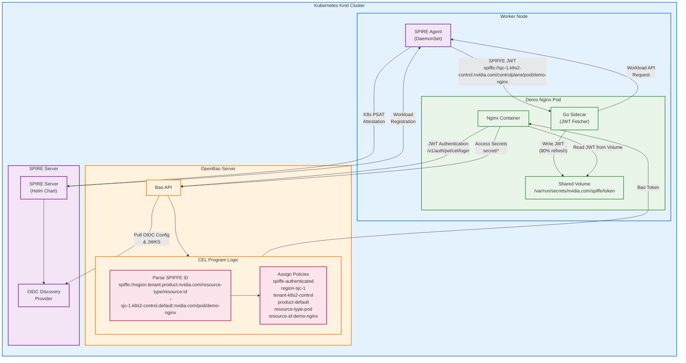

# SPIFFE + OpenBao CEL Demo

Complete demonstration of SPIFFE JWT authentication with OpenBao's CEL (Common Expression Language) enabled JWT auth method.

## Prerequisites

- Docker, kubectl, Kind, Helm

## Quick Start

```bash
make install    # Complete setup
make clean      # Remove everything
make test       # Run integration tests
make help       # Show all available targets
```

## What It Creates

- **Kind cluster** (2 nodes) with trust domain `sjc-1.k8s2-control.nvidia.com`
- **SPIRE server/agent** with k8s PSAT attestation 
- **SPIFFE CSI driver** for JWT file injection
- **Demo nginx pod** with Go sidecar that:
  - Fetches JWT tokens via SPIFFE Workload API
  - Refreshes at 80% of token expiry with retries
  - Writes to `/var/run/secrets/nvidia.com/spiffe/token`
- **OpenBao** with CEL-based JWT authentication and dynamic policy assignment

## Individual Steps

```bash
make cluster      # Create cluster
make spire        # Install SPIRE  
make verify-spire # Verify SPIRE installation  
make nginx        # Deploy demo workload
make bao          # Deploy OpenBao with SPIFFE auth
```

## Configuration

- `config/kind-config.yaml` - Cluster settings
- `config/spire-server-values.yaml` - SPIRE Helm values
- `config/demo-nginx.yaml` - Demo workload with resources
- `config/bao-values.yaml` - OpenBao Helm values with local image

## Troubleshooting

```bash
make verify-spire # Run SPIRE verification

# Manual checks
kubectl get pods -n spire-server
kubectl logs demo-nginx -c spiffe-sidecar
kubectl exec demo-nginx -c nginx -- cat /var/run/secrets/nvidia.com/spiffe/token
kubectl port-forward -n bao svc/openbao 8200:8200
```

## Architecture

This demo creates a complete SPIFFE identity and authentication flow within a Kind cluster:



### Key Features:

- **SPIFFE Identity**: Workloads get cryptographically verifiable identities
- **Dynamic Policy Assignment**: CEL program parses SPIFFE ID components (`region`, `tenant`, `product`, `resource-type`, `resource-id`) from pattern `spiffe://region.tenant.nvidia.com/product/resource-type/resource-id` and assigns policies dynamically
- **Automatic JWT Refresh**: Go sidecar refreshes tokens at 80% expiry with retry logic