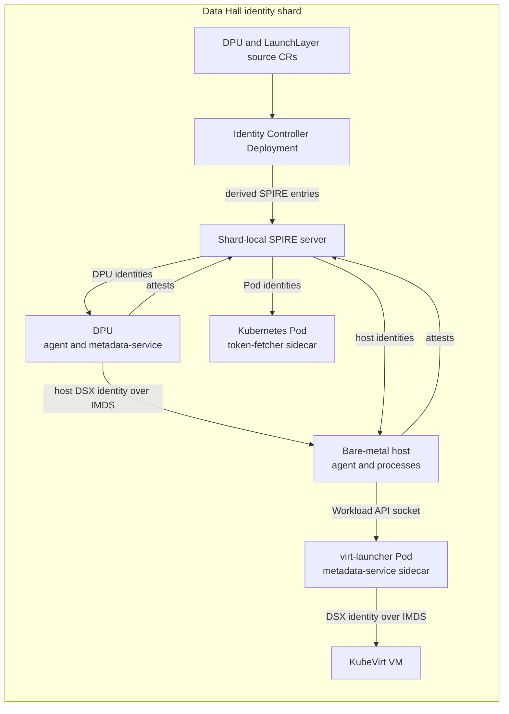
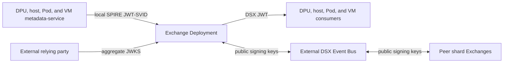
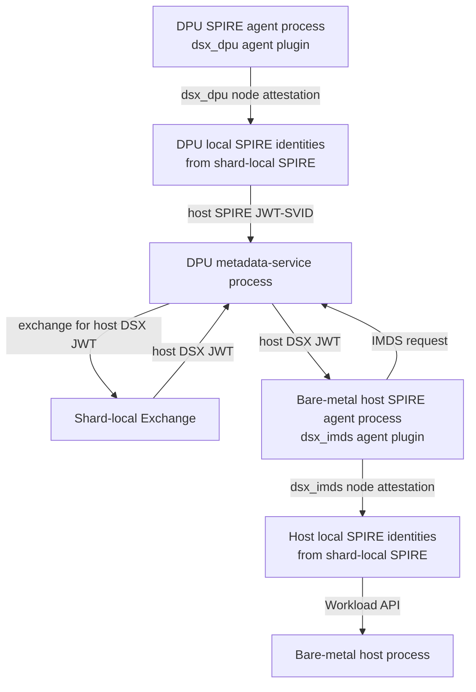
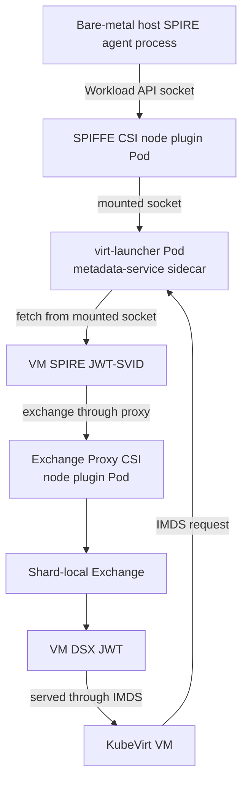
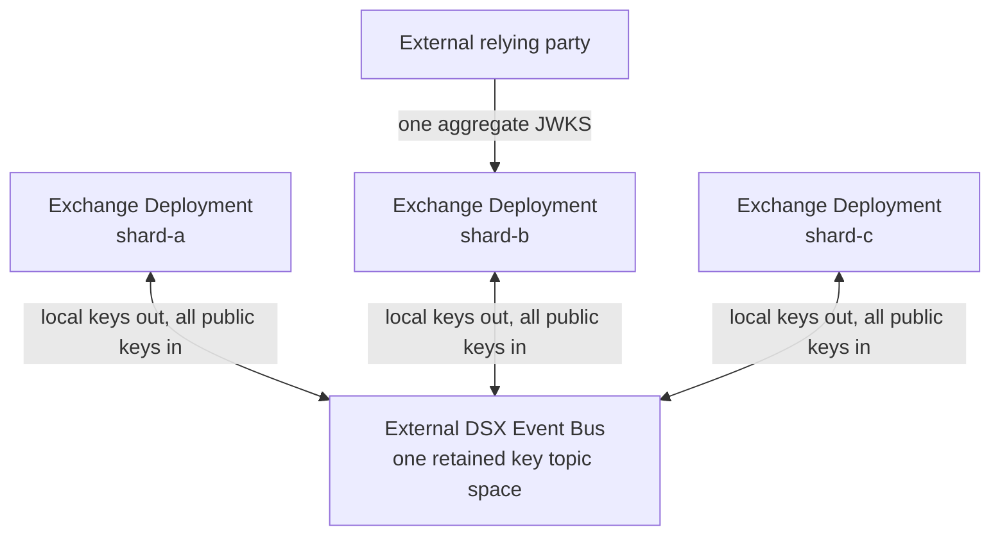
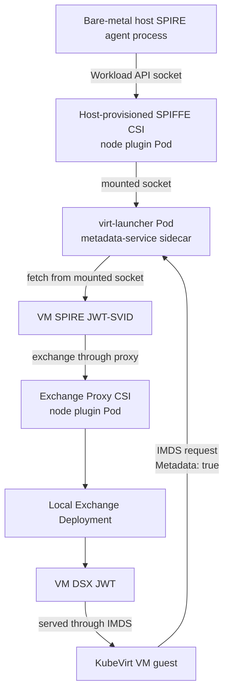
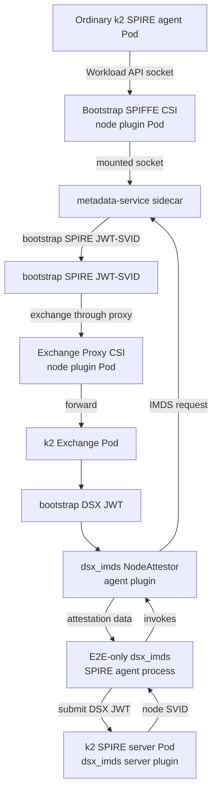
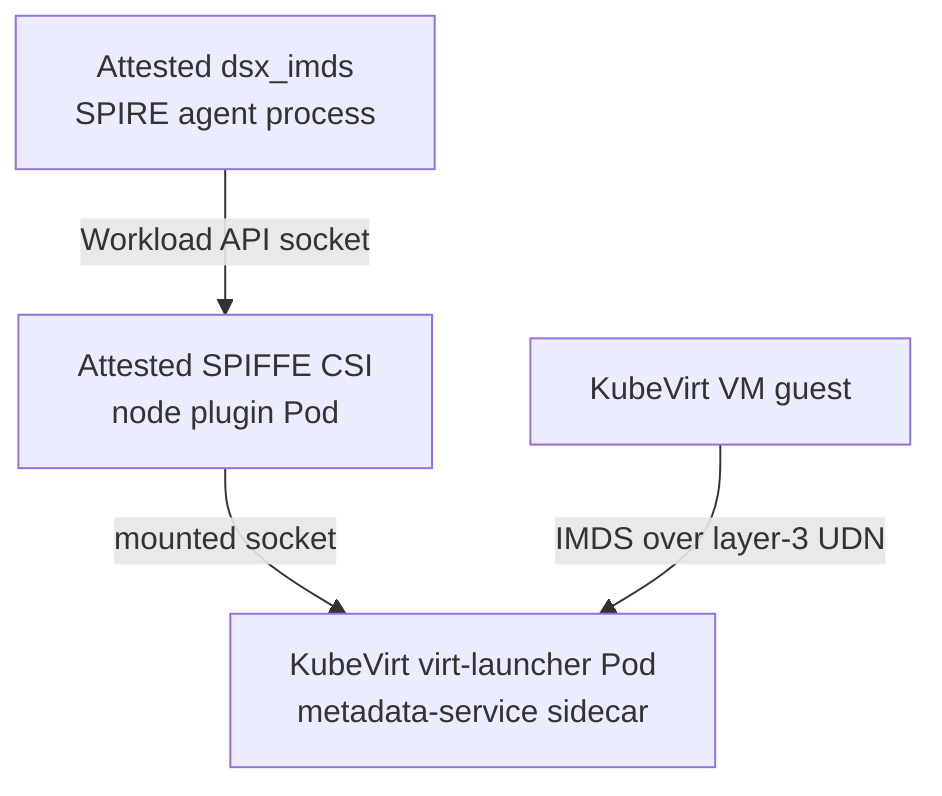
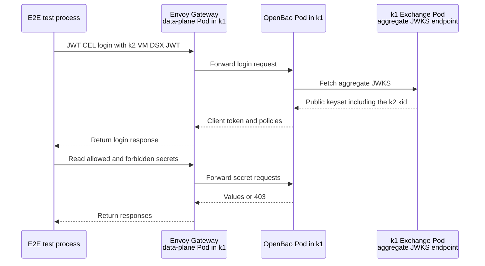

# DSX identity

DSX Identity turns shard-local SPIRE identities into DSX JWTs that relying
parties can validate across shards. An identity shard contains an independent
SPIRE deployment and a co-located Exchange. The Exchange validates only its
local SPIRE JWT-SVIDs, issues DSX JWTs, and distributes its public signing keys
through the external DSX Event Bus.

There is no SPIRE federation between shards. Cross-shard trust starts after
token exchange, when another shard or relying party validates a DSX JWT with
the aggregate public keys served by any Exchange.

## Architecture

Local SPIRE identities are hierarchical. The DPU identity comes first, the
bare-metal host identity is attested through the DPU, and VM identity is served
from the attested host path.



Local consumers exchange local SPIRE JWT-SVIDs with their shard's Exchange for
DSX JWTs. Exchanges share only public signing keys across shards.



A SPIRE JWT-SVID is a cluster-local credential obtained from the local SPIRE
Workload API. A DSX JWT is the credential returned by the local Exchange.
SPIRE JWT-SVIDs never establish trust between shards.

Install the identity chart once per shard. Data Hall management clusters also
run the Identity Controller, which derives SPIRE entries from read-only DPU and
LaunchLayer source CRs. Every Exchange validates only local SPIRE JWT-SVIDs and
serves the aggregate public keys received through the Event Bus.

The Event Bus, OAuth2 provider, Kyverno runtime, and relying parties are
external to the identity chart.

### Identity trust paths

The architecture overview omits attestor and CSI details. The Data Hall trust
paths use the shard-local SPIRE server and Exchange as follows.

The DPU establishes the first local SPIRE identities. The bare-metal host is
attested from the DPU identity before it can serve host processes or VMs.



VM identity uses the attested host agent. The VM receives only the DSX identity
served through IMDS.



### Identity delivery

| Consumer | SPIRE trust path | DSX JWT delivery |
|---|---|---|
| Kubernetes Pod | `k8s_psat` NodeAttestor and Kubernetes WorkloadAttestor | token-fetcher obtains a local SPIRE JWT-SVID, exchanges it, and writes the DSX JWT |
| DPU process or Pod | External `dsx_dpu` NodeAttestor agent and server, then Unix or Kubernetes WorkloadAttestor | token-fetcher selects the local SPIRE JWT-SVID with hint `dsx-dpu` and exchanges it |
| Bare-metal host process | The DPU agent is attested through `dsx_dpu`. The host agent is attested through the repository `dsx_imds` NodeAttestor agent and server, then serves processes through the Unix WorkloadAttestor | DPU metadata-service exchanges the host SPIRE JWT-SVID and serves the DSX JWT through IMDS. The host agent submits that JWT for node attestation |
| KubeVirt VM | The controller derives the VM entry. The externally provisioned bare-metal host SPIRE agent and the Kubernetes WorkloadAttestor serve the virt-launcher Pod. A host-provisioned SPIFFE CSI driver exposes that agent's Workload API socket | metadata-service obtains the VM SPIRE JWT-SVID through the Workload API, exchanges it through Exchange Proxy CSI, and serves the DSX JWT through IMDS |

### Flat Exchange key distribution



Every Exchange publishes only its local public keys and consumes every valid
publication in the Event Bus topic space. Each Exchange therefore serves the
same aggregate JWKS. Relying parties can use any reachable Exchange.

```text
spiffe-exchange/v1/pub-keys/shard/<shard-id>/kid/<kid>
```

Shard IDs and key IDs are globally unique within an Event Bus topic space.
Signing keys remain local to their shard. Rotation publishes a new key and
allows the previous publication to expire after its lease is no longer
refreshed.

## Helm chart

Install `charts/dsx-identity` once per identity shard. Install the official
SPIRE CRD chart first. The identity chart installs SPIRE and can install the
repository-owned Exchange, controller, metadata, CSI, and identity policies.

Each installation supplies its shard identity, external Event Bus connection,
OAuth2 client, and signing keyset.

```yaml
global:
  spire:
    trustDomain: shard.example.com
    clusterName: shard-a
    jwtIssuer: spiffe://shard.example.com

exchange:
  shardID: shard-a
  jwksURL: https://exchange.shard.example.com/.well-known/jwks.json
  signingKeysetSecret: spiffe-exchange-signing-keyset
  mqtt:
    brokerURL: tls://event-bus.example.com
    oauth2:
      tokenURL: https://auth.example.com/oauth2/token
      clientID: spiffe-exchange
      clientSecretSecret: spiffe-exchange-mqtt-oauth
      clientSecretKey: client-secret
```

Data Hall shards also enable the controller and VM identity path.

```yaml
podTokenFetcher:
  enabled: true

vmSupport:
  enabled: true

identityController:
  enabled: true
  operatorTenant: nca-0000000000000001
  dpuHolder:
    namespace: dsx-identity
    serviceAccount: dpu-token-fetcher
```

The referenced Secrets must exist before their consumers start. Controller
deployments require the external DPU and LaunchLayer APIs. Identity injection
requires Kyverno. Tracing requires the DSX observability stack. ServiceMonitor
resources require the Prometheus Operator APIs.

## Identity contract

DSX JWT subjects use:

```text
spiffe://nca-<16-digits>.ds9.dsx.nvid.id/<dpu|host|vm>/<resource-id>
  [/process/<name>|/pod/<uuid>]
  [/role/<role>]
```

Cluster-local SPIRE identities encode the same tenant, service, resource type,
and resource ID under the shard trust domain.

```text
spiffe://<local-trust-domain>/tenant/<tenant>/service/dsx/<resource-type>/<resource-id>[/...]
```

Pods using token-fetcher injection supply:

```yaml
metadata:
  labels:
    spiffe.nvidia.com/tenant: nca-0000000000000001
    spiffe.nvidia.com/service: dsx
    spiffe.nvidia.com/resource-type: host
    spiffe.nvidia.com/resource-id: host-1234
```

The Identity Controller derives SPIRE entries from externally owned DPU and
LaunchLayer source objects. A source object provides resource ownership and
placement, not a complete SPIRE registration entry.

```yaml
spec:
  type: vm                             # host or vm
  tenantID: nca-0000000000000001
  resourceID: vm-1234
  parentID: host-1234                  # DPU ID for host, host ID for VM
  parentTenantID: nca-0000000000000001 # required for VM
  role: database                       # optional
  holder:
    namespace: tenant-tenant1
    serviceAccount: vm-identity-client
    podUID: <pod-uuid>                 # optional
```

## Exchange and Event Bus

`/v1/exchange` accepts a SPIRE JWT-SVID issued by the Exchange shard's local
SPIRE server. Exchange validates that credential, preserves its validated
claims, replaces the subject and issuer with the DSX identity contract, and
signs the resulting DSX JWT with the shard keyset.

Each shard runs two active Exchange replicas backed by one shard-local signing
keyset. Private signing keys never leave their shard. Exchange authenticates to
the external Event Bus with an OAuth2 client credential restricted to the
`spiffe-exchange.>` MQTT topic space.

## DSX IMDS host and VM flows

Bare-metal hosts and KubeVirt VMs request an audience-bound DSX identity from
the metadata-service. The API is tokenless, requires the metadata header, and
rejects proxy headers.

```http
GET /latest/meta-data/identity?aud=<audience>
Metadata: true
Accept: application/json
```

The compatibility path `/2009-04-04/meta-data/identity` is also supported.
JSON responses contain the token, remaining lifetime, and DSX SPIFFE ID.
`Accept: text/plain` returns only the token.

On a bare-metal host, the externally provisioned SPIRE agent uses its
`dsx_imds` plugin to request the host DSX identity from the DPU
metadata-service over link-local IMDS. The repository-owned `dsx_imds` server
plugin validates that identity during node attestation.

For a KubeVirt VM, the guest initiates the metadata request. The virt-launcher
Pod hosts metadata-service, but the VM identity comes from the externally
provisioned bare-metal host SPIRE agent and the local shard.



## Observability

First-party Go processes emit JSON logs to stdout or stderr. Chart-owned metric
endpoints support Prometheus discovery. Injected processes export traces
through the SDK and sidecar collector installed by the DSX observability stack.

```yaml
observability:
  logLevel: info
  metrics:
    enabled: true
    serviceMonitor:
      enabled: true
```

Tracing adds the documented SDK and sidecar annotations to chart-owned
application Pods and the SPIRE server Pod. Repository-owned SPIRE server
plugins inherit the injected server-container environment.

```yaml
metadata:
  annotations:
    instrumentation.opentelemetry.io/inject-sdk: "dsx-obs/default-instrumentation"
    sidecar.opentelemetry.io/inject: "dsx-obs/default-sidecar"
```

Pods that receive an identity container supply the same tracing annotations on
their Pod template. For token-fetcher injection:

```yaml
metadata:
  annotations:
    spiffe.nvidia.com/inject-dsx-token-fetcher: "true"
    instrumentation.opentelemetry.io/inject-sdk: "dsx-obs/default-instrumentation"
    sidecar.opentelemetry.io/inject: "dsx-obs/default-sidecar"
```

For KubeVirt IMDS injection, put them on the VM Pod template:

```yaml
spec:
  template:
    metadata:
      annotations:
        spiffe.nvidia.com/inject-dsx-imds: "true"
        instrumentation.opentelemetry.io/inject-sdk: "dsx-obs/default-instrumentation"
        sidecar.opentelemetry.io/inject: "dsx-obs/default-sidecar"
```

See the
[DSX service observability guide](https://gitlab-master.nvidia.com/ncp/dsx/dsx-docs/-/blob/9aa5ed1e74f2cd33261bd05e118372ef220c0aba/docs/dev-environments/observability-guide.md).

## Signing-key rotation

Each shard loads one private signing keyset from its configured Secret. Rotate
that Secret to a newly generated, globally unique `kid`, then roll the Exchange
Deployment. New replicas publish the new public key and stop refreshing the
previous publication. The previous key remains in aggregate JWKS responses
until its publication lease expires.

## Local E2E

The repository validates the architecture with two Kind clusters. k1 hosts a
Common Services identity shard plus the external Event Bus, OAuth2 provider,
and OpenBao relying party. k2 hosts a Data Hall identity shard, the Identity
Controller, OVN-Kubernetes layer-3 UDN, and a KubeVirt VM. The k1 and k2 names
describe only this fixture and do not define a production trust hierarchy.

The identity chart is installed independently in both clusters. The remaining
components are separate Skaffold modules. Complete chart inputs are in:

- `scripts/k1-values.yaml`
- `scripts/k2-values.yaml`

### E2E-only `dsx_imds` bootstrap

The local k2 topology must exercise the host and VM attestation contract
without physical DPU hardware. It therefore runs an E2E-only second SPIRE agent
Pod. Bootstrap SPIFFE CSI exposes the ordinary k2 agent's Workload API socket,
and metadata-service uses it to fetch the bootstrap SPIRE JWT-SVID. The second
agent's `dsx_imds` plugin obtains a DSX JWT through metadata-service and submits
it to the repository-owned `dsx_imds` server plugin for node attestation.

This second agent is configured only in `scripts/k2-values.yaml`. It is not
enabled by the identity chart defaults.



After the second agent is attested, the VM path matches the host-backed IMDS
contract.



The KubeVirt VM contains no SPIRE agent. SPIFFE CSI exposes the attested second
agent's Workload API socket to the virt-launcher Pod, and metadata-service uses
that socket to fetch the VM SPIRE JWT-SVID.

### Cross-shard OpenBao validation

The local E2E topology deploys OpenBao in k1 as an external relying party. A VM
DSX JWT issued in k2 is accepted because the k2 Exchange public key propagates
through the Event Bus and appears in the k1 Exchange aggregate JWKS.



### Local signing-key rotation

The following commands rotate the k1 fixture keyset:

```bash
umask 077
KEYSET_DIR=/secure/path/k1-key-rotation
install -d -m 0700 "${KEYSET_DIR}"
mise exec -- go run ./cmd/generate-signing-keyset > "${KEYSET_DIR}/generated.json"
mise exec -- jq -c '.jwks' "${KEYSET_DIR}/generated.json" \
  > "${KEYSET_DIR}/signing-jwks.json"
mise exec -- jq -jr '.active_kid' "${KEYSET_DIR}/generated.json" \
  > "${KEYSET_DIR}/active-kid"
mise exec -- kubectl create secret generic spiffe-exchange-signing-keyset \
  -n dsx-identity --context kind-k1 \
  --from-file="${KEYSET_DIR}/signing-jwks.json" \
  --from-file="${KEYSET_DIR}/active-kid" --dry-run=client -o yaml \
  | mise exec -- kubectl apply --context kind-k1 -f -
mise exec -- kubectl rollout restart deployment/spiffe-exchange \
  -n dsx-identity --context kind-k1
mise exec -- kubectl rollout status deployment/spiffe-exchange \
  -n dsx-identity --context kind-k1
```

### Workflow

Repository validation requires Git, mise, Make, and `curl`. Mise installs the
repository-pinned tools. The full E2E lifecycle also requires Docker with
Buildx, OpenSSL, OpenSSH, and a supported Linux host with the kernel features
needed by OVN-Kubernetes and KubeVirt. WSL is unsupported.

```bash
git submodule update --init --recursive
make validate
```

One root Skaffold workflow deploys both Kind clusters.

```bash
make -j install
make test
make clean
```

The E2E suite verifies Pod and VM identity delivery, shard isolation, Event Bus
publication, aggregate JWKS behavior, OpenBao authorization, restart recovery,
and signing-key rotation.
