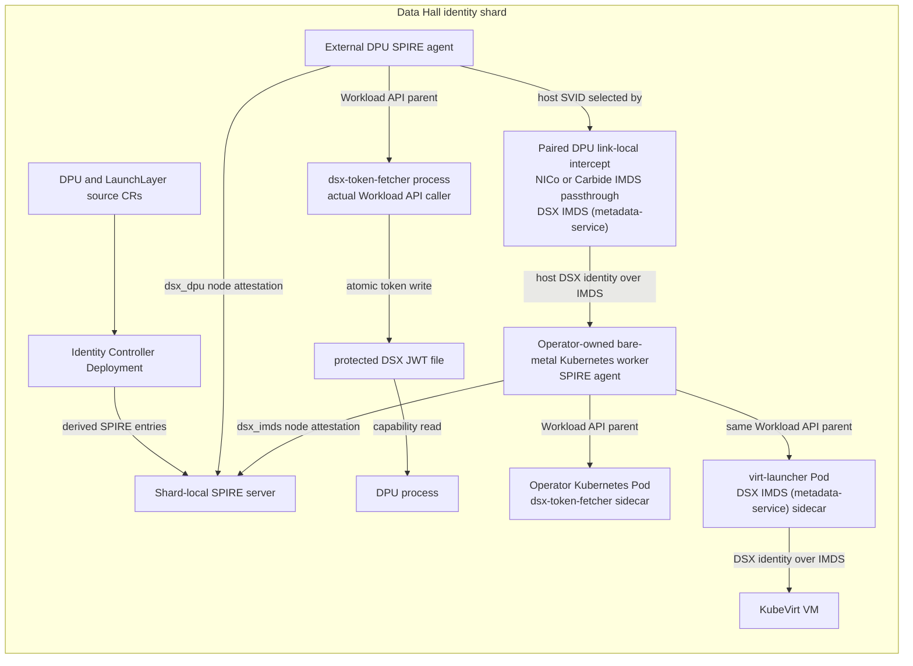
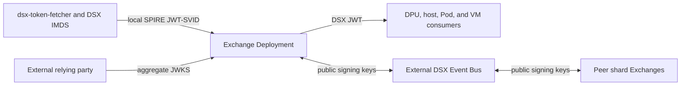
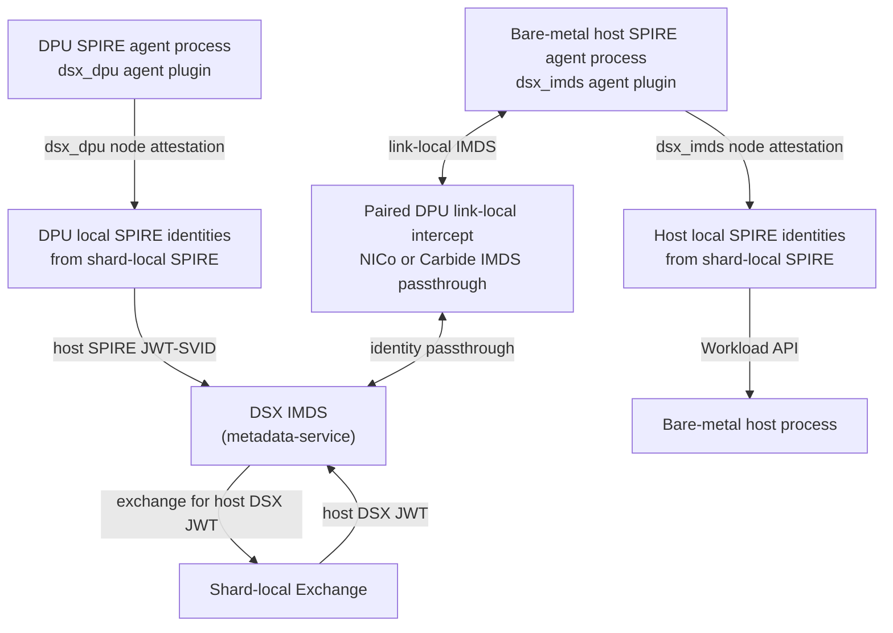
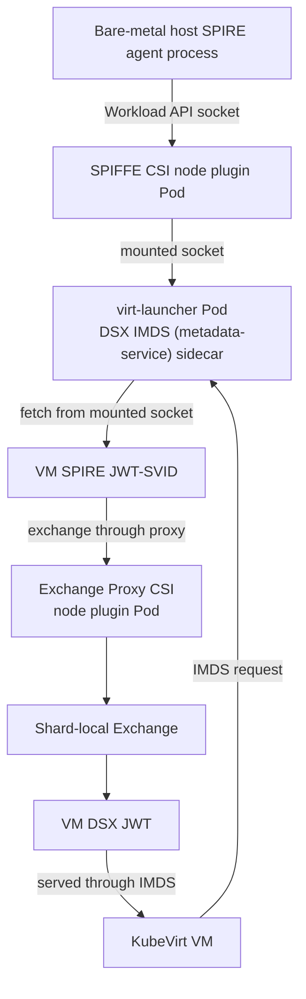
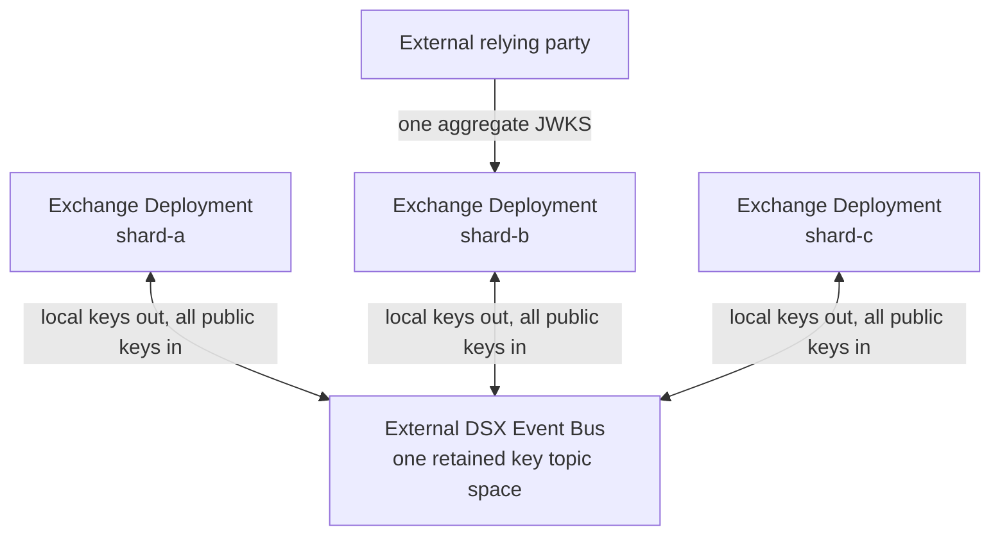
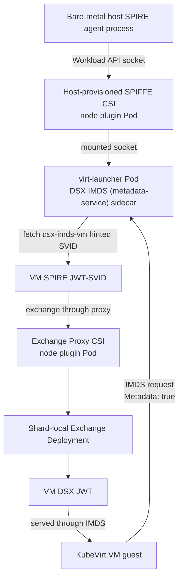
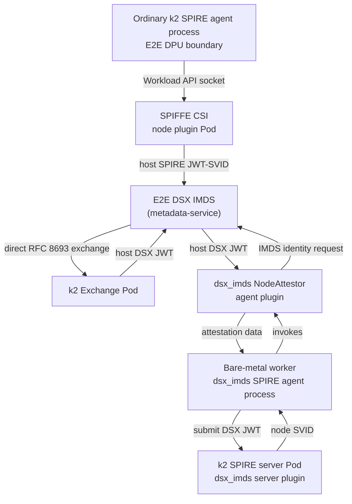
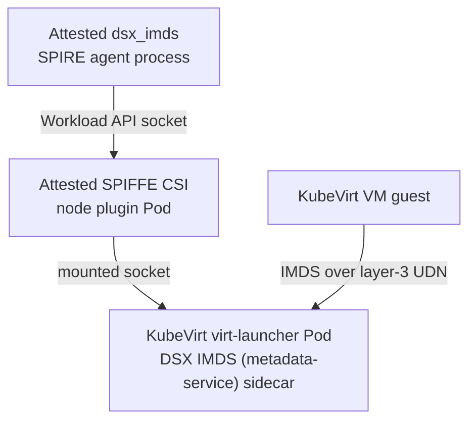
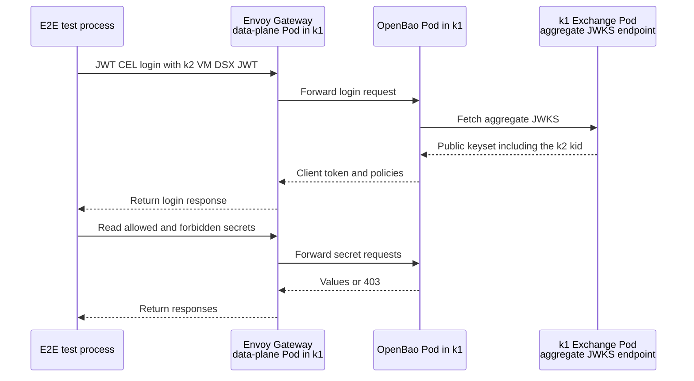

# DSX identity

DSX Identity turns shard-local SPIRE identities into DSX JWTs that relying
parties can validate across shards. An identity shard contains an independent
SPIRE deployment and a co-located Exchange. The Exchange validates only its
local SPIRE JWT-SVIDs, issues DSX JWTs, and distributes its public signing keys
through the external DSX Event Bus.

There is no SPIRE federation between shards. Cross-shard trust starts after
token exchange, when another shard or relying party validates a DSX JWT with
the aggregate public keys served by any Exchange.

This README records system contracts. Component-specific decisions live beside
their implementations in `cmd/*/README.md` and concise code or values comments.
Files under `docs/plans` record change execution and are not design authority.

## Architecture

Local SPIRE identities are hierarchical. The DPU identity comes first, the
bare-metal host identity is attested through the DPU, and VM identity is served
from the attested host path.



The detailed topology below reproduces the SDD Design Summary relationships in
repository-native form. Common Services owns the identity shard for Common
Services and Data Hall control-plane resources. Each Data Hall owns the shard
for its capacity resources. The same registration rules apply in both shards.

```mermaid
flowchart TB
  subgraph CSCluster["Common Services cluster"]
    direction TB
    CSSources["DPU and LaunchLayer source CRs<br/>Common Services and Data Hall control plane"]
    CSController["DSX Identity Controller<br/>two replicas, leader elected"]
    CSEntries["ClusterStaticEntry CRs"]
    CSPodManager["one logical SPIRE controller-manager<br/>co-located in two SPIRE server Pods<br/>leader elected<br/>operator Pod registrations"]
    CSSPIRE["two Common Services SPIRE server replicas<br/>dsx_dpu and dsx_imds NodeAttestor server plugins"]
    CSExchange["Common Services Exchange"]
  end

  subgraph DHCluster["Data Hall control-plane cluster"]
    direction TB
    DHSources["DPU and LaunchLayer source CRs<br/>Data Hall capacity"]
    DHController["DSX Identity Controller<br/>two replicas, leader elected"]
    DHEntries["ClusterStaticEntry CRs"]
    DHPodManager["one logical SPIRE controller-manager<br/>co-located in two SPIRE server Pods<br/>leader elected<br/>operator Pod registrations"]
    DHSPIRE["two Data Hall SPIRE server replicas<br/>dsx_dpu and dsx_imds NodeAttestor server plugins"]
    DHExchange["Data Hall Exchange"]
    DHProxy["Exchange Proxy CSI<br/>node plugin Pod"]
  end

  subgraph TenantVM["tenant-owned KubeVirt VM"]
    direction TB
    VMWorkload["VM process"]
    VMIMDS["VM IMDS endpoint"]
  end

  subgraph CSHost["Operator-owned Common Services bare-metal Kubernetes worker"]
    direction TB
    CSHostDSX["Kubernetes Pod DSX JWT<br/>operator tenant"]
    CSHostPod["operator Kubernetes Pod<br/>dsx-token-fetcher sidecar"]
    CSHostSVIDs["Kubernetes Pod cluster-local SPIRE JWT-SVID"]
    CSHostAgent["host SPIRE agent process<br/>Unix and Kubernetes WorkloadAttestors<br/>dsx_imds NodeAttestor client plugin"]
    CSHostIMDS["host IMDS endpoint"]
    CSHostDeferred["host-process token delivery deferred"]
  end

  subgraph CPHost["Operator-owned Data Hall control-plane bare-metal Kubernetes worker"]
    direction TB
    CPHostDSX["Kubernetes Pod DSX JWT<br/>operator tenant"]
    CPHostPod["operator Kubernetes Pod<br/>dsx-token-fetcher sidecar"]
    CPHostSVIDs["Kubernetes Pod cluster-local SPIRE JWT-SVID"]
    CPHostAgent["host SPIRE agent process<br/>Unix and Kubernetes WorkloadAttestors<br/>dsx_imds NodeAttestor client plugin"]
    CPHostIMDS["host IMDS endpoint"]
    CPHostDeferred["host-process token delivery deferred"]
  end

  subgraph VMHost["Operator-owned Data Hall capacity bare-metal host<br/>KubeVirt worker"]
    direction TB
    VMHostDSX["VM DSX JWT<br/>LaunchLayer CR tenant"]
    VMDSXIMDS["virt-launcher Pod<br/>DSX IMDS (metadata-service) sidecar"]
    VMHostSVIDs["one host Workload API<br/>virt-launcher Pod: dsx-pod, operator tenant<br/>VM: dsx-imds-vm, LaunchLayer CR tenant"]
    VMHostAgent["operator host SPIRE agent process<br/>Unix and Kubernetes WorkloadAttestors<br/>dsx_imds NodeAttestor client plugin"]
    VMHostIMDS["host IMDS endpoint"]
    VMHostDeferred["host-process token delivery deferred"]
  end

  subgraph BMHost["Standalone tenant-facing Data Hall capacity bare-metal host"]
    direction TB
    BMHostIdentity["host agent identity<br/>LaunchLayer CR tenant"]
    BMHostAgent["host SPIRE agent process<br/>Unix WorkloadAttestor<br/>dsx_imds NodeAttestor client plugin"]
    BMHostIMDS["host IMDS endpoint"]
    BMHostDeferred["host-process token delivery deferred"]
  end

  subgraph CSDPU["External Common Services DPU"]
    direction TB
    CSDPUDSX["exchanged DSX JWTs<br/>DPU token file: operator tenant<br/>host node attestation: operator tenant"]
    CSDPUFetcher["dsx-token-fetcher process<br/>actual Workload API caller"]
    CSDPUIMDS["paired DPU link-local intercept<br/>NICo or Carbide IMDS passthrough<br/>DSX IMDS (metadata-service)"]
    CSDPUAgent["external DPU SPIRE agent process<br/>Unix WorkloadAttestor<br/>dsx_dpu NodeAttestor client plugin"]
    CSHardware["DPU serial number and SPDM"]
  end

  subgraph CPDPU["External Data Hall control-plane DPU"]
    direction TB
    CPDPUDSX["exchanged DSX JWTs<br/>DPU token file: operator tenant<br/>host node attestation: operator tenant"]
    CPDPUFetcher["dsx-token-fetcher process<br/>actual Workload API caller"]
    CPDPUIMDS["paired DPU link-local intercept<br/>NICo or Carbide IMDS passthrough<br/>DSX IMDS (metadata-service)"]
    CPDPUAgent["external DPU SPIRE agent process<br/>Unix WorkloadAttestor<br/>dsx_dpu NodeAttestor client plugin"]
    CPHardware["DPU serial number and SPDM"]
  end

  subgraph VMDPU["External Data Hall capacity DPU<br/>paired with an operator KubeVirt worker"]
    direction TB
    VMDPUDSX["exchanged DSX JWTs<br/>DPU token file: operator tenant<br/>host node attestation: operator tenant"]
    VMDPUFetcher["dsx-token-fetcher process<br/>actual Workload API caller"]
    VMDPUIMDS["paired DPU link-local intercept<br/>NICo or Carbide IMDS passthrough<br/>DSX IMDS (metadata-service)"]
    VMDPUAgent["external DPU SPIRE agent process<br/>Unix WorkloadAttestor<br/>dsx_dpu NodeAttestor client plugin"]
    VMHardware["DPU serial number and SPDM"]
  end

  subgraph BMDPU["External Data Hall capacity DPU<br/>paired with a standalone tenant host"]
    direction TB
    BMDPUDSX["exchanged DSX JWTs<br/>DPU token file: operator tenant<br/>host node attestation: LaunchLayer CR tenant"]
    BMDPUFetcher["dsx-token-fetcher process<br/>actual Workload API caller"]
    BMDPUIMDS["paired DPU link-local intercept<br/>NICo or Carbide IMDS passthrough<br/>DSX IMDS (metadata-service)"]
    BMDPUAgent["external DPU SPIRE agent process<br/>Unix WorkloadAttestor<br/>dsx_dpu NodeAttestor client plugin"]
    BMHardware["DPU serial number and SPDM"]
  end

  CSSources --> CSController
  CSController --> CSEntries
  CSEntries --> CSSPIRE
  CSPodManager --> CSSPIRE
  DHSources --> DHController
  DHController --> DHEntries
  DHEntries --> DHSPIRE
  DHPodManager --> DHSPIRE

  CSHostAgent --> CSSPIRE
  CPHostAgent --> CSSPIRE
  CSDPUAgent --> CSSPIRE
  CPDPUAgent --> CSSPIRE
  VMHostAgent --> DHSPIRE
  BMHostAgent --> DHSPIRE
  VMDPUAgent --> DHSPIRE
  BMDPUAgent --> DHSPIRE

  CSHostAgent -->|"Kubernetes WorkloadAttestor<br/>dsx-pod"| CSHostSVIDs
  CSHostSVIDs --> CSHostPod
  CSHostPod --> CSExchange
  CSExchange --> CSHostDSX
  CPHostAgent -->|"Kubernetes WorkloadAttestor<br/>dsx-pod"| CPHostSVIDs
  CPHostSVIDs --> CPHostPod
  CPHostPod --> CSExchange
  CSExchange --> CPHostDSX
  CSDPUAgent -->|"Unix WorkloadAttestor<br/>DPU fetcher selectors, dsx-dpu"| CSDPUFetcher
  CSDPUAgent -->|"external DPU runtime selectors<br/>host identity, dsx-imds"| CSDPUIMDS
  CSDPUFetcher --> CSExchange
  CSDPUIMDS --> CSExchange
  CSExchange --> CSDPUDSX
  CPDPUAgent -->|"Unix WorkloadAttestor<br/>DPU fetcher selectors, dsx-dpu"| CPDPUFetcher
  CPDPUAgent -->|"external DPU runtime selectors<br/>host identity, dsx-imds"| CPDPUIMDS
  CPDPUFetcher --> CSExchange
  CPDPUIMDS --> CSExchange
  CSExchange --> CPDPUDSX
  VMHostAgent -->|"Kubernetes WorkloadAttestor<br/>distinct dsx-pod and dsx-imds-vm hints"| VMHostSVIDs
  VMHostSVIDs --> VMDSXIMDS
  VMDSXIMDS --> DHProxy
  DHProxy --> DHExchange
  DHExchange --> VMHostDSX
  VMDPUAgent -->|"Unix WorkloadAttestor<br/>DPU fetcher selectors, dsx-dpu"| VMDPUFetcher
  VMDPUAgent -->|"external DPU runtime selectors<br/>host identity, dsx-imds"| VMDPUIMDS
  VMDPUFetcher --> DHExchange
  VMDPUIMDS --> DHExchange
  DHExchange --> VMDPUDSX
  BMDPUAgent -->|"Unix WorkloadAttestor<br/>DPU fetcher selectors, dsx-dpu"| BMDPUFetcher
  BMDPUAgent -->|"external DPU runtime selectors<br/>host identity, dsx-imds"| BMDPUIMDS
  BMDPUFetcher --> DHExchange
  BMDPUIMDS --> DHExchange
  DHExchange --> BMDPUDSX

  CSHostAgent --> CSHostIMDS
  CSHostIMDS --> CSDPUIMDS
  CPHostAgent --> CPHostIMDS
  CPHostIMDS --> CPDPUIMDS
  VMHostAgent --> VMHostIMDS
  VMHostIMDS --> VMDPUIMDS
  BMHostAgent --> BMHostIMDS
  BMHostIMDS --> BMDPUIMDS
  BMHostAgent --> BMHostIdentity
  VMWorkload --> VMIMDS
  VMIMDS --> VMDSXIMDS
```



The parent association is an attested SPIRE agent, not a resource-ownership
hierarchy. DPUs are external hardware and are not Kubernetes worker nodes.
Every Kubernetes worker is an operator-owned bare-metal host, and every Pod
uses the configured operator tenant and a `/host/<node-name>/pod/<pod-uid>`
subject. A tenant-facing bare-metal host is standalone and never becomes a
Kubernetes node. A KubeVirt VM runs in an operator-owned virt-launcher Pod, so
the Pod keeps its operator identity while its metadata sidecar selects the
dynamically tenant-supplied VM SVID from the same operator host Workload API.

`dsx-token-fetcher` is one token-file delivery implementation used as a local
process for DPU delivery and as a sidecar for Kubernetes Pods. In DPU mode the
fetcher, not the consuming DPU process, calls the Workload API. Its Unix
selectors authorize the fetcher, and the protected token file is the capability
read by the DPU process. DSX IMDS is one `metadata-service` implementation used
behind the NICo or Carbide IMDS passthrough and as the virt-launcher sidecar.
The paired-DPU placement connects directly to its reachable shard-local
Exchange. The KubeVirt placement connects only through Exchange Proxy CSI.
Each `metadata-service` process configures exactly one of those transports.

In an identity-enabled namespace, the same `spiffe.nvidia.com/service: dsx`
label selects both the Pod registration and token-fetcher injection. The
fetcher alone receives the Workload API socket. Application containers receive
the Pod-private DSX token volume read-only. The externally owned DPU supervisor
still needs integration to run `dsx-token-fetcher` as a local process. A
host-process-specific token path is not defined here.

Local consumers exchange local SPIRE JWT-SVIDs with their shard's Exchange for
DSX JWTs. Exchanges share only public signing keys across shards.



A SPIRE JWT-SVID is a cluster-local credential obtained from the local SPIRE
Workload API. A DSX JWT is the credential returned by the local Exchange.
SPIRE JWT-SVIDs never establish trust between shards.

Install the identity chart once per shard. Each regular management cluster that
owns DPU or LaunchLayer source CRs runs the Identity Controller for its shard.
Every Exchange validates only local SPIRE JWT-SVIDs through its node-local
Workload API and serves the aggregate public keys received through the Event
Bus.

The Event Bus, OAuth2 provider, Kyverno runtime, and relying parties are
external to the identity chart.

### Identity trust paths

The architecture overview omits attestor and CSI details. The Data Hall trust
paths use the shard-local SPIRE server and Exchange as follows.

The external DPU establishes the first local SPIRE identities. The bare-metal
host is attested from the DPU identity before it can serve host processes or
VMs. A standalone tenant-facing bare-metal host uses the tenant supplied by its
LaunchLayer source. A KubeVirt VM also uses its LaunchLayer-supplied tenant, but
the operator-owned worker host and virt-launcher Pod remain under the configured
operator tenant. LaunchLayer is the source, not a tenant.



VM identity uses the attested host agent. The VM receives only the DSX identity
served through IMDS.



### Identity delivery

| Consumer | SPIRE trust path | DSX JWT delivery |
|---|---|---|
| Kubernetes Pod | Kubernetes WorkloadAttestor under the worker's `dsx_imds`-attested host agent. The registration uses the operator tenant and worker host subject | The `dsx-token-fetcher` sidecar selects `dsx-pod`, exchanges the local SPIRE JWT-SVID, and writes the DSX JWT to a Pod-private volume mounted read-only in application containers |
| DPU process | The external DPU agent attests through the `dsx_dpu` NodeAttestor agent and server. For token-file delivery, Unix WorkloadAttestor selectors bind the base DPU SVID to the `dsx-token-fetcher` process because it is the Workload API caller | `dsx-token-fetcher` selects `dsx-dpu`, exchanges the local SPIRE JWT-SVID, and writes a protected token file. The DPU process consumes that file as a capability |
| Bare-metal host process | The DPU agent is attested through `dsx_dpu`. The host agent is attested through the repository `dsx_imds` NodeAttestor agent and server, then can serve local processes through the Unix WorkloadAttestor | The paired DPU intercept carries link-local IMDS to NICo or Carbide IMDS, which passes identity requests to DSX IMDS. DPU-hosted DSX IMDS exchanges directly with its reachable shard-local Exchange. The host agent uses the returned DSX JWT for node attestation. A host-process-specific token delivery contract is not currently defined |
| KubeVirt VM | The controller derives the VM subject from the dynamically supplied tenant ID and parents it to the operator-owned worker host's `dsx_imds` agent. The Kubernetes WorkloadAttestor serves the operator-owned virt-launcher Pod, and SPIFFE CSI exposes that same agent's Workload API socket | The DSX IMDS sidecar selects the VM SPIRE JWT-SVID by its exact `dsx-imds-vm` hint, exchanges it through Exchange Proxy CSI, and serves the DSX JWT through IMDS |

### Flat Exchange key distribution



Every Exchange publishes only its local public keys and consumes every valid
publication in the Event Bus topic space. Each Exchange therefore serves the
same aggregate JWKS. Relying parties can use any reachable Exchange.

```text
spiffe-exchange/v1/pub-keys/shard/<shard-id>/kid/<kid>
```

Shard IDs and key IDs are globally unique within an Event Bus topic space.
Signing keys remain local to their shard. Rotation publishes a new key and
allows the previous publication to expire after its lease is no longer
refreshed.

## Helm chart

Install `charts/dsx-identity` once per identity shard. Install the official
SPIRE CRD chart first. The identity chart installs SPIRE and can install the
repository-owned Exchange, controller, metadata, CSI, and identity policies.

Each installation supplies its shard identity, external Event Bus connection,
OAuth2 client, and signing keyset.

The chart defaults Exchange and the Identity Controller to two active replicas.
SPIRE server deployment and datastore settings pass through to the official
SPIRE chart.

```yaml
global:
  operatorTenant: operator-1
  spire:
    trustDomain: shard.example.com
    clusterName: shard-a
    jwtIssuer: spiffe://shard.example.com

spire:
  spire-server:
    controllerManager:
      extraEnv:
        - name: OPERATOR_TENANT
          value: operator-1

exchange:
  shardID: shard-a
  jwksURL: https://exchange.shard.example.com/.well-known/jwks.json
  signingKeysetSecret: spiffe-exchange-signing-keyset
  mqtt:
    brokerURL: tls://event-bus.example.com
    oauth2:
      tokenURL: https://auth.example.com/oauth2/token
      clientID: spiffe-exchange
      clientSecretSecret: spiffe-exchange-mqtt-oauth
      clientSecretKey: client-secret
```

Each identity shard configures the `dsx_imds` server plugin in SPIRE and exposes
the external host agent's canonical socket through the single SPIFFE CSI
driver. The plugin validates host bootstrap DSX JWTs against the shard's
aggregate Exchange JWKS.

```yaml
spire:
  spire-agent:
    enabled: false
  spire-server:
    initContainers:
      - name: install-dsx-imds-node-attestor-server
        image: nvcr.io/0837451325059433/components-dev/dsx-imds-node-attestor-server:<chart-version>
        args:
          - /plugins/dsx-imds-node-attestor-server
        volumeMounts:
          - name: dsx-imds-server-plugin
            mountPath: /plugins
    extraVolumes:
      - name: dsx-imds-server-plugin
        emptyDir: {}
    extraVolumeMounts:
      - name: dsx-imds-server-plugin
        mountPath: /opt/spire/plugins
        readOnly: true
    customPlugins:
      nodeAttestor:
        dsx_imds:
          plugin_cmd: /opt/spire/plugins/dsx-imds-node-attestor-server
          plugin_checksum: ""
          plugin_data:
            trust_domain: shard.example.com
            audience: spiffe://shard.example.com/spire/server
            jwks_url: https://exchange.shard.example.com/.well-known/jwks.json
  spiffe-csi-driver:
    enabled: true
    pluginName: csi.spiffe.io
    agentSocketPath: /run/spire/agent-sockets/spire-agent.sock
```

The host agent and its `dsx_imds` agent plugin are provisioned with the host,
outside the identity chart. An ordinary in-cluster agent is disabled by
default. If a separate node class needs one, enable and constrain it so it
cannot share a node with the host agent.

Identity shards that reconcile DPU or LaunchLayer sources enable the controller.
Data Hall capacity shards also enable the VM identity path. The two DPU
selector sets configure distinct WorkloadAttestor contracts.

```yaml
podTokenFetcher:
  enabled: true
  exchangeServiceURL: https://exchange.shard.example.com/v1/exchange

vmSupport:
  enabled: true
  exchangeProxy:
    target: TCP:spiffe-exchange.dsx-identity.svc.cluster.local:8080

identityController:
  enabled: true
  dpuTokenFetcherSelectors:
    - unix:uid:32001
    - unix:path:/usr/local/bin/dsx-token-fetcher
    - unix:sha256:<packaged-binary-digest>
  dpuMetadataSelectors:
    - <selector for DPU-hosted metadata-service>
```

Path and SHA-256 selectors require `discover_workload_path = true` in the
external DPU agent's Unix WorkloadAttestor configuration. The fetcher runs
under the dedicated UID, and the executable is root-owned and immutable.

The referenced Secrets must exist before their consumers start. Controller
deployments require the external DPU and LaunchLayer APIs. Identity injection
requires Kyverno. Tracing requires the DSX observability stack. ServiceMonitor
resources require the Prometheus Operator APIs.

Kyverno is the admission boundary, not a source of identity data. The identity
chart installs fail-closed policies before protected registrations. Configured
deployment subjects may manage release `ClusterSPIFFEID` objects, the Identity
Controller may manage derived `ClusterStaticEntry` objects, and the official
controller-manager may update status and finalizers. The controller is the sole
writer and validator for derived static entries. Admission validates release
registration shapes and prevents application containers from mounting the
Workload API or Exchange proxy sockets.

## Identity contract

DSX JWT subjects use:

```text
spiffe://<tenant>.ds9.dsx.nvid.id/<dpu|host|vm>/<resource-id>
  [/process/<name>][/role/<role>]
spiffe://<operator-tenant>.ds9.dsx.nvid.id/host/<node-name>/pod/<pod-uuid>
  [/role/<role>]
```

Cluster-local SPIRE identities encode the same tenant, service, resource type,
and resource ID under the shard trust domain.

```text
spiffe://<local-trust-domain>/tenant/<tenant>/service/dsx/<resource-type>/<resource-id>[/...]
```

| Resource | Tenant source | Subject resource path |
|---|---|---|
| DPU | `global.operatorTenant` | `/dpu/<dpu-id>` |
| Operator bare-metal Kubernetes worker | `global.operatorTenant` | `/host/<node-name>` |
| Kubernetes Pod | `global.operatorTenant` | `/host/<node-name>/pod/<pod-uid>` |
| Bare-metal host with a LaunchLayer source | Source CR `tenantID`, supplied dynamically | `/host/<host-id>` |
| VM with a LaunchLayer source | Source CR `tenantID`, supplied dynamically | `/vm/<vm-id>` |

Every Kubernetes worker is an operator-owned bare-metal host. There is no
configured worker list and no LaunchLayer source for these hosts. The Pod
registration template derives the host ID directly from the Kubernetes node
name. Physical worker-to-DPU pairing belongs to the external NICo and DPU
integration boundary, not the Identity Controller configuration.

Every DSX Kubernetes Pod supplies the service label. One SPIRE
controller-manager derives its operator tenant, host resource type, node name,
and Pod UID. Every worker is an operator-owned bare-metal host, so the fixed
parent template identifies that worker's operator-tenant `dsx_imds` agent.

```yaml
metadata:
  labels:
    spiffe.nvidia.com/service: dsx
    spiffe.nvidia.com/role: database  # optional
```

```yaml
spire:
  spire-server:
    controllerManager:
      extraEnv:
        - name: OPERATOR_TENANT
          value: operator-1
      parentIDTemplate: 'spiffe://{{ .TrustDomain }}/spire/agent/dsx_imds/tenant/$OPERATOR_TENANT/host/{{ .NodeMeta.Name }}'
```

The chart requires the controller-manager value to equal
`global.operatorTenant`. Because it is part of the SPIRE Pod template, changing
both values causes the StatefulSet to roll out without a restart hook.

DPU identities remain separate controller-derived static entries parented to
the external `dsx_dpu` agent. In token-file mode, configured Unix selectors
select the `dsx-token-fetcher` process that calls the Workload API. The token
file, not the SPIRE selector, authorizes the consuming DPU process. DPUs are not
Kubernetes nodes and do not participate in Pod registration.

The Identity Controller derives SPIRE entries from externally owned DPU and
LaunchLayer source objects. Until LaunchLayer publishes its final API, the
repository uses a temporary `LaunchLayerSourceFixture` with only the fields
shown below. It supplies the resource tenant and placement inputs, not a
complete SPIRE registration entry.

```yaml
spec:
  type: vm                             # host or vm
  tenantID: tenant-2       # supplied dynamically by this source
  resourceID: vm-1234
  parentID: host-1234                  # DPU ID for host, operator worker host ID for VM
  role: database                       # optional for a VM only
  holder:
    namespace: tenant-tenant1
    serviceAccount: vm-identity-client
    podUID: <pod-uuid>                 # optional
```

The temporary source has no `parentTenantID`. The configured operator tenant
determines a VM entry's operator-worker parent. It also has no SPIFFE IDs,
selectors, hints, or class names because the Identity Controller derives those
registration outputs.

## Exchange and Event Bus

`/v1/exchange` accepts a SPIRE JWT-SVID issued by the Exchange shard's local
SPIRE server. Exchange validates the credential and common subject grammar. It
does not receive tenant configuration or apply tenant-specific policy. It
preserves the tenant already present in the validated subject, preserves the
remaining validated claims, replaces the subject and issuer with the DSX
identity contract, and signs the resulting DSX JWT with the shard keyset.

The external Gateway terminates TLS and applies source-aware request quotas.
Exchange keeps an application-layer unauthenticated HTTP endpoint
because the submitted local SPIRE JWT-SVID is the credential being exchanged.
Clients configure the Gateway HTTPS endpoint. Local fixtures configure their
HTTP endpoints directly.

Each shard runs two active Exchange replicas backed by one shard-local signing
keyset. Private signing keys never leave their shard. Exchange authenticates to
the external Event Bus with an OAuth2 client credential restricted to the
`spiffe-exchange.>` MQTT topic space.

## DSX IMDS host and VM flows

Bare-metal hosts and KubeVirt VMs request an audience-bound DSX identity from
DSX IMDS, implemented by the `metadata-service` binary. The API is tokenless,
requires the metadata header, and rejects proxy headers.

```http
GET /latest/meta-data/identity?aud=<audience>
Metadata: true
Accept: application/json
```

Repeat `aud` to request additional audiences. The compatibility path
`/2009-04-04/meta-data/identity` is also supported.

JSON responses contain the token, remaining lifetime, and DSX SPIFFE ID.
`Accept: text/plain` returns only the token.

On a bare-metal host, the externally provisioned SPIRE agent uses its
`dsx_imds` plugin to request the host DSX identity over link-local IMDS. The
paired DPU intercept carries that request to NICo or Carbide IMDS. Its identity
route passes through to DSX IMDS, which selects and exchanges the `dsx-imds`
SPIRE JWT-SVID. The repository-owned `dsx_imds` server plugin validates the
returned DSX JWT during node attestation.

For a KubeVirt VM, the guest initiates the metadata request. The virt-launcher
Pod has an operator-tenant host Pod identity. The same host-provisioned Workload
API also supplies the VM entry whose tenant ID came dynamically from the source
CR. The DSX IMDS sidecar selects that tenant-facing VM SVID by the exact
`dsx-imds-vm` hint before exchange. The hint, not a separate SPIRE agent path,
distinguishes the identity used for IMDS.



## Observability

First-party Go processes emit JSON logs to stdout or stderr. Chart-owned metric
endpoints support Prometheus discovery. Injected processes export traces
through the SDK and sidecar collector installed by the DSX observability stack.
Structured allow, deny, and dependency events never include credentials.

```yaml
observability:
  logLevel: info
  metrics:
    enabled: true
    serviceMonitor:
      enabled: true
```

Tracing adds the documented SDK and sidecar annotations to chart-owned
application Pods and the SPIRE server Pod. Repository-owned SPIRE server
plugins inherit the injected server-container environment.

```yaml
metadata:
  annotations:
    instrumentation.opentelemetry.io/inject-sdk: "dsx-obs/default-instrumentation"
    sidecar.opentelemetry.io/inject: "dsx-obs/default-sidecar"
```

Pods that receive an identity container supply the same tracing annotations on
their Pod template. For token-fetcher injection:

```yaml
metadata:
  labels:
    spiffe.nvidia.com/service: dsx
  annotations:
    instrumentation.opentelemetry.io/inject-sdk: "dsx-obs/default-instrumentation"
    sidecar.opentelemetry.io/inject: "dsx-obs/default-sidecar"
```

For KubeVirt IMDS injection, put them on the VM Pod template:

```yaml
spec:
  template:
    metadata:
      annotations:
        spiffe.nvidia.com/inject-dsx-imds: "true"
        instrumentation.opentelemetry.io/inject-sdk: "dsx-obs/default-instrumentation"
        sidecar.opentelemetry.io/inject: "dsx-obs/default-sidecar"
```

See the
[DSX service observability guide](https://gitlab-master.nvidia.com/ncp/dsx/dsx-docs/-/blob/9aa5ed1e74f2cd33261bd05e118372ef220c0aba/docs/dev-environments/observability-guide.md).

## Signing-key rotation

Each shard loads one private signing keyset from its configured Secret. Rotate
that Secret to a newly generated, globally unique `kid`, then roll the Exchange
Deployment. New replicas publish the new public key and stop refreshing the
previous publication. The previous key remains in aggregate JWKS responses
until its publication lease expires.

## Local E2E

The repository validates the architecture with two Kind clusters. k1 hosts a
Common Services identity shard plus the external Event Bus, OAuth2 provider,
and OpenBao relying party. k2 hosts a Data Hall identity shard, the Identity
Controller, OVN-Kubernetes layer-3 UDN, and a KubeVirt VM. The k1 and k2 names
describe only this fixture and do not define a trust hierarchy. Local identity
components use one replica and SPIRE uses its SQLite default.

The identity chart is installed independently in both clusters. The remaining
components are separate Skaffold modules. Shared fixture settings and the
shard-specific overrides are in:

- `scripts/identity-e2e-values.yaml`
- `scripts/k1-values.yaml`
- `scripts/k2-values.yaml`

### E2E-only `dsx_imds` bootstrap

Kind starts without an external DPU or an attested worker agent. Before the
worker agent is available, the control-plane node represents the Phase 0 seed
host. Each identity chart is installed once. Its normal Exchange Pod runs on
the seed node and uses the ordinary operator-Pod registration there while the
worker's `dsx_imds` agent attests. Exchange has no bootstrap-specific identity
or deployment path.

Both local shards must exercise host attestation without physical DPU hardware.
Each therefore runs an official SPIRE agent DaemonSet constrained to its worker
as the external host-agent fixture. The ordinary shard agent remains on the
control-plane node as the emulated external DPU boundary. One SPIFFE CSI driver
exposes each node's canonical Workload API socket. The worker agent's
`dsx_imds` plugin obtains a DSX JWT from DSX IMDS and submits it to the
repository-owned `dsx_imds` server plugin for node attestation. k2 then reuses
that worker agent for its KubeVirt VM path.

The local fixture exposes the real DSX IMDS implementation directly at the
external intercept and passthrough boundary. It proves the repository-owned
HTTP, token exchange, and `dsx_imds` contracts, not physical link-local routing
or NICo or Carbide integration.

The ordinary-agent entry is the permitted fixture at the external `dsx_dpu`
boundary. E2E proves the downstream operator-host IMDS and `dsx_imds`
contracts. It derives the operator host ID from the fixture worker name without
creating a controller input for that worker.

This external-agent fixture uses the shared
`scripts/dsx-imds-host-agent-values.yaml` values and a shard override under
`scripts/k1` or `scripts/k2`. It is not part of the identity chart release.



After the second agent is attested, the VM path matches the host-backed IMDS
contract.



The KubeVirt VM contains no SPIRE agent. SPIFFE CSI exposes the attested second
agent's Workload API socket to the virt-launcher Pod, and DSX IMDS uses that
socket to fetch the VM SPIRE JWT-SVID.

### Cross-shard OpenBao validation

The local E2E topology deploys OpenBao in k1 as an external relying party. A VM
DSX JWT issued in k2 is accepted because the k2 Exchange public key propagates
through the Event Bus and appears in the k1 Exchange aggregate JWKS.



### Local signing-key rotation

The following commands rotate the k1 fixture keyset:

```bash
umask 077
KEYSET_DIR=/secure/path/k1-key-rotation
install -d -m 0700 "${KEYSET_DIR}"
mise exec -- go run ./cmd/generate-signing-keyset > "${KEYSET_DIR}/generated.json"
mise exec -- jq -c '.jwks' "${KEYSET_DIR}/generated.json" \
  > "${KEYSET_DIR}/signing-jwks.json"
mise exec -- jq -jr '.active_kid' "${KEYSET_DIR}/generated.json" \
  > "${KEYSET_DIR}/active-kid"
mise exec -- kubectl create secret generic spiffe-exchange-signing-keyset \
  -n dsx-identity --context kind-k1 \
  --from-file="${KEYSET_DIR}/signing-jwks.json" \
  --from-file="${KEYSET_DIR}/active-kid" --dry-run=client -o yaml \
  | mise exec -- kubectl apply --context kind-k1 -f -
mise exec -- kubectl rollout restart deployment/spiffe-exchange \
  -n dsx-identity --context kind-k1
mise exec -- kubectl rollout status deployment/spiffe-exchange \
  -n dsx-identity --context kind-k1
```

### Workflow

Repository validation requires Git, mise, Make, and `curl`. Mise installs the
repository-pinned tools. The full E2E lifecycle also requires Docker with
Buildx, OpenSSL, OpenSSH, and a supported Linux host with the kernel features
needed by OVN-Kubernetes and KubeVirt. WSL is unsupported.

```bash
git submodule update --init --recursive
make validate
```

One root Skaffold workflow deploys both Kind clusters.

```bash
make -j install
make test
make clean
```

The E2E suite verifies operator-host IMDS through both `dsx_imds` plugin halves,
dynamic standalone-host registration, DPU file delivery, Pod and VM identity
delivery, shard isolation, Event Bus publication, aggregate JWKS behavior,
OpenBao authorization, restart recovery, and signing-key rotation. External
DPU and standalone-host hardware is not modeled as Kubernetes Nodes.
