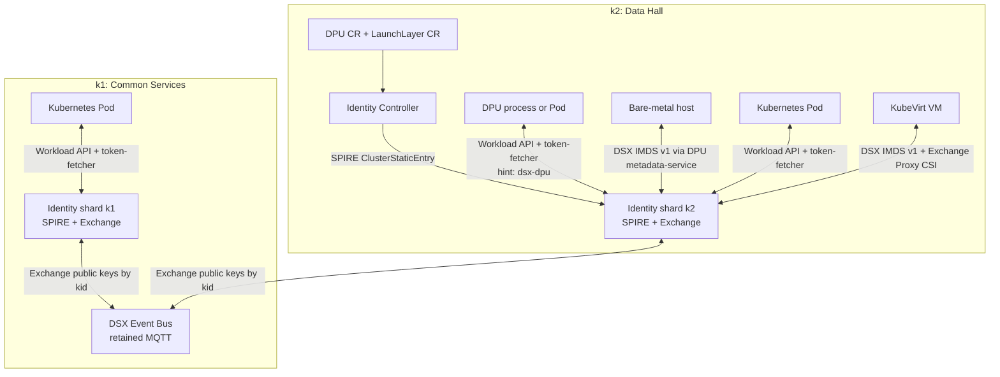
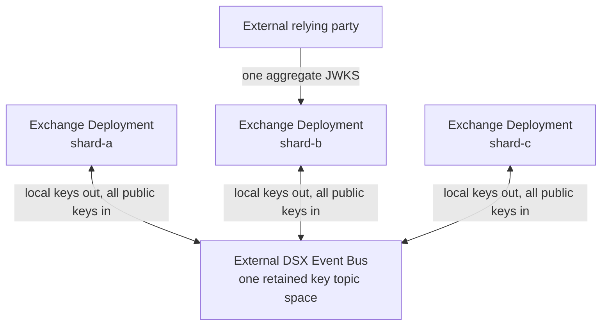
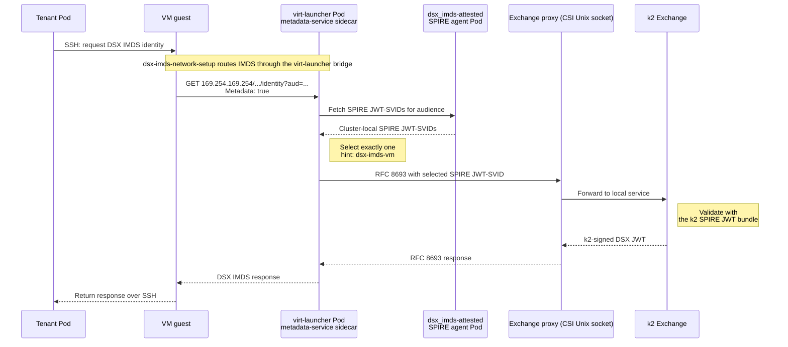
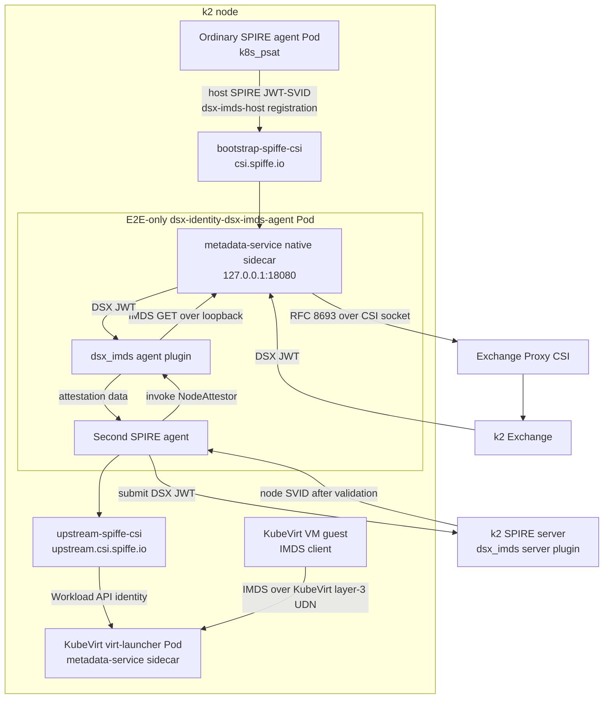
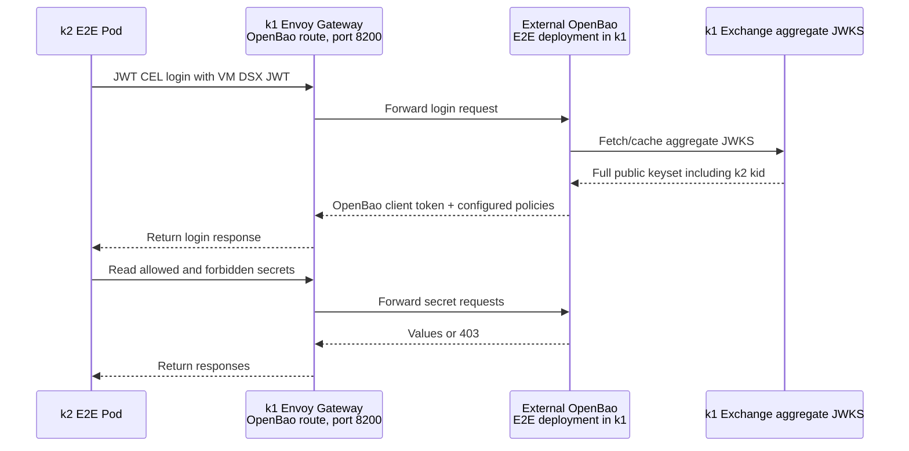

# DSX identity

DSX identity issues identities from SPIRE and exchanges them for DSX JWTs. The
full local environment runs two Kind clusters, each with its own SPIRE server
and Exchange shard.

## Local E2E identity topology



k1 and k2 are separate SPIRE trust domains. Pods, processes, hosts, and VMs use
the SPIRE server and Exchange in their local shard. Cross-shard trust starts
with a DSX JWT and the public keys distributed through the Event Bus.

The full local lifecycle places the Event Bus, Keycloak OAuth2 provider, and
OpenBao test deployment in k1. These services are external to the production
identity umbrella, but the local test runs them as Kubernetes resources in k1.
The k2 Exchange reaches the OAuth2 and MQTT endpoints through the k1 Gateway.
The OpenBao route is used by the relying-party test.

A **SPIRE JWT-SVID** is the cluster-local credential fetched through a SPIRE
Workload API. A **DSX JWT** is the token returned by RFC 8693 Exchange.

## Flat Exchange key distribution



All Exchanges attached to an Event Bus share one flat retained topic space.
Common Services and Data Hall are deployment placement labels. The protocol
topology remains flat. Every Exchange has a globally unique `exchange.shardID`
and publishes the public keys for its own shard at
`spiffe-exchange/v1/pub-keys/shard/<shard-id>/kid/<kid>`. It subscribes to
`spiffe-exchange/v1/pub-keys/shard/+/kid/+`. It retains every valid local and
remote public key in one aggregate keyed by globally unique `kid` and serves
that aggregate from its JWKS endpoint.

Each replica has a unique MQTT client ID derived from its Pod name. A relying
party configures one reachable Exchange endpoint and receives the complete key
union from that aggregate JWKS. SPIRE, the Identity Controller, IMDS, and CSI
remain local to their shard. DSX JWTs and public keys cross shard boundaries.

### Identity delivery

| Consumer | SPIRE plugins | Delivery |
|---|---|---|
| k1 and k2 Kubernetes Pods | `k8s_psat` NodeAttestor and Kubernetes WorkloadAttestor | token-fetcher fetches a local SPIRE JWT-SVID, exchanges it, and writes the DSX JWT |
| DPU process or Pod | external `dsx_dpu` NodeAttestor agent and server with a Unix or Kubernetes WorkloadAttestor | token-fetcher selects the local SPIRE JWT-SVID with hint `dsx-dpu`, then exchanges it for a DSX JWT |
| Bare-metal host | external `dsx_dpu` NodeAttestor agent and server attest the DPU agent. Kubernetes WorkloadAttestor serves the DPU metadata-service. Repository `dsx_imds` NodeAttestor agent and server attest the physical host agent. Unix WorkloadAttestor serves host processes | DPU metadata-service exchanges a local host SPIRE JWT-SVID and serves the DSX JWT at `169.254.169.254`. The host agent submits that JWT for node attestation, then serves host processes |
| KubeVirt VM | `k8s_psat` and Kubernetes WorkloadAttestor bootstrap an E2E-only second agent. Repository `dsx_imds` NodeAttestor agent and server attest it. Kubernetes WorkloadAttestor serves the virt-launcher metadata-service | the attested second agent and its CSI driver supply the VM identity. Metadata-service exchanges through Exchange Proxy CSI. The guest calls IMDS |

## Quick start

### Prerequisites

Repository setup and validation require Git, mise, Make, and `curl`. Mise
installs the tools pinned in `mise.toml`.

The E2E workflow additionally requires Docker with Buildx, `openssl`, OpenSSH
`ssh-keygen`, and a supported Linux host with privileged Docker and loadable
`openvswitch`, `vport-geneve`, `nft_socket`, `tun`, and `vhost_net` modules.
WSL is unsupported.

```bash
git submodule update --init --recursive
make validate
```

`make validate` does not require a cluster.

### Full two-cluster workflow

```bash
make -j install
make test
make clean
```

`make test` verifies k2 identity delivery and cross-shard acceptance.

`make clean` removes both clusters and leaves the Zot service and cache intact.

### Deployment ownership and image loading

Make bootstraps Zot and the Kind clusters, then invokes one root Skaffold
config. Skaffold owns every Kubernetes resource and all component ordering. Its
hooks prepare dynamic DNS and credential inputs.

Kind writes the ordinary `kind-k1` and `kind-k2` entries to kubeconfig. Each
Skaffold deployment module names the context it uses. There is no merged,
flattened, or synthetic kubeconfig, and deployment routing does not depend on
the current context. Skaffold loads locally built images only into the Kind
clusters that consume them.

Zot only caches upstream images. Locally built images are loaded directly into
Kind, not published to Zot. The Zot service and volume survive cluster cleanup.

## Helm chart

`charts/dsx-identity` installs the shard-local SPIRE and Exchange resources. It
depends on the official SPIRE chart and renders Pod and VM identity support and
injection policies. The k2 configuration also renders the Identity Controller.

External E2E components are separate Skaffold modules, not umbrella chart
dependencies.

Cluster values files `scripts/k1-values.yaml` and `scripts/k2-values.yaml` are
local E2E inputs. Each deployed shard supplies its own SPIRE trust domain,
cluster name, globally unique Exchange shard ID, and external Event Bus and
OAuth2 endpoints. VM, UDN, nginx, DPU API, and external-client resources are
E2E fixtures.

## Identity contract

DSX JWT subjects use:

```text
spiffe://nca-<16-digits>.ds9.dsx.nvid.id/<dpu|host|vm>/<resource-id>
  [/process/<name>|/pod/<uuid>]
  [/role/<role>]
```

Cluster-local SPIRE JWT-SVID and `ClusterStaticEntry` IDs encode the same
components under the local trust domain:

```text
spiffe://<local-trust-domain>/tenant/<tenant>/service/dsx/<resource-type>/<resource-id>[/...]
```

Kubernetes Pods using token-fetcher injection provide these labels:

```text
spiffe.nvidia.com/tenant=nca-<16-digits>
spiffe.nvidia.com/service=dsx
spiffe.nvidia.com/resource-type=dpu|host|vm
spiffe.nvidia.com/resource-id=<resource-id>
```

The k2 management cluster runs a DSX Identity Controller. It watches
unstructured `provisioning.dpu.nvidia.com/v1alpha1, Kind=DPU` resources and uses
`metadata.name` as the DPU ID. The controller reads host and VM inputs from the
LaunchLayer source CR. The local fixture uses `LaunchLayerSourceFixture` until
that source API is available. An optional `role` becomes the final
`/role/<role>` suffix.

The source object has this shape:

```yaml
spec:
  type: vm                     # host or vm
  tenantID: nca-0000000000000001
  resourceID: vm-1234
  parentID: host-1234          # DPU ID for host, host ID for VM
  parentTenantID: nca-0000000000000001  # required only for VM
  role: database               # optional
  holder:
    namespace: tenant-tenant1
    serviceAccount: vm-identity-client
    podUID: <pod-uuid>         # optional
```

## Exchange and Event Bus

Every DSX JWT uses issuer `spiffe://ds9.dsx.nvid.id`. `/v1/exchange` accepts a
local SPIRE JWT-SVID and uses SVID validation as its trust boundary. Exchange
preserves claims such as `aud`, `iat`, and `exp`, then replaces `sub`, `iss`,
and the signature.

Each shard runs two active Exchange replicas and loads a static signing keyset
from a local Secret containing `signing-jwks.json` and `active-kid`. Private
keys stay in that Secret. Exchange derives the signing algorithm from each JWK
and advertises the algorithms present in its aggregate. Each public key is
retained at:

```text
spiffe-exchange/v1/pub-keys/shard/<shard-id>/kid/<kid>
```

Each publication carries its lease expiry and is refreshed every quarter of
`exchange.publicKeyLeaseTTL`. This leaves three further publish opportunities
before the previous lease expires. Configure the Event Bus retained-message `maxAge` to
match that TTL and cover the maximum DSX JWT lifetime plus relying-party
leeway. Keys are retained by globally unique `kid` and served at
`/.well-known/jwks.json`. Exchange preserves configured `kid` values, and each
valid retained publication refreshes the key it addresses.

`exchange.shardID` is globally unique across the Event Bus topic space and is a
required chart value. The local `k1` and `k2` values are fixture names.

The NVIDIA DSX Event Bus is pinned to `v2.6.0` in the `dsx-exchange` submodule.
Every Exchange authenticates with OAuth2 client credentials. Its MQTT ACL is
limited to `spiffe-exchange.>` publish and subscribe access. Rolling updates and
the PodDisruptionBudget keep one Exchange replica available.

## DSX IMDS host and VM flows

Hosts and VMs use the tokenless v1 request:

```http
GET /latest/meta-data/identity?aud=<audience>
Metadata: true
```

`GET /2009-04-04/meta-data/identity` is also accepted. Both routes require the
metadata header and reject proxy headers. The JSON response contains `token`,
`expires_in`, and `spiffe_id`. `Accept: text/plain` returns the exchanged JWT.

The table above describes the bare-metal host path. For the VM E2E, the runner
uses `kubectl exec` to start the request in a tenant-network client Pod. The
sequence begins there.



### k2 E2E `dsx_imds` bootstrap

k2 runs two SPIRE agent DaemonSets. The ordinary shard agent uses `k8s_psat`.
The official SPIRE chart's `upstream-spire-agent` alias is also enabled in
`scripts/k2-values.yaml` with `nameOverride: dsx-imds-agent`. It renders the
E2E-only `dsx-identity-dsx-imds-agent` DaemonSet, with one Kubernetes Pod on
each k2 node. This fixture is a Kubernetes Pod, not a VM or bare-metal host.

The second agent Pod contains a native `metadata-service` sidecar listening on
`http://127.0.0.1:18080`. Its `dsx_imds` agent plugin calls that endpoint. The
`dsx-imds-host` `ClusterSPIFFEID` registers a host SPIRE JWT-SVID for the Pod,
and `bootstrap-spiffe-csi` obtains it from the ordinary agent. The sidecar sends
the SPIRE JWT-SVID through Exchange Proxy CSI to the real k2 Exchange and
returns the resulting DSX JWT. The agent plugin submits that DSX JWT to the real
`dsx_imds` server plugin, which validates it before SPIRE issues the second
agent's node SVID.



The attested second agent and `upstream-spiffe-csi` provide the parent and
Workload API identity used by the virt-launcher metadata-service. The VM guest
is an IMDS client and has no SPIRE agent. Other k2 workloads remain on the
cluster Pod network. The layer-3 UDN belongs to the KubeVirt path.

Production uses an externally provisioned SPIRE agent on the physical
bare-metal host. Its `dsx_imds` plugin points to `169.254.169.254`, where the
DPU metadata-service serves IMDS. Host-agent provisioning is outside this
repository.

The E2E host bootstrap substitutes same-Pod loopback and an ordinary-agent CSI
identity for the physical DPU-to-host link-local transport. That transport
requires hardware integration testing.

In local E2E, the retained Event Bus publication carries the k2 public key to
the k1 Exchange. The runner then uses the VM's DSX JWT to exercise cross-shard
OpenBao login:



The external host-agent configuration is in
`scripts/k2/spire/dsx-imds-agent-plugin.hcl`.

## Signing-key rotation

Each `kid` is the go-jose SHA-256 public-JWK thumbprint and remains unique after
retirement. Normal Skaffold reruns validate and reuse the signing keyset Secret.
They do not rotate it. Keep private material in a restricted directory. The
following commands explicitly rotate the local k1 E2E shard:

```bash
umask 077
KEYSET_DIR=/secure/path/k1-key-rotation
install -d -m 0700 "${KEYSET_DIR}"
mise exec -- go run ./cmd/generate-signing-keyset > "${KEYSET_DIR}/generated.json"
mise exec -- jq -c '.jwks' "${KEYSET_DIR}/generated.json" \
  > "${KEYSET_DIR}/signing-jwks.json"
mise exec -- jq -jr '.active_kid' "${KEYSET_DIR}/generated.json" \
  > "${KEYSET_DIR}/active-kid"
mise exec -- kubectl create secret generic spiffe-exchange-signing-keyset \
  -n dsx-identity \
  --context kind-k1 --from-file="${KEYSET_DIR}/signing-jwks.json" \
  --from-file="${KEYSET_DIR}/active-kid" --dry-run=client -o yaml \
  | mise exec -- kubectl apply --context kind-k1 -f -
mise exec -- kubectl rollout restart deployment/spiffe-exchange \
  -n dsx-identity --context kind-k1
mise exec -- kubectl rollout status deployment/spiffe-exchange \
  -n dsx-identity --context kind-k1
```

The new key publishes under its own `kid`. Old replicas stop refreshing the old
key's publication when the rolling update replaces them, so its lease expires
after `exchange.publicKeyLeaseTTL`. Reload relying-party remote-JWKS caches before
requiring immediate rejection of tokens signed by the retired key.
