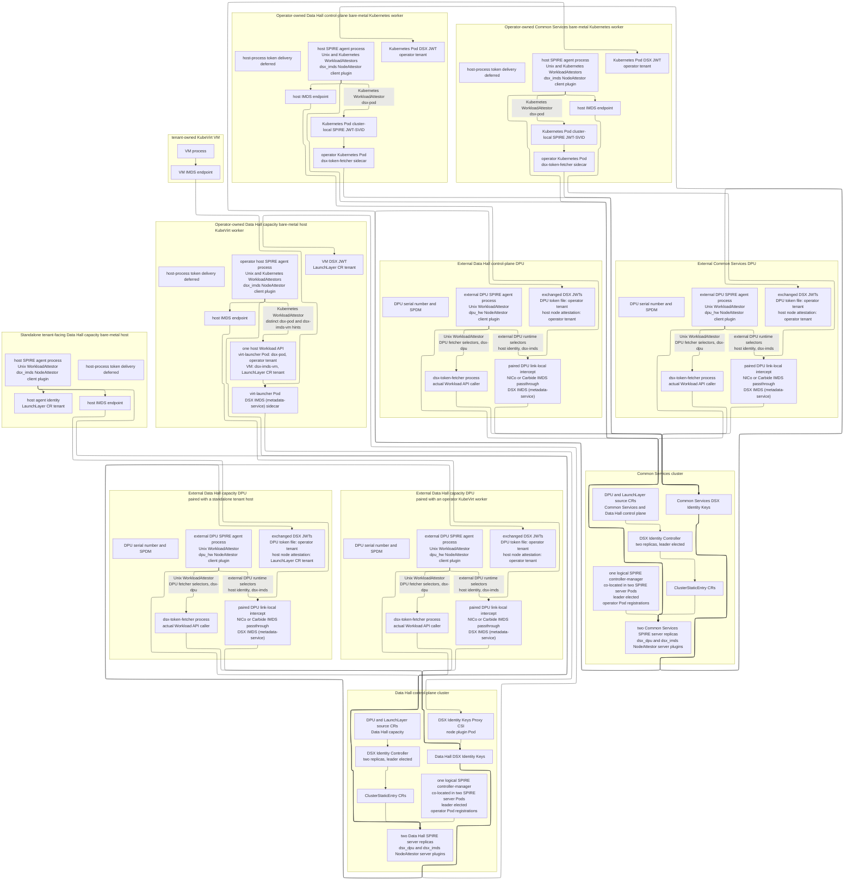
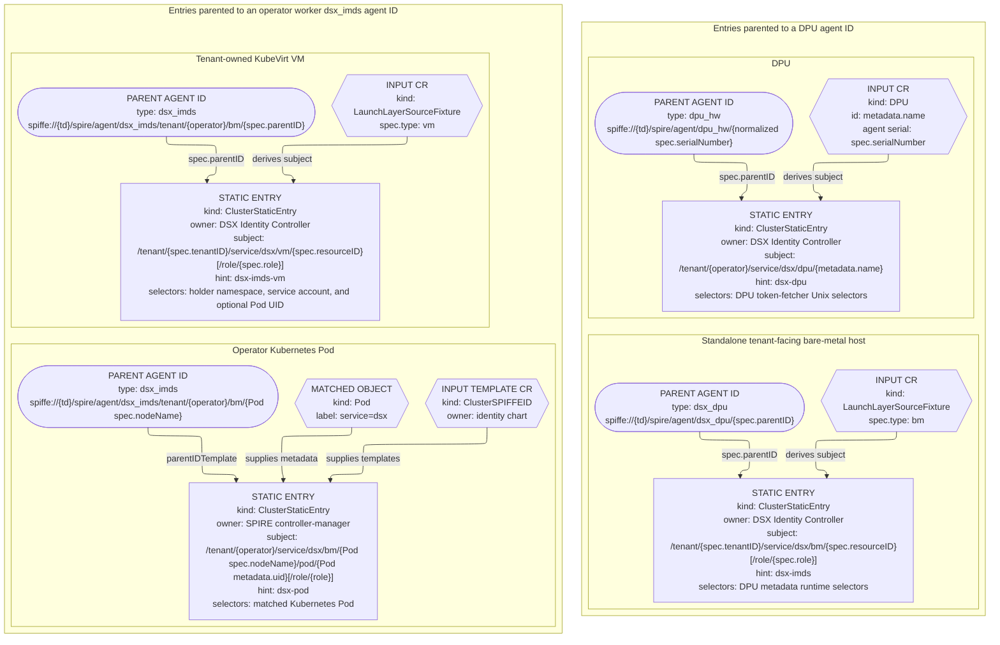
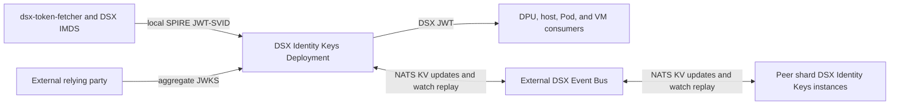
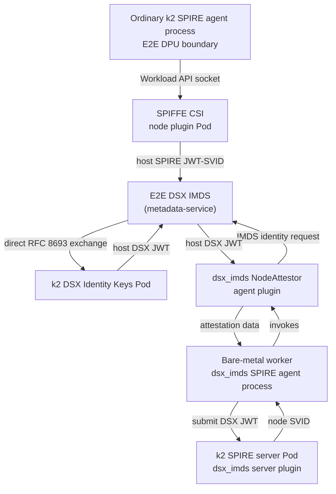
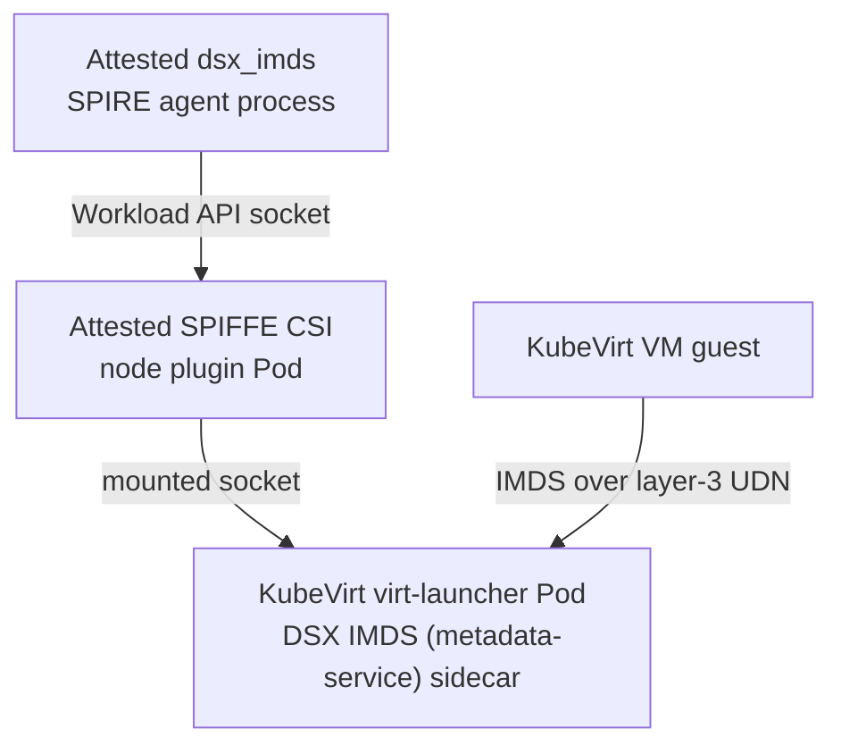
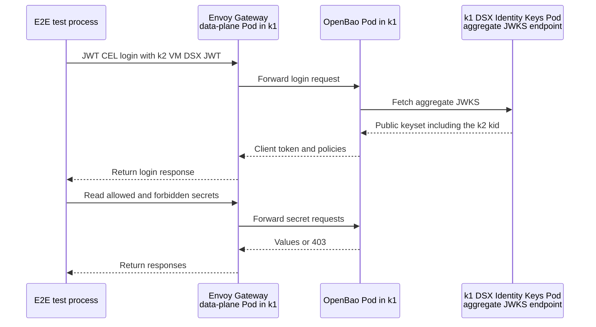

# DSX identity

DSX Identity turns shard-local SPIRE identities into DSX JWTs that relying
parties can validate across shards. An identity shard contains an independent
SPIRE deployment and a co-located DSX Identity Keys deployment. DSX Identity Keys validates only its
local SPIRE JWT-SVIDs, issues DSX JWTs, and distributes its public signing keys
through the external DSX Event Bus.

There is no SPIRE federation between shards. Cross-shard trust starts after
token exchange, when another shard or relying party validates a DSX JWT with
the aggregate public keys served by any DSX Identity Keys instance.

Component commands and runtime configuration:

- [DSX Identity Controller](cmd/dsx-identity-controller/README.md)
- [DSX IMDS Network Setup](cmd/dsx-imds-network-setup/README.md)
- [`dsx_imds` NodeAttestor agent plugin](cmd/dsx-imds-node-attestor-agent/README.md)
- [`dsx_imds` NodeAttestor server plugin](cmd/dsx-imds-node-attestor-server/README.md)
- [`dpu_hw` NodeAttestor server plugin](cmd/dsx-dpu-node-attestor-server/README.md)
- [DSX Token Fetcher](cmd/dsx-token-fetcher/README.md)
- [DSX Identity Keys Proxy CSI Driver](cmd/dsx-identity-keys-proxy-csi/README.md)
- [Generate Signing Keyset](cmd/generate-signing-keyset/README.md)
- [DSX IMDS](cmd/metadata-service/README.md)
- [DSX Identity Keys](cmd/dsx-identity-keys/README.md)
- [Kata UDS Proxy](kata-uds-proxy/README.md)

## Architecture

Local SPIRE identities are hierarchical. The DPU identity comes first, the
bare-metal host identity is attested through the DPU, and VM identity is served
from the attested host path.


Common Services owns the identity shard for Common Services and Data Hall
control-plane resources. Each Data Hall owns the shard for its capacity
resources. Both shards derive entries from their local DPU and LaunchLayer
source CRs, and their Pods register beneath local `dsx_imds` agents.



The parent association is an attested SPIRE agent, not a resource-ownership
hierarchy. DPUs are external hardware and are not Kubernetes worker nodes.
Every Kubernetes worker is an operator-owned bare-metal host, and every Pod
uses the configured operator tenant and a `/bm/<node-name>/pod/<pod-uid>`
subject. A tenant-facing bare-metal host is standalone and never becomes a
Kubernetes node. A KubeVirt VM runs in an operator-owned virt-launcher Pod, so
the Pod keeps its operator identity while its metadata sidecar selects the
dynamically tenant-supplied VM SVID from the same operator host Workload API.

### Static entry parentage

The repository produces four static entry forms. The DSX Identity Controller
owns the DPU, standalone host, and VM `ClusterStaticEntry` objects. The official
SPIRE controller-manager derives each Pod `ClusterStaticEntry` from the
chart-owned `ClusterSPIFFEID` template and the matched Kubernetes Pod.

This diagram shows registration data only. Hexagons are input objects,
stadiums are parent agent IDs, and rectangles are actual
`ClusterStaticEntry` objects. Parent agent IDs are established separately
through node attestation. They are not registration entries.



The external DPU and NICo integration must provision a SPIRE registration for
the operator worker host beneath the paired DPU's `dsx_dpu` agent. The
registration selectors allow DPU-hosted DSX IMDS to obtain the host SPIRE
JWT-SVID and exchange it for the DSX JWT returned through link-local IMDS. The
worker uses that DSX JWT to attest its local SPIRE agent through `dsx_imds`.
Because the repository has no worker-to-DPU mapping, it does not own this
bootstrap registration and the registration is outside this diagram.

For a standalone host, the LaunchLayer source supplies the host-to-DPU
relationship, so the DSX Identity Controller creates the equivalent host
entry. No current host-process static entry is defined beneath the resulting
`dsx_imds` agent.

Local consumers exchange local SPIRE JWT-SVIDs with their shard's DSX Identity Keys for
DSX JWTs. DSX Identity Keys instances share only public signing keys across shards.



A SPIRE JWT-SVID is a cluster-local credential obtained from the local SPIRE
Workload API. A DSX JWT is the credential returned by the local DSX Identity Keys.
SPIRE JWT-SVIDs never establish trust between shards.

Install the identity chart once per shard. Each regular management cluster that
owns DPU or LaunchLayer source CRs runs the Identity Controller for its shard.
Every DSX Identity Keys instance validates only local SPIRE JWT-SVIDs through its node-local
Workload API and serves the aggregate public keys received through the Event
Bus.

The Event Bus, OAuth2 provider, Kyverno runtime, and relying parties are
external to the identity chart.

### Identity delivery

| Consumer | SPIRE trust path | DSX JWT delivery |
|---|---|---|
| [Kubernetes Pod](cmd/dsx-token-fetcher/README.md) | Kubernetes WorkloadAttestor under the worker's `dsx_imds`-attested host agent. The registration uses the operator tenant and worker host subject | The `dsx-token-fetcher` sidecar selects `dsx-pod`, exchanges the local SPIRE JWT-SVID, and writes the DSX JWT to a Pod-private volume mounted read-only in application containers |
| [DPU process](cmd/dsx-token-fetcher/README.md) | The external DPU agent attests through the `dpu_hw` NodeAttestor agent and server. For token-file delivery, Unix WorkloadAttestor selectors bind the base DPU SVID to the `dsx-token-fetcher` process because it is the Workload API caller | `dsx-token-fetcher` selects `dsx-dpu`, exchanges the local SPIRE JWT-SVID, and writes a protected token file. The DPU process consumes that file as a capability |
| [Bare-metal host process](cmd/dsx-imds-node-attestor-agent/README.md) | The DPU agent is attested through `dsx_dpu`. The host agent is attested through the repository `dsx_imds` NodeAttestor agent and server, then can serve local processes through the Unix WorkloadAttestor | The paired DPU intercept carries link-local IMDS to NICo or Carbide IMDS, which passes identity requests to DSX IMDS. DPU-hosted DSX IMDS exchanges directly with its reachable shard-local DSX Identity Keys. The host agent uses the returned DSX JWT for node attestation. A host-process-specific token delivery contract is not currently defined |
| [Kata Containers Pod](kata-uds-proxy/README.md) | Identical to a Kubernetes Pod. The guest is a VM, so SPIFFE CSI cannot reach the agent socket; the `kata-uds-proxy` host DaemonSet forwards it over vsock into the sandbox instead | Unchanged from a Kubernetes Pod. A guest sidecar re-serves the forwarded socket at the same path, so the same `dsx-token-fetcher` sidecar applies |
| [KubeVirt VM](cmd/metadata-service/README.md) | The controller derives the VM subject from the dynamically supplied tenant ID and parents it to the operator-owned worker host's `dsx_imds` agent. The Kubernetes WorkloadAttestor serves the operator-owned virt-launcher Pod, and SPIFFE CSI exposes that same agent's Workload API socket | The DSX IMDS sidecar selects the VM SPIRE JWT-SVID by its exact `dsx-imds-vm` hint, exchanges it through DSX Identity Keys Proxy CSI, and serves the DSX JWT through IMDS |

## Helm chart

Install `charts/dsx-identity` once per identity shard. Install the official
SPIRE CRD chart first. The identity chart installs SPIRE and can install the
repository-owned DSX Identity Keys, controller, metadata, CSI, and identity policies.

Each installation supplies its shard identity, external Event Bus connection,
OAuth2 client, and signing keyset.

The chart defaults DSX Identity Keys and the Identity Controller to two active replicas.
SPIRE server deployment and datastore settings pass through to the official
SPIRE chart.

```yaml
global:
  operatorTenant: operator-1
  spire:
    trustDomain: shard.example.com
    clusterName: shard-a
    jwtIssuer: spiffe://shard.example.com

spire:
  spire-server:
    controllerManager:
      extraEnv:
        - name: OPERATOR_TENANT
          value: operator-1

identityKeys:
  shardID: shard-a
  jwksURL: https://identity-keys.shard.example.com/.well-known/jwks.json
  signingKeysetSecret: dsx-identity-keys-signing-keyset
  activeKIDSecret: dsx-identity-keys-active-kid
  nats:
    serverURL: tls://event-bus.example.com:4222
    kv:
      bucket: DSX_IDENTITY_KEYS
      replicas: 3
    auth:
      mode: oauth2
      credentialsSecret: dsx-identity-keys-nats-oauth
      credentialsKey: credentials.json
      issuerURL: https://auth.example.com
```

Each identity shard configures the `dsx_imds` server plugin in SPIRE and exposes
the external host agent's canonical socket through the single SPIFFE CSI
driver. The plugin validates host bootstrap DSX JWTs against the shard's
aggregate JWKS served by DSX Identity Keys.

```yaml
spire:
  spire-agent:
    enabled: false
  spire-server:
    image:
      registry: nvcr.io
      repository: 0837451325059433/components-dev/dsx-spire-server
      tag: <chart-version>
    customPlugins:
      nodeAttestor:
        dsx_imds:
          plugin_cmd: /opt/spire/plugins/dsx-imds-node-attestor-server
          plugin_checksum: ""
          plugin_data:
            trust_domain: shard.example.com
            audience: spiffe://shard.example.com/spire/server
            jwks_url: https://identity-keys.shard.example.com/.well-known/jwks.json
  spiffe-csi-driver:
    enabled: true
    pluginName: csi.spiffe.io
    agentSocketPath: /run/spire/agent-sockets/spire-agent.sock
```

The host agent and its `dsx_imds` agent plugin are provisioned with the host,
outside the identity chart. The matching
`nvcr.io/0837451325059433/components-dev/dsx-spire-agent:<chart-version>`
image embeds that plugin at `/opt/spire/plugins/dsx-imds-node-attestor-agent`.
An ordinary in-cluster agent is disabled by default. If a separate node class
needs one, enable and constrain it so it cannot share a node with the host
agent.

Identity shards that reconcile DPU or LaunchLayer sources enable the controller.
Data Hall capacity shards also enable the VM identity path. The two DPU
selector sets configure distinct WorkloadAttestor contracts.

```yaml
podTokenFetcher:
  enabled: true
  identityKeysURL: https://identity-keys.shard.example.com/v1/exchange

vmSupport:
  enabled: true
  identityKeysProxy:
    target: TCP:dsx-identity-keys.dsx-identity.svc.cluster.local:8080

identityController:
  enabled: true
  dpuTokenFetcherSelectors:
    - unix:uid:32001
    - unix:path:/usr/local/bin/dsx-token-fetcher
    - unix:sha256:<packaged-binary-digest>
  dpuMetadataSelectors:
    - <selector for DPU-hosted metadata-service>
```

Shards that schedule Kata Containers workloads enable `kataSupport`. A Kata Pod
runs inside a VM, so the SPIFFE CSI driver cannot carry the agent's Workload API
socket across the VM boundary. Enabling this deploys a privileged host DaemonSet
that serves that socket over vsock, and injects a guest sidecar into Kata Pods
that re-serves it as a unix socket at the path the token fetcher already uses.
The token fetcher itself is unchanged in both cases.

```yaml
kataSupport:
  enabled: true
  runtimeClassNames:
    - kata-qemu-runtime-rs
    - kata-qemu
```

The host DaemonSet needs `hostPID`, host cgroup write access, and a privileged
container, so its namespace requires the `privileged` Pod Security Admission
level. Nodes must run cgroup v2 with the systemd cgroup driver and configure
Kata with `sandbox_cgroup_only = true`. The default `nodeSelector` targets the
`katacontainers.io/kata-runtime=true` label. Every Kata RuntimeClass in use must
be listed in `runtimeClassNames`, since injection keys off it. See
[kata-uds-proxy/README.md](kata-uds-proxy/README.md).

`imagePullSecrets` applies to chart-owned and Kyverno-injected DSX images.
Each matched consumer namespace must contain Secrets with the same names.

Path and SHA-256 selectors require `discover_workload_path = true` in the
external DPU agent's Unix WorkloadAttestor configuration. The fetcher runs
under the dedicated UID, and the executable is root-owned and immutable.

The referenced Secrets must exist before their consumers start. Controller
deployments require the external DPU and LaunchLayer APIs. Identity injection
requires Kyverno. Tracing requires the DSX observability stack. ServiceMonitor
resources require the Prometheus Operator APIs.

Kyverno injects identity sidecars and prevents application containers from
mounting the Workload API or DSX Identity Keys Proxy sockets.

## Identity contract

DSX JWT subjects use:

```text
spiffe://<tenant>.ds9.dsx.nvid.id/<dpu|bm|vm>/<resource-id>
  [/process/<name>][/role/<role>]
spiffe://<operator-tenant>.ds9.dsx.nvid.id/bm/<node-name>/pod/<pod-uuid>
  [/role/<role>]
```

Cluster-local SPIRE identities encode the same tenant, service, resource type,
and resource ID under the shard trust domain.

```text
spiffe://<local-trust-domain>/tenant/<tenant>/service/dsx/<resource-type>/<resource-id>[/...]
```

| Resource | Tenant source | Subject resource path |
|---|---|---|
| DPU | `global.operatorTenant` | `/dpu/<dpu-id>` |
| Operator bare-metal Kubernetes worker | `global.operatorTenant` | `/bm/<node-name>` |
| Kubernetes Pod | `global.operatorTenant` | `/bm/<node-name>/pod/<pod-uid>` |
| Bare-metal host with a LaunchLayer source | Source CR `tenantID`, supplied dynamically | `/bm/<bm-id>` |
| VM with a LaunchLayer source | Source CR `tenantID`, supplied dynamically | `/vm/<vm-id>` |

Every Kubernetes worker is an operator-owned bare-metal host. There is no
configured worker list and no LaunchLayer source for these hosts. The Pod
registration template derives the host ID directly from the Kubernetes node
name. Physical worker-to-DPU pairing belongs to the external NICo and DPU
integration boundary, not the Identity Controller configuration.

Every DSX Kubernetes Pod supplies the service label. One SPIRE
controller-manager derives its operator tenant, BM resource type, node name,
and Pod UID. Every worker is an operator-owned bare-metal host, so the fixed
parent template identifies that worker's operator-tenant `dsx_imds` agent.

```yaml
metadata:
  labels:
    spiffe.nvidia.com/service: dsx
    spiffe.nvidia.com/role: database  # optional
```

```yaml
spire:
  spire-server:
    controllerManager:
      extraEnv:
        - name: OPERATOR_TENANT
          value: operator-1
      parentIDTemplate: 'spiffe://{{ .TrustDomain }}/spire/agent/dsx_imds/tenant/$OPERATOR_TENANT/bm/{{ .NodeMeta.Name }}'
```

The chart requires the controller-manager value to equal
`global.operatorTenant`. Because it is part of the SPIRE Pod template, changing
both values causes the StatefulSet to roll out without a restart hook.

DPU identities remain separate controller-derived static entries parented to
the external `dpu_hw` agent identified by the normalized DPU serial. DPUs are
not Kubernetes nodes and do not participate in Pod registration. The
[DSX Token Fetcher](cmd/dsx-token-fetcher/README.md) obtains and exchanges the
DPU SPIRE JWT-SVID, then writes the DSX JWT to a protected file.

The [DSX Identity Controller](cmd/dsx-identity-controller/README.md) derives
SPIRE registration entries from DPU and LaunchLayer sources. Until LaunchLayer
publishes its final API, the repository uses a temporary
`LaunchLayerSourceFixture` with only the fields shown below.

```yaml
spec:
  type: vm                             # bm or vm
  tenantID: tenant-2       # supplied dynamically by this source
  resourceID: vm-1234
  parentID: host-1234                  # DPU ID for BM, operator worker host ID for VM
  role: database                       # optional for BM or VM
  holder:
    namespace: tenant-tenant1
    serviceAccount: vm-identity-client
    podUID: <pod-uuid>                 # optional
```

The temporary source has no `parentTenantID`. The configured operator tenant
determines a VM entry's operator-worker parent. It also has no SPIFFE IDs,
selectors, hints, or class names because the Identity Controller derives those
registration outputs.

## DSX Identity Keys and Event Bus

[DSX Identity Keys](cmd/dsx-identity-keys/README.md) validates
local SPIRE JWT-SVIDs, issues DSX JWTs, publishes public signing keys to the
Event Bus, and serves aggregate JWKS. The external Gateway terminates TLS and
applies source-aware request quotas. Clients configure the Gateway HTTPS
endpoint. Local fixtures configure their HTTP endpoints directly.

## DSX IMDS host and VM flows

[DSX IMDS](cmd/metadata-service/README.md) serves the tokenless host and VM
identity API. The
[`dsx_imds` NodeAttestor agent](cmd/dsx-imds-node-attestor-agent/README.md) and
[`dsx_imds` NodeAttestor server](cmd/dsx-imds-node-attestor-server/README.md)
bootstrap the host SPIRE agent. The
[DSX Identity Keys Proxy CSI Driver](cmd/dsx-identity-keys-proxy-csi/README.md) carries VM
exchange requests, and
[DSX IMDS Network Setup](cmd/dsx-imds-network-setup/README.md) routes the VM's
link-local metadata traffic.

## Observability

First-party Go processes emit JSON logs to stdout or stderr. Chart-owned metric
endpoints support Prometheus discovery. First-party processes export traces
through their SDK and the sidecar collector installed by the DSX observability
stack. Structured allow, deny, and dependency events never include
credentials.

SPIRE server, controller-manager, and the optional local SPIRE agent expose
their native Prometheus metrics through chart-owned monitors. SPIRE 1.13.2
does not produce traces. SPIFFE CSI Driver, CSI node-driver-registrar, and
the `socat` proxy expose no native application telemetry. Their health checks,
container logs, and platform container metrics remain available.

The DSX sidecar collector configuration has a trace pipeline and no metrics
pipeline. `dsx-token-fetcher`, `metadata-service`, and
`dsx-imds-network-setup` export traces and do not expose application metrics.

```yaml
observability:
  logLevel: info
  metrics:
    enabled: true
    serviceMonitor:
      enabled: true
```

Tracing adds the SDK and sidecar annotations shown below to chart-owned
application Pods and the SPIRE server Pod. Repository-owned SPIRE server
plugins inherit the injected server-container environment.

```yaml
metadata:
  annotations:
    instrumentation.opentelemetry.io/inject-sdk: "dsx-obs/default-instrumentation"
    sidecar.opentelemetry.io/inject: "dsx-obs/default-sidecar"
```

Pods that receive an identity container supply the same tracing annotations on
their Pod template. For token-fetcher injection:

```yaml
metadata:
  labels:
    spiffe.nvidia.com/service: dsx
  annotations:
    instrumentation.opentelemetry.io/inject-sdk: "dsx-obs/default-instrumentation"
    sidecar.opentelemetry.io/inject: "dsx-obs/default-sidecar"
```

For KubeVirt IMDS injection, put them on the VM Pod template:

```yaml
spec:
  template:
    metadata:
      annotations:
        spiffe.nvidia.com/inject-dsx-imds: "true"
        instrumentation.opentelemetry.io/inject-sdk: "dsx-obs/default-instrumentation"
        sidecar.opentelemetry.io/inject: "dsx-obs/default-sidecar"
```

See the
[DSX service observability guide](https://gitlab-master.nvidia.com/ncp/dsx/dsx-docs/-/blob/9aa5ed1e74f2cd33261bd05e118372ef220c0aba/docs/dev-environments/observability-guide.md).

## Local E2E

The repository validates the architecture with two Kind clusters. k1 hosts a
Common Services identity shard, one unauthenticated NATS server with in-memory
JetStream for KV, and the
OpenBao relying party. k2 hosts a Data Hall identity shard, the Identity
Controller, OVN-Kubernetes layer-3 UDN, and a KubeVirt VM. The k1 and k2 names
describe only this fixture and do not define a trust hierarchy. Local identity
components use one replica and SPIRE uses its SQLite default.

The identity chart is installed independently in both clusters. The remaining
components are separate Skaffold modules. Shared fixture settings and the
shard-specific overrides are in:

- `scripts/identity-e2e-values.yaml`
- `scripts/k1-values.yaml`
- `scripts/k2-values.yaml`

### E2E-only `dsx_imds` bootstrap

Kind starts without an external DPU or an attested worker agent. Before the
worker agent is available, the control-plane node represents the Phase 0 seed
host. Each identity chart is installed once. Its normal DSX Identity Keys Pod runs on
the seed node and uses the ordinary operator-Pod registration there while the
worker's `dsx_imds` agent attests. DSX Identity Keys has no bootstrap-specific identity
or deployment path.

Both local shards must exercise host attestation without physical DPU hardware.
Each therefore runs an official SPIRE agent DaemonSet constrained to its worker
as the external host-agent fixture. The ordinary shard agent remains on the
control-plane node as the emulated external DPU boundary. One SPIFFE CSI driver
exposes each node's canonical Workload API socket. The worker agent's
`dsx_imds` plugin obtains a DSX JWT from DSX IMDS and submits it to the
repository-owned `dsx_imds` server plugin for node attestation. k2 then reuses
that worker agent for its KubeVirt VM path.

The local fixture exposes the real DSX IMDS implementation directly at the
external intercept and passthrough boundary. E2E sends the IMDS request,
exchanges the selected SPIRE JWT-SVID, and uses the returned DSX JWT for
`dsx_imds` node attestation. It does not test physical link-local routing or
NICo or Carbide integration.

The ordinary-agent entry is the permitted fixture at the external `dsx_dpu`
boundary. E2E requests the operator-host identity from IMDS and attests the
worker's `dsx_imds` SPIRE agent with it. The fixture derives the operator host
ID from the worker name without creating a controller input for that worker.

This external-agent fixture uses the shared
`scripts/dsx-imds-host-agent-values.yaml` values and a shard override under
`scripts/k1` or `scripts/k2`. It is not part of the identity chart release.





The KubeVirt VM contains no SPIRE agent. SPIFFE CSI exposes the attested second
agent's Workload API socket to the virt-launcher Pod, and DSX IMDS uses that
socket to fetch the VM SPIRE JWT-SVID.

### Cross-shard OpenBao validation

The local E2E topology deploys OpenBao in k1 as an external relying party. A VM
DSX JWT issued in k2 is accepted because the k2 DSX Identity Keys public key propagates
through the Event Bus and appears in the k1 DSX Identity Keys aggregate JWKS.



### Workflow

Repository validation requires Git, mise, Make, `curl`, and a supported Linux
host. `make validate` builds Linux-only nftables code and exercises Unix socket
paths that exceed macOS limits. macOS and WSL are unsupported. Mise installs
the repository-pinned tools. The full E2E lifecycle also requires Docker with
Buildx, OpenSSL, OpenSSH, and the kernel features needed by OVN-Kubernetes and
KubeVirt.

```bash
git submodule update --init --recursive
make validate
```

One root Skaffold workflow deploys both Kind clusters.

```bash
make -j install
make test
make clean
```

The E2E suite verifies operator-host IMDS through both `dsx_imds` plugin halves,
DPU file delivery, Pod and VM identity delivery, shard isolation, NATS KV
propagation, aggregate JWKS behavior, OpenBao authorization, restart recovery,
and signing-key rotation. External DPU and standalone-host hardware is not
modeled as Kubernetes Nodes.
