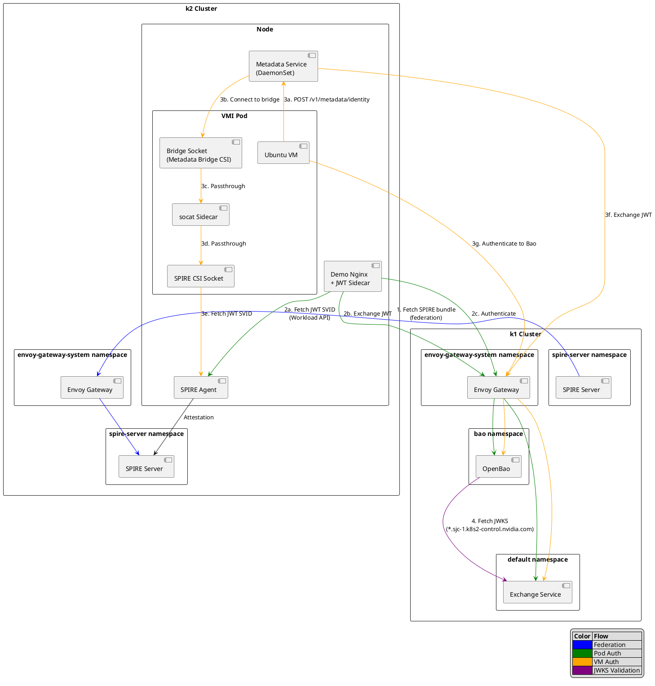
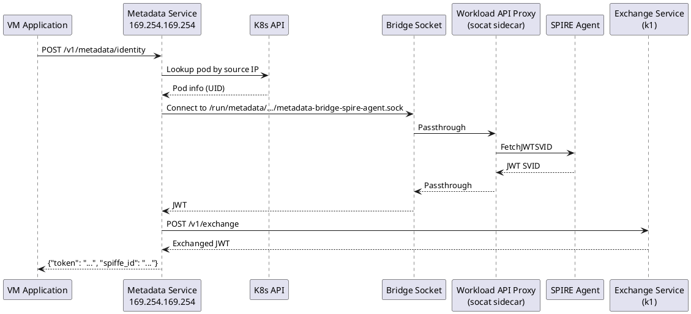

# SPIFFE + OpenBao CEL Multi-Cluster Demo

Demonstrates workloads in k2 obtaining SPIFFE JWTs and using them to authenticate to OpenBao in k1 via CEL-based JWT auth. k2 workloads include pods and KubeVirt VMs accessing JWTs through a metadata service.

## Quick Start

```bash
make clean && make install -j && make test
```

## Prerequisites

Docker, kubectl, Kind, Helm, OpenBao CLI (`bao`), virtctl, jq

## Architecture



**SPIRE Trust Domains:**
- k1: `sjc-1.k8s2-control.nvidia.com`
- k2: `k2.sjc-1.k8s2-control.nvidia.com`

**Exchange Service Trust Domains (per-tenant):** `{tenant}.sjc-1.k8s2-control.nvidia.com`

**Gateway DNS:**
- k1: `gateway.sjc-1.k8s2-control.nvidia.com` (OpenBao :8200, Exchange :8080)
- k2: `gateway.k2.sjc-1.k8s2-control.nvidia.com` (SPIRE bundle :8443)

## SPIFFE Exchange Service

Transforms JWTs from k2's trust domain into tenant-specific trust domains for OpenBao authentication.

### JWT Transformation

SPIFFE ID Pattern: `spiffe://<tenant>.<region>.<domain>/<product>/<resource_type>/<resource_id>`

**Pod Example:**
```
Input:  spiffe://k2.sjc-1.k8s2-control.nvidia.com/domain/tenant1/default/pod/{uuid}
Output: spiffe://tenant1.sjc-1.k8s2-control.nvidia.com/default/pod/{uuid}
```

**VM Example:**
```
Input:  spiffe://k2.sjc-1.k8s2-control.nvidia.com/domain/tenant1/vmaas/vm/{uuid}
Output: spiffe://tenant1.sjc-1.k8s2-control.nvidia.com/vmaas/vm/{uuid}
```

The exchange service:
1. Validates incoming JWT against k2's SPIRE trust bundle (via federation)
2. Extracts tenant from `/domain/{tenant}/` path component
3. Constructs new trust domain: `{tenant}.sjc-1.k8s2-control.nvidia.com`
4. Re-signs JWT with tenant-specific key, updating `sub` and `iss` claims

### JWKS Endpoint

Exchange service serves `/.well-known/jwks.json` for each tenant domain. CoreDNS wildcard rewrite routes `*.sjc-1.k8s2-control.nvidia.com` to the exchange service, enabling OpenBao to fetch JWKS for any tenant.

## SPIFFE JWT Metadata Service

HTTP metadata service at **169.254.169.254** providing SPIFFE JWTs to KubeVirt VMs via tenant-specific DaemonSet. Uses OVN User Defined Networks (UDN) for tenant isolation and source IP identity verification.

### Sequence Diagram



### Components

**Metadata Service DaemonSet**: Per-tenant deployment attached to tenant UDN. Resolves VM source IP to pod via K8s API, connects to bridge socket to fetch JWT.

**Workload API Proxy Sidecar**: Injected into VMI pods via Kyverno policy. Proxies SPIRE socket to bridge socket using `socat`. Inherits VMI pod's SPIFFE identity.

**Metadata Bridge CSI Driver**: Creates per-pod directories at `/run/metadata/metadata-bridge-sockets/<pod-uid>/` for socket bridging between VMI pod and metadata service.

### HTTP API

```bash
curl -X POST http://169.254.169.254:8080/v1/metadata/identity \
  -H "Content-Type: application/json" \
  -d '{"audience": "spiffe://tenant1.sjc-1.k8s2-control.nvidia.com"}'
```

```json
{
  "token": "eyJhbGciOiJFUzI1NiIs...",
  "expires_at": "2025-09-18T15:30:00Z",
  "spiffe_id": "spiffe://tenant1.sjc-1.k8s2-control.nvidia.com/vmaas/vm/{uuid}"
}
```

### Security Model

- **Source IP Authenticity**: OVN guarantees source IP cannot be spoofed within UDN
- **Pod Identity**: K8s API confirms VMI pod identity from source IP
- **Workload Attestation**: SPIRE attests sidecar PID to VMI pod identity
- **Socket Isolation**: Per-pod sockets prevent cross-VM access

## OpenBao CEL Integration

CEL program parses SPIFFE ID components for dynamic policy assignment:

```
spiffe://tenant1.sjc-1.k8s2-control.nvidia.com/vmaas/vm/{uuid}
         ──┬───  ──┬──                         ──┬── ─┬─
         tenant  region                       product resource_type
```

Assigned policies: `spiffe-authenticated`, `tenant-tenant1`, `region-sjc-1`, `product-vmaas`, `resource-type-vm`

## Make Targets

```bash
make install -j     # Setup both clusters
make test           # Run integration tests  
make clean          # Remove clusters
make status         # Show component status
make help           # Show all targets
```

| k1 | k2 |
|----|-----|
| `cluster` | `k2-cluster` |
| `gateway` | `k2-gateway` |
| `spire` | `k2-spire` |
| `exchange-service` | `nginx` |
| `bao` | `metadata-service` |
| | `vm` |

## Troubleshooting

```bash
make status           # Component overview
make verify-nginx     # Test nginx -> OpenBao auth
make verify-vm        # Test VM -> metadata service

# Logs
kubectl logs -l app=spiffe-exchange-service --context kind-k1
kubectl logs -l app=metadata-service --context kind-k2

# VM console (ubuntu/ubuntu)
virtctl console demo-ubuntu-vm --context kind-k2
```
