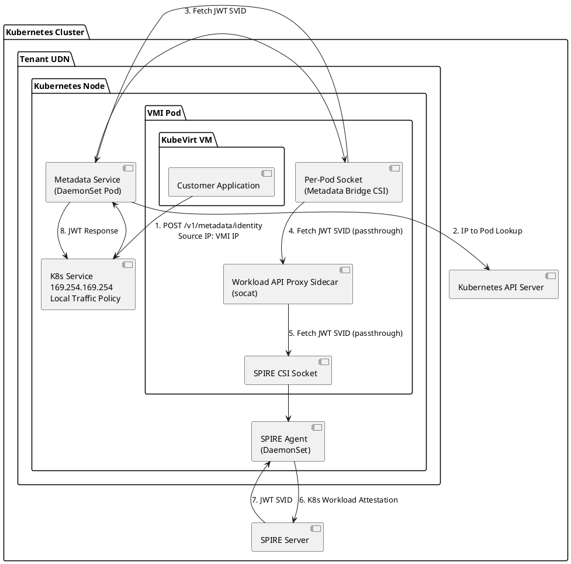
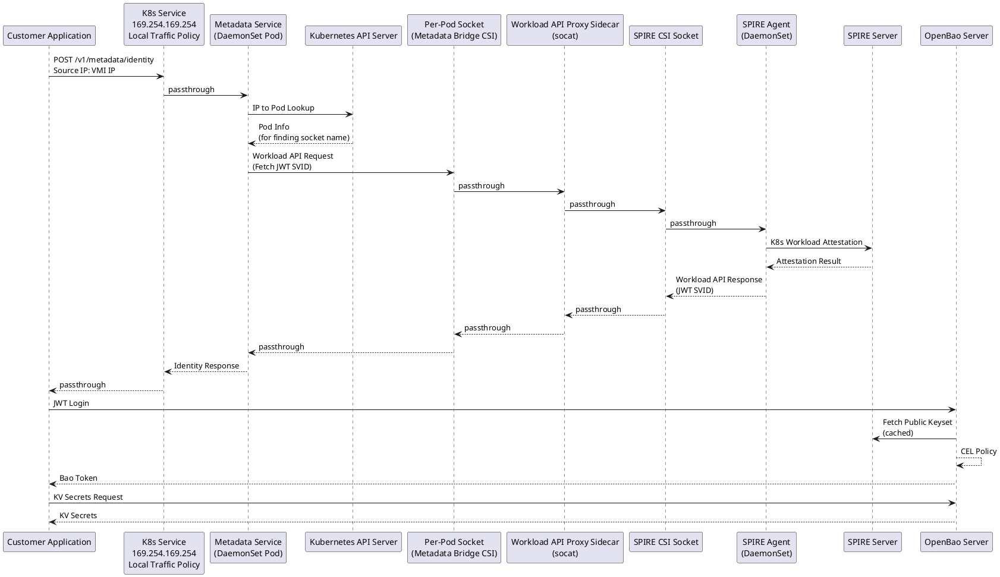
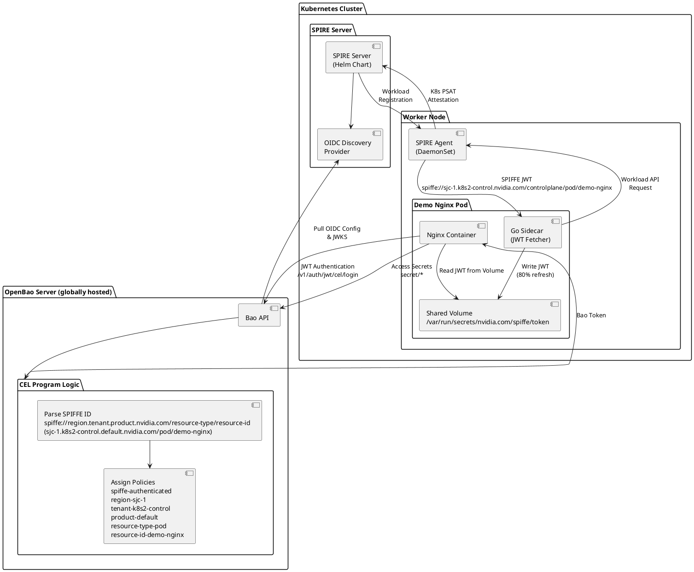

# SPIFFE + OpenBao CEL Demo

Complete demonstration of SPIFFE JWT authentication with OpenBao's CEL (Common Expression Language) enabled JWT auth method, including a SPIFFE JWT metadata service at 169.254.169.254 for KubeVirt VMs.

## Prerequisites

- Docker, kubectl, Kind, Helm, OpenBao CLI, virtctl

## Quick Start

```bash
make install     # Complete setup (cluster, SPIRE, OpenBao, metadata service, VM)
make verify-vm   # Verify VM can fetch SPIFFE JWTs from metadata service
make test        # Run integration tests
make clean       # Remove everything
make help        # Show all available targets
```

## What It Creates

- **Kind cluster** (2 nodes) with trust domain `sjc-1.k8s2-control.nvidia.com`
- **SPIRE server/agent** with Kubernetes PSAT attestation
- **SPIFFE CSI driver** for Workload API socket mounting
- **KubeVirt + CDI** for virtual machine management
- **Kyverno** for policy-based sidecar injection
- **Demo nginx pod** with Go sidecar that fetches/refreshes JWT tokens
- **OpenBao** with CEL-based JWT authentication and dynamic policy assignment
- **SPIFFE JWT Metadata Service** at 169.254.169.254 for VMs
- **Metadata Workload API Bridge CSI** for per-pod socket bridging
- **Ubuntu VM** with automatic SPIFFE JWT access via metadata service

## SPIFFE JWT Metadata Service

### Overview

HTTP metadata service at **169.254.169.254** that provides SPIFFE JWT to KubeVirt VMs via tenant-specific DaemonSet deployment. Uses OVN User Defined Networks (UDN) for tenant isolation and source IP identity verification.

VMI pods include a `socat` sidecar that proxies the SPIRE Workload API socket to a per-pod bridge socket (Metadata Workload API Bridge CSI) shared with the metadata service. This allows the metadata service to fetch JWTs by connecting to the Workload API through the sidecar.

**Why the proxy sidecar is required**: SPIRE's workload attestation is PID-based. The caller PID must be the workload being attested. A PID from outside the VM's pod would result in a different workload identity.

### Architecture

#### Block Diagram



#### Sequence Diagram



### Components

#### Metadata Service DaemonSet

- Tenant-specific DaemonSet with node selector for tenant labels
- Attached to tenant UDN for network isolation
- Listens on port 8080, exposed at **169.254.169.254** via Kubernetes Service with `externalTrafficPolicy: Local` for source IP preservation
- Mounts Metadata Workload API Bridge CSI volume to access per-pod sockets at `/run/metadata/metadata-bridge-sockets/<pod-uid>/`
- Resolves VM IP to pod via Kubernetes API, connects to corresponding bridge socket to fetch JWT via proxied Workload API

#### Workload API Proxy Sidecar

- Injected into VMI pods via Kyverno policy (matches annotation `nvidia.com/inject-workload-api-proxy: "true"`)
- Proxies the SPIRE Workload API socket to the Metadata Workload API Bridge CSI socket using `socat`
- Command: `socat -dd UNIX-LISTEN:/var/run/secrets/nvidia.com/metadata-bridge-spire-agent.sock,fork,unlink-early UNIX-CONNECT:/var/run/secrets/spire.io/spire-agent.sock`
- Inherits VMI pod's SPIFFE identity via SPIRE's Kubernetes workload attestation, allowing metadata service to fetch JWTs as the VM pod

#### Metadata Workload API Bridge CSI Driver

- Single CSI driver (`metadata-bridge.csi.nvidia.com`) enabling per-pod Workload API socket bridging
- Creates per-pod directories at `/run/metadata/metadata-bridge-sockets/<pod-uid>/` with 0777 permissions for `socat` to bind
- Mounts directory into VMI pod at `/var/run/secrets/nvidia.com/` and metadata service at `/run/metadata/metadata-bridge-sockets/`
- Based on [SPIFFE CSI Driver](https://github.com/spiffe/spiffe-csi) architecture

### Identity Resolution Flow

1. VM sends HTTP POST to `169.254.169.254:8080/v1/metadata/identity` with audience
2. Metadata service extracts source IP, queries Kubernetes API to find VMI pod
3. Metadata service connects to `/run/metadata/metadata-bridge-sockets/<pod-uid>/metadata-bridge-spire-agent.sock`
4. Sidecar proxies connection to SPIRE Workload API socket
5. SPIRE Agent attests sidecar's PID, resolving to VMI pod's SPIFFE identity
6. SPIRE returns JWT SVID through proxied connection
7. Metadata service returns JWT to VM via HTTP response

### HTTP API

**Request**:

```bash
curl -X POST http://169.254.169.254:8080/v1/metadata/identity \
  -H "Content-Type: application/json" \
  -d '{"audience": "spiffe://sjc-1.k8s2-control.nvidia.com"}'
```

**Response**:

```json
{
  "token": "eyJhbGciOiJSUzI1NiIs...",
  "expires_at": "2025-09-18T15:30:00Z",
  "spiffe_id": "spiffe://sjc-1.k8s2-control.nvidia.com/default/pod/virt-launcher-demo-ubuntu-vm-9n5ln"
}
```

### Security Model

- **Source IP Authenticity**: OVN guarantees source IP cannot be spoofed within UDN
- **Pod Identity Verification**: Kubernetes API confirms VMI pod identity from source IP
- **Workload Attestation**: SPIRE Agent attests sidecar's PID to VMI pod identity
- **Socket Isolation**: Per-pod sockets prevent cross-VM communication
- **Network Isolation**: Tenant UDNs prevent cross-tenant access

## OpenBao CEL Integration

### Architecture



### Key Features

- **SPIFFE Identity**: Workloads get cryptographically verifiable identities
- **Dynamic Policy Assignment**: CEL program parses SPIFFE ID components (`region`, `tenant`, `product`, `resource-type`, `resource-id`) from pattern `spiffe://region.tenant.nvidia.com/product/resource-type/resource-id` and assigns policies dynamically
- **Automatic JWT Refresh**: Go sidecar refreshes tokens at 80% expiry with retry logic

## SPIRE Multi-Cluster Key Management

SPIRE servers in k2 clusters use shared private keys from k1:

- **Single JWKS Endpoint**: Only k1 serves public JWKS externally
- **Single Key Domain**: New k2 clusters use existing keyset
- **Reduced Exposure**: k2 SPIRE servers don't require public JWKS endpoints
- **Native K8s Auth**: k2 maintains local SPIRE servers for Kubernetes attestation

## Individual Steps

```bash
make cluster            # Create Kind cluster
make kubevirt           # Install KubeVirt and CDI
make kyverno            # Install Kyverno
make spire              # Install SPIRE
make verify-spire       # Verify SPIRE installation
make bao                # Deploy OpenBao with SPIFFE auth
make nginx              # Deploy demo workload
make metadata-service   # Deploy metadata service
make vm                 # Deploy Ubuntu VM
make verify-vm          # Verify VM metadata service
```

## Configuration Files

- `config/kind-config.yaml` - Cluster settings
- `config/spire-server-values.yaml` - SPIRE Helm values
- `config/demo-nginx.yaml` - Demo workload with Go sidecar
- `config/bao-values.yaml` - OpenBao Helm values
- `config/metadata-service-daemonset.yaml.tmpl` - Metadata service deployment
- `config/metadata-service-rbac.yaml.tmpl` - Metadata service permissions
- `config/metadata-bridge-csi-daemonset.yaml` - Metadata Workload API Bridge CSI driver
- `config/workload-api-proxy-policy.yaml` - Kyverno policy for sidecar injection
- `config/vm-template.yaml.tmpl` - VM template with UDN and sidecar annotation

## Troubleshooting

### SPIRE and Metadata Service

```bash
make verify-spire       # Run SPIRE verification
make verify-vm          # Verify VM metadata service

# Manual checks
kubectl get pods -n spire-server
kubectl logs demo-nginx -c spiffe-sidecar
kubectl logs -l app=metadata-service --tail=50
kubectl logs -l kubevirt.io=virt-launcher -c workload-api-proxy --tail=50
```

### OpenBao

```bash
kubectl port-forward -n bao svc/openbao 8200:8200
kubectl exec demo-nginx -c nginx -- cat /var/run/secrets/nvidia.com/spiffe/token
```

### VM Access

```bash
virtctl console demo-ubuntu-vm -n default
# Username: ubuntu, Password: ubuntu

# Inside VM, test metadata service
curl -X POST http://169.254.169.254:8080/v1/metadata/identity \
  -H "Content-Type: application/json" \
  -d '{"audience": "spiffe://sjc-1.k8s2-control.nvidia.com"}'
```

## Implementation Notes

- **CSI Driver**: Creates per-pod directories with 0777 permissions for `socat` to bind socket
- **Socket Path Pattern**: `/run/metadata/metadata-bridge-sockets/<pod-uid>/metadata-bridge-spire-agent.sock`
- **RBAC**: Metadata service requires `pods` get/list permissions for IP resolution
- **UDN Network**: VMs and metadata service share tenant-specific User Defined Network for isolation
- **Service IP**: Currently uses dynamic UDN IP; static 169.254.169.254 support planned in [ovn-kubernetes#5595](https://github.com/ovn-kubernetes/ovn-kubernetes/pull/5595)
