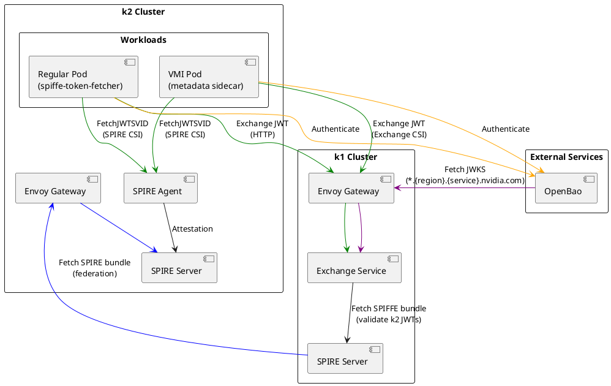
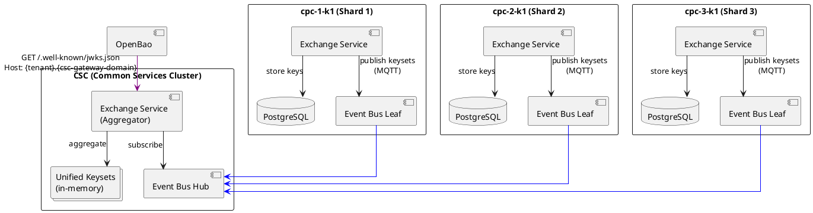
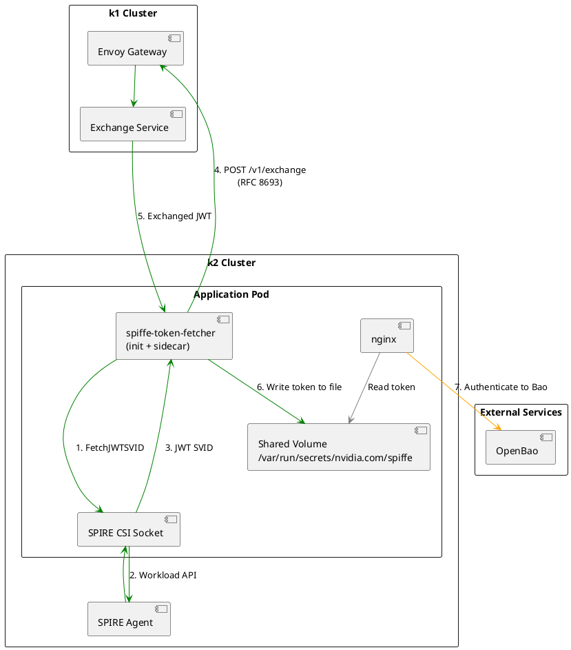
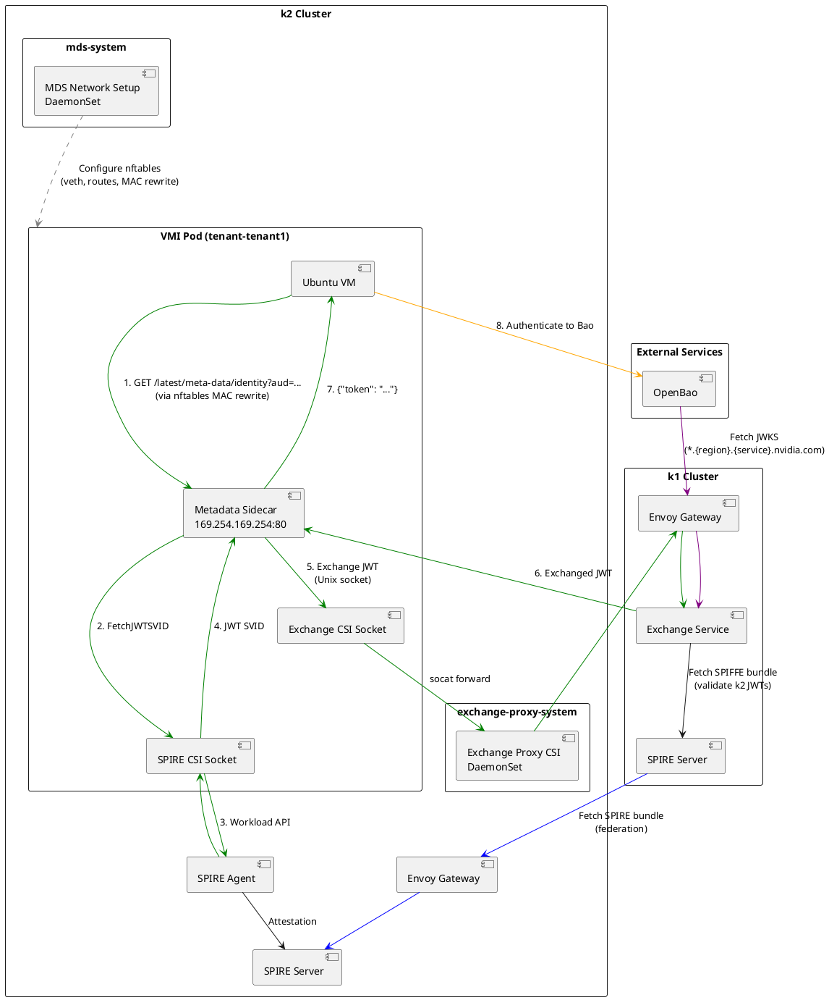
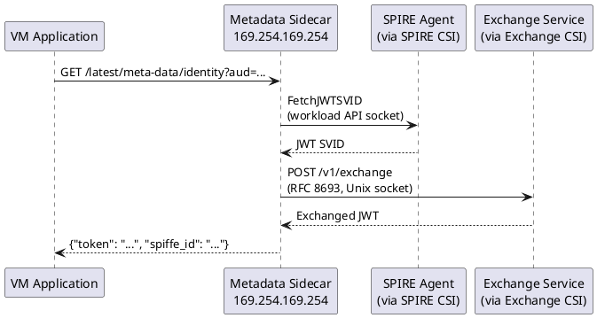
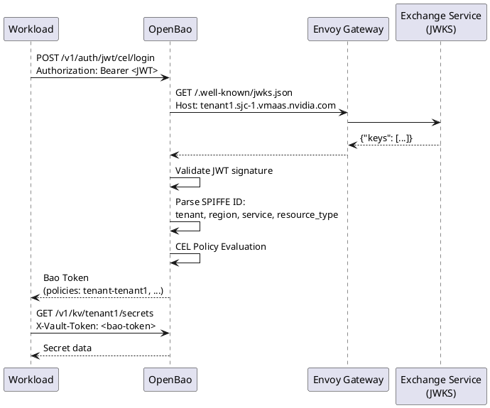

# SPIFFE + OpenBao CEL Multi-Cluster Demo

Demonstrates workloads in k2 obtaining SPIFFE JWTs and using them to authenticate to OpenBao in k1 via CEL-based JWT auth. k2 workloads include pods and KubeVirt VMs accessing JWTs through a metadata service.

## Quick Start

```bash
make clean && make install -j && make test
```

## Prerequisites

Docker, kubectl, Kind, Helm, OpenBao CLI (`bao`), virtctl, jq

## Architecture



**SPIRE Trust Domains:**
- k1: `sjc-1.nvidia.com`
- k2: `k2.sjc-1.nvidia.com`

**Exchange Service Trust Domains (per-tenant):** `{tenant}.{region}.{service}.nvidia.com`

**Gateway DNS:**
- k1: `gateway.sjc-1.nvidia.com` (OpenBao :8200, Exchange :8080)
- k2: `gateway.k2.sjc-1.nvidia.com` (SPIRE bundle :8443)

## SPIFFE Exchange Service

Transforms JWTs from k2's trust domain into tenant-specific trust domains for OpenBao authentication.

### JWT Transformation

SPIFFE ID Pattern: `spiffe://{tenant}.{region}.{service}.nvidia.com/{resource_type}/{resource_id}`

**Pod Example:**
```
Input:  spiffe://k2.sjc-1.nvidia.com/tenant/tenant1/service/internal/pod/{uuid}
Output: spiffe://tenant1.sjc-1.internal.nvidia.com/pod/{uuid}
```

**VM Example:**
```
Input:  spiffe://k2.sjc-1.nvidia.com/tenant/tenant1/service/vmaas/vm/{uuid}
Output: spiffe://tenant1.sjc-1.vmaas.nvidia.com/vm/{uuid}
```

The exchange service:
1. Validates incoming JWT against k2's SPIRE trust bundle (via federation)
2. Extracts components from path: `/tenant/{tenant}/service/{service}/{resource_type}/{resource_id}`
3. Constructs new trust domain: `{tenant}.{region}.{service}.nvidia.com` (region is configured)
4. Re-signs JWT with tenant-specific key, updating `sub` and `iss` claims

### Key Storage

The exchange service supports two storage backends for domain signing keys:

**In-Memory (default for local dev):** Keys are generated on first use and lost on restart. Use `--keystore-backend=in-memory`.

**PostgreSQL (production):** Keys are encrypted as JWE and persisted in PostgreSQL via CloudNativePG operator. Use `--keystore-backend=postgres`.

Required configuration for Postgres backend:
- `--pg-host`, `--pg-port`, `--pg-database`, `--pg-user`: Connection parameters
- `EXCHANGE_PG_PASSWORD`: Database password (from CloudNativePG's `postgres-app` secret)
- `EXCHANGE_ENCRYPTION_KEYSET`: JWKS containing symmetric keys for encryption
- `EXCHANGE_ACTIVE_KEY_ID`: Key ID of the active key for new encryptions

**JWKS Format:**
```json
{
  "keys": [
    {
      "kty": "oct",
      "kid": "mk-2025-01",
      "k": "<base64url-encoded-32-byte-key>",
      "alg": "A256GCM",
      "use": "enc"
    }
  ]
}
```

**Key Rotation:**
1. Generate new 32-byte key, base64url-encode, add to JWKS with new kid
2. Update `EXCHANGE_ACTIVE_KEY_ID` to new kid
3. Update Kubernetes secret and restart service
4. Old keys remain in JWKS for decrypting existing data
5. Query `SELECT * FROM domain_keys WHERE master_key_id = 'old-kid'` to find keys to re-encrypt

### JWKS Endpoint

Exchange service serves `/.well-known/jwks.json` for each tenant domain. CoreDNS wildcard rewrite routes `*.{region}.{service}.nvidia.com` to the exchange service per service, enabling OpenBao to fetch JWKS for any tenant.

## Latinum Sharding Model

Sharded deployment architecture for the exchange service across control plane clusters within a datacenter.



### How It Works

Each control plane cluster (cpc-N-k1) runs an independent exchange service with its own PostgreSQL database for key storage. When a new signing key is generated for a tenant domain, the exchange service publishes its public key to the local event bus leaf using retained MQTT messages on a topic like `spiffe-exchange/v1/pub-keysets/tenant/{tenant_domain}/kid/{kid}`. Messages have TTLs and are republished periodically to ensure availability.

The event bus uses a hub-and-spoke topology: each shard's leaf connects to the central hub in CSC, which replicates retained messages across all connected nodes. The exchange service in CSC subscribes to the keyset topic pattern and aggregates all published keysets in memory, maintaining a unified view of public keys across all shards.

When OpenBao validates a JWT, it fetches the JWKS from the CSC exchange service using the tenant as a subdomain in the Host header (e.g., `Host: tenant1.exchange.csc.nvidia.com`). The CSC exchange service returns a merged keyset containing public keys from all shards for that tenant. This allows workloads from any shard to authenticate against a central OpenBao instance, regardless of which shard's exchange service signed their JWT.

Key benefits:
- **Shard isolation**: Each CPC operates independently with its own key storage
- **Eventual consistency**: Keysets propagate through the event bus without direct cross-shard communication
- **Unified validation**: Single JWKS endpoint serves keys from all shards
- **Retained messages**: New CSC instances or restarts immediately receive current keysets

## Pod Workload Architecture

Regular pods use the spiffe-token-fetcher sidecar to fetch and refresh SPIFFE JWTs.

### Architecture Diagram



### Components

**spiffe-token-fetcher**: Runs as a native sidecar (init container with `restartPolicy: Always`). Blocks pod startup until initial token is available, then continues running to refresh token before expiry. Fetches JWT from SPIRE, exchanges via HTTP, writes to shared volume.

**SPIRE CSI Driver**: Mounts SPIRE agent socket at `/var/run/secrets/spire.io/spire-agent.sock`.

**Shared Token Volume**: EmptyDir volume at `/var/run/secrets/nvidia.com/spiffe/` where token is written as a file.

### Token File

The application reads the exchanged JWT from the token file:

```bash
TOKEN=$(cat /var/run/secrets/nvidia.com/spiffe/token)
curl -H "Authorization: Bearer $TOKEN" https://gateway.sjc-1.nvidia.com:8200/v1/auth/jwt/cel/login
```

## VM Workload Architecture

KubeVirt VMs access SPIFFE JWTs via an HTTP metadata service at **169.254.169.254**. The metadata sidecar runs in each VMI pod, injected via Kyverno policy.

### Architecture Diagram



### Components

**Metadata Sidecar**: Container running in the VMI pod that serves the metadata API at 169.254.169.254. Directly accesses the SPIRE workload API socket and exchange service socket via CSI drivers.

**MDS Network Setup DaemonSet**: Privileged DaemonSet that configures networking in each VMI pod's namespace to route VM traffic to the metadata sidecar (see [cmd/mds-network-setup/README.md](cmd/mds-network-setup/README.md)).

**Exchange Proxy CSI Driver**: DaemonSet that creates Unix sockets forwarding to the exchange service via socat, mounted into VMI pods for exchange service access without cluster network.

**SPIRE CSI Driver**: Mounts SPIRE agent socket into the pod for workload API access.

### Sequence Diagram



### CSI Volumes

**SPIRE CSI** (`csi.spiffe.io`): Mounts SPIRE agent socket at `/var/run/secrets/spire.io/spire-agent.sock` for fetching JWT SVIDs.

**Exchange CSI** (`csi.exchange.nvidia.com`): Mounts exchange service socket at `/var/run/secrets/exchange.io/exchange.sock` for JWT exchange without cluster network access.

### Network Configuration

The MDS Network Setup DaemonSet configures each VMI pod's network namespace to route VM traffic to the metadata sidecar. See `cmd/mds-network-setup/README.md` for details.

### Security Model

- **Pod Co-location**: Metadata sidecar runs in the same pod as the VM, inheriting the same SPIFFE identity. It serves only one VM.
- **Local traffic**: Metadata service API is not exposed as a K8s service, only routing with the pod local network rewrite.

### HTTP API

The metadata service supports both JSON and plain text responses based on the `Accept` header. If no `Accept` header is provided, JSON is the default.

**JSON Response** (default or `Accept: application/json`):
```bash
curl -G -H "Metadata: true" http://169.254.169.254/latest/meta-data/identity \
  --data-urlencode "aud=spiffe://tenant1.sjc-1.vmaas.nvidia.com"
```

```json
{
  "token": "eyJhbGciOiJFUzI1NiIs...",
  "expires_in": 3600,
  "spiffe_id": "spiffe://tenant1.sjc-1.vmaas.nvidia.com/vm/{uuid}"
}
```

## External Services

### OpenBao CEL Integration

CEL program parses SPIFFE ID components for dynamic policy assignment:

```
spiffe://tenant1.sjc-1.vmaas.nvidia.com/vm/{uuid}
         ──┬───  ──┬── ──┬──            ─┬─
         tenant  region service     resource_type
```

Assigned policies: `spiffe-authenticated`, `tenant-tenant1`, `region-sjc-1`, `service-vmaas`, `resource-type-vm`

### Authentication Sequence



### Example Login

```bash
# Get JWT from token file (pod) or metadata service (VM)
TOKEN=$(cat /var/run/secrets/nvidia.com/spiffe/token)

# Authenticate to OpenBao
BAO_TOKEN=$(curl -s -X POST https://gateway.sjc-1.nvidia.com:8200/v1/auth/jwt/cel/login \
  -H "Content-Type: application/json" \
  -d "{\"jwt\": \"$TOKEN\"}" | jq -r '.auth.client_token')

# Access secrets
curl -s https://gateway.sjc-1.nvidia.com:8200/v1/kv/tenant1/example \
  -H "X-Vault-Token: $BAO_TOKEN"
```

## Required Pod Labels

Workloads must have these labels for SPIFFE identity:
- `spiffe.nvidia.com/tenant`: Tenant identifier (e.g., `tenant1`)
- `spiffe.nvidia.com/service`: Service name (e.g., `vmaas`, `internal`)

## Make Targets

```bash
make install -j     # Setup both clusters
make test           # Run integration tests  
make clean          # Remove clusters
make status         # Show component status
make help           # Show all targets
```

| k1 | k2 |
|----|-----|
| `cluster` | `k2-cluster` |
| `gateway` | `k2-gateway` |
| `spire` | `k2-spire` |
| `exchange-service` | `nginx` |
| `bao` | `metadata-service` |
| | `vm` |

## Troubleshooting

```bash
make status           # Component overview
make verify-nginx     # Test nginx -> OpenBao auth
make verify-vm        # Test VM -> metadata service

# Logs
kubectl logs -l app=spiffe-exchange-service -n spiffe-exchange --context kind-k1
kubectl logs -n tenant-tenant1 -l kubevirt.io/domain -c metadata-service --context kind-k2

# VM console (ubuntu/ubuntu)
virtctl console demo-ubuntu-vm --context kind-k2
```
