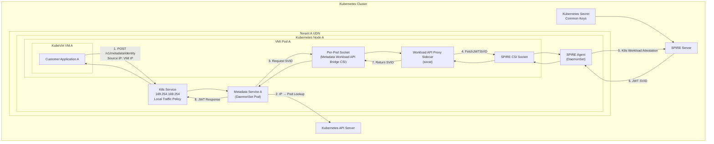

# SPIFFE JWT Metadata Service Design

## Overview

HTTP metadata service that provides SPIFFE JWT via tenant-specific DaemonSet deployment on 169.254.169.254. Uses OVN User Defined Networks (UDN) for tenant isolation and source IP identity verification. VMI pods include a sidecar container that acts as a SPIRE Workload API proxy, communicating with the metadata service via per-pod shared Unix domain sockets.

The reason the sidecar has to request the SVID is that the spire agent itself issues the token and the workload api WorkloadAttestor plugin only takes a PID as input. The caller PID must be the workload that is being attested, so a PID coming from outside of the VM's pod would result in a workload identity differing from the VM.

## Architecture



## Components

### Metadata Service DaemonSet

- **Deployment**: Tenant-specific DaemonSet with node selector matching tenant labels
- **Network**: Attached to tenant-specific OVN User Defined Network (UDN)
- **Endpoint**: Listens on `http://169.254.169.254:8080/v1/metadata/identity` via Kubernetes Service
- **Traffic Policy**: External Traffic Policy set to `Local` to ensure source IP preservation
- **Isolation**: At most one DaemonSet pod per node since nodes are not shared between tenants
- **Socket Access**: Mounts shared per-pod Unix domain sockets via CSI driver to communicate with sidecars

### Workload API Proxy Sidecar

- **Deployment**: Injected into VMI pods via Kyverno policy based on annotation
- **Function**: Mirrors incoming connections on bridged socket to SPIRE Workload API socket
- **Identity**: Inherits VMI pod's SPIFFE identity via Kubernetes workload attestation
- **Communication**:
  - **SPIRE CSI Socket**: Mounts SPIRE Workload API socket
  - **Per-Pod Socket**: Listens on Unix domain socket provided by metadata service bridge CSI

### Metadata Service Bridge CSI Driver

- **Purpose**: Single CSI driver that enables per-pod socket communication between metadata service and VMI sidecars
- **Function**: Creates and manages per-pod Unix domain sockets accessible to both sidecar (writer) and metadata service (reader)
- **Deployment**: Runs as DaemonSet on each node
- **Socket Management**: Creates unique socket per VMI pod at predictable paths based on pod namespace/name
- **Reference**: Based on [SPIFFE CSI Driver](https://github.com/spiffe/spiffe-csi) architecture

### Identity Resolution Flow

1. **VM Request**: Customer VM sends HTTP POST to 169.254.169.254 with audience
2. **IP Resolution**: Metadata service extracts source IP and queries Kubernetes API to identify VMI pod
3. **Socket Connection**: Metadata service connects to VMI pod's shared Unix socket
4. **Connection Mirroring**: Proxy sidecar mirrors connection to SPIRE Workload API socket
5. **SVID Request**: Metadata service requests JWT SVID via standard Workload API protocol
6. **Workload Attestation**: SPIRE Agent attests proxy sidecar's PID, resolving to VMI pod's identity
7. **Response**: SPIRE returns JWT SVID through mirrored connection to metadata service
8. **VM Response**: Metadata service returns JWT SVID to customer VM via HTTP

### Network Architecture

- **UDN Isolation**: Each tenant has dedicated User Defined Network preventing cross-tenant access
- **Service Discovery**: Kubernetes Service provides stable 169.254.169.254 endpoint within tenant UDN
- **Node Affinity**: DaemonSet pods only deploy on nodes with appropriate tenant labels
- **Socket Isolation**: Per-pod shared sockets prevent cross-VM communication

### Security Model

- **Source IP Authenticity**: OVN guarantees source IP cannot be spoofed within UDN
- **Pod Identity Verification**: Kubernetes API query confirms VMI pod identity
- **Workload Attestation**: SPIRE Agent attests sidecar's identity based on Kubernetes pod metadata
- **Socket Isolation**: Each VMI pod has dedicated socket accessible only by node-local metadata service

## Socket Proxy Architecture

### Socket Location

Applications see static paths:

**VMI Pod (proxy sidecar)**:

```text
/var/run/secrets/nvidia.com/metadata-bridge-spire-agent.sock
```

**Metadata Service**:

```text
/var/run/spiffe/sockets/<namespace>/<pod-name>/metadata-bridge-spire-agent.sock
```

The metadata service bridge CSI driver mounts sockets at these paths. Applications use static paths without discovery logic.

### Connection Mirroring

The proxy sidecar transparently mirrors connections between the shared socket and the SPIRE Workload API socket. When the metadata service connects to the shared socket, the proxy:

1. Accepts the connection on the shared socket
2. Establishes a connection to the SPIRE Workload API socket
3. Bidirectionally forwards all data between the two connections

This allows the metadata service to communicate directly with SPIRE using the standard Workload API protocol, with the proxy providing PID-based identity context.

## HTTP API Specification

**Request**: POST to metadata endpoint with JSON payload containing audience

```bash
curl -X POST http://169.254.169.254:8080/v1/metadata/identity \
  -H "Content-Type: application/json" \
  -d '{"audience": "spiffe://sjc-1.k8s2-control.nvidia.com"}'
```

**Response**: JWT with expiration timestamp and SPIFFE ID

```json
{
  "token": "eyJhbGciOiJSUzI1NiIs...",
  "expires_at": "2025-09-18T15:30:00Z",
  "spiffe_id": "spiffe://sjc-1.k8s2-control.nvidia.com/default/pod/demo-app"
}
```

## SPIRE Integration

### Multi-Cluster Key Management

SPIRE servers in k2 clusters use shared private keys from k1 to simplify JWKS management and scaling. Private keys are generated in k1 and distributed to all k2 SPIRE servers, enabling:

- **Single JWKS Endpoint**: Only k1 serves public JWKS externally, eliminating need to configure multiple endpoints in Vault/OpenBao
- **Simplified Scaling**: New k2 clusters automatically use existing keyset without additional configuration
- **Reduced Exposure**: k2 SPIRE servers don't require public JWKS endpoints
  - services in k2 can still read the endpoint from their local k2 SPIRE server if desired
- **Native K8s Auth**: k2 maintains local SPIRE servers for native Kubernetes attestation and scaling

## Usage

### Tenant DaemonSet Deployment

Deploy metadata service for each tenant:

```yaml
apiVersion: apps/v1
kind: DaemonSet
metadata:
  name: metadata-service-tenant-a
  namespace: tenant-a
spec:
  selector:
    matchLabels:
      app: metadata-service
      tenant: tenant-a
  template:
    metadata:
      labels:
        app: metadata-service
        tenant: tenant-a
    spec:
      serviceAccountName: metadata-service
      nodeSelector:
        tenant: tenant-a
      containers:
      - name: metadata-service
        image: metadata-service:latest
        args:
        - --listen=:8080
        - --log-level=info
        ports:
        - containerPort: 8080
        resources:
          requests:
            cpu: 100m
            memory: 128Mi
          limits:
            cpu: 200m
            memory: 256Mi
        volumeMounts:
        - name: shared-sockets
          mountPath: /var/run/spiffe/sockets
          readOnly: true
      volumes:
      - name: shared-sockets
        csi:
          driver: csi.spiffe.io/metadata-bridge  # Metadata service bridge CSI
          readOnly: true
```

### Workload API Proxy Sidecar Injection

VMI pods automatically receive sidecar via Kyverno policy:

```yaml
apiVersion: kyverno.io/v1
kind: ClusterPolicy
metadata:
  name: inject-workload-api-proxy
spec:
  rules:
  - name: add-workload-api-proxy
    match:
      any:
      - resources:
          kinds: [Pod]
          namespaces: [tenant-*]
          annotations:
            kubevirt.io/vm: "*"
    mutate:
      patchStrategicMerge:
        spec:
          containers:
          - name: workload-api-proxy
            image: alpine/socat:latest
            command:
            - socat
            - UNIX-LISTEN:/var/run/secrets/nvidia.com/metadata-bridge-spire-agent.sock,fork
            - UNIX-CONNECT:/var/run/secrets/spire.io/spire-agent.sock
            resources:
              requests:
                cpu: 50m
                memory: 64Mi
              limits:
                cpu: 100m
                memory: 128Mi
            volumeMounts:
            - name: spiffe-csi
              mountPath: /var/run/secrets/spire.io
              readOnly: true
            - name: metadata-bridge
              mountPath: /var/run/secrets/nvidia.com
          volumes:
          - name: spiffe-csi
            csi:
              driver: csi.spiffe.io
              readOnly: true
          - name: metadata-bridge
            csi:
              driver: csi.spiffe.io/metadata-bridge
```

### Kubernetes Service Configuration

Service with Local traffic policy for source IP preservation:

```yaml
apiVersion: v1
kind: Service
metadata:
  name: metadata-service
  namespace: tenant-a
spec:
  type: ClusterIP
  externalTrafficPolicy: Local
  selector:
    app: metadata-service
    tenant: tenant-a
  ports:
  - port: 80
    targetPort: 8080
  clusterIP: 169.254.169.254
```

### Customer VM Configuration

Customer VMs connect to UDN and automatically receive workload API proxy sidecar:

```yaml
apiVersion: kubevirt.io/v1
kind: VirtualMachine
metadata:
  name: customer-vm
  namespace: tenant-a
spec:
  template:
    metadata:
      annotations:
        k8s.ovn.org/networks: tenant-a-udn
    spec:
      domain:
        devices:
          disks:
          - disk:
              bus: virtio
            name: containerdisk
        machine:
          type: ""
        resources:
          requests:
            memory: 1Gi
      terminationGracePeriodSeconds: 0
      volumes:
      - containerDisk:
          image: customer-vm:latest
        name: containerdisk
```

Note: The Kyverno policy automatically injects the workload API proxy sidecar into VMI pods based on the `kubevirt.io/vm` annotation (added automatically by KubeVirt).

## Implementation Components

### 1. Workload API Proxy Sidecar (New Component)

**Purpose**: Mirror incoming socket connections to SPIRE Workload API socket

**Implementation**:

- Use `socat` to relay connections between sockets
- Command: `socat UNIX-LISTEN:/var/run/secrets/nvidia.com/metadata-bridge-spire-agent.sock,fork UNIX-CONNECT:/var/run/secrets/spire.io/spire-agent.sock`
- No custom code required

### 2. Metadata Service

**Implementation**:

- Connect to SPIRE Workload API via bridge socket at `/var/run/spiffe/sockets/<namespace>/<pod-name>/metadata-bridge-spire-agent.sock`
- Construct socket path from resolved VMI pod namespace and name
- Mount metadata service bridge CSI volume

### 3. Metadata Service Bridge CSI Driver (New Component)

**Purpose**: Single CSI driver that enables per-pod socket communication between metadata service and VMI sidecars

**Reference**: Based on [SPIFFE CSI Driver](https://github.com/spiffe/spiffe-csi) architecture

**Requirements**:

- Deploy as DaemonSet on each node
- Create unique socket per VMI pod
- Mount socket into VMI pod at `/var/run/secrets/nvidia.com/metadata-bridge-spire-agent.sock`
- Mount all pod sockets into metadata service at `/var/run/spiffe/sockets/<namespace>/<pod-name>/metadata-bridge-spire-agent.sock`
- Handle socket lifecycle (creation on pod start, cleanup on pod deletion)
- Watch Kubernetes API for VMI pod events
- Ensure node-local access only

### 4. Workload API Proxy Injection Policy

**Purpose**: Automatically inject workload API proxy sidecar into VMI pods

**Implementation**:

- Kyverno ClusterPolicy matching `kubevirt.io/vm` annotation
- Inject proxy sidecar container with SPIRE CSI and shared socket volumes
- Set appropriate resource limits
- Configure probes for readiness/liveness

### 5. RBAC Configuration

**Permissions Required**:

- `pods` get/list for IP-to-pod resolution
