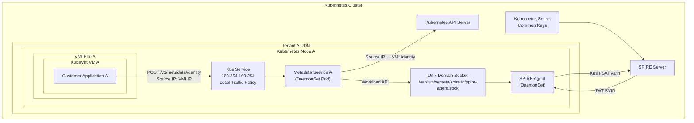

# SPIFFE JWT Metadata Service Design

## Overview

HTTP metadata service that provides SPIFFE JWT via tenant-specific DaemonSet deployment on 169.254.169.254. Uses OVN User Defined Networks (UDN) for tenant isolation and source IP identity verification.

## Architecture



## Components

### Metadata Service DaemonSet

- **Deployment**: Tenant-specific DaemonSet with node selector matching tenant labels
- **Network**: Attached to tenant-specific OVN User Defined Network (UDN)
- **Endpoint**: Listens on `http://169.254.169.254:8080/v1/metadata/identity` via Kubernetes Service
- **Traffic Policy**: External Traffic Policy set to `Local` to ensure source IP preservation
- **Isolation**: At most one DaemonSet pod per node since nodes are not shared between tenants

### Identity Resolution

- **Source IP Tracking**: OVN guarantees source IP authenticity (no spoofing)
- **K8s API Query**: Metadata service queries Kubernetes API using source IP to identify calling pod
- **SPIRE Integration**: Uses resolved pod identity with SPIRE Workload API to fetch JWT SVID
- **Security**: UDN isolation ensures only tenant pods can access their metadata service

### Network Architecture

- **UDN Isolation**: Each tenant has dedicated User Defined Network preventing cross-tenant access
- **Service Discovery**: Kubernetes Service provides stable 169.254.169.254 endpoint within tenant UDN
- **Node Affinity**: DaemonSet pods only deploy on nodes with appropriate tenant labels

## API Specification

**Request**: POST to metadata endpoint with JSON payload containing audience

```bash
curl -X POST http://169.254.169.254:8080/v1/metadata/identity \
  -H "Content-Type: application/json" \
  -d '{"audience": "spiffe://sjc-1.k8s2-control.nvidia.com"}'
```

**Response**: JWT with expiration timestamp and SPIFFE ID

```json
{
  "token": "eyJhbGciOiJSUzI1NiIs...",
  "expires_at": "2025-09-18T15:30:00Z",
  "spiffe_id": "spiffe://sjc-1.k8s2-control.nvidia.com/default/pod/demo-app"
}
```

## SPIRE Integration

### Multi-Cluster Key Management

SPIRE servers in k2 clusters use shared private keys from k1 to simplify JWKS management and scaling. Private keys are generated in k1 and distributed to all k2 SPIRE servers, enabling:

- **Single JWKS Endpoint**: Only k1 serves public JWKS externally, eliminating need to configure multiple endpoints in Vault/OpenBao
- **Simplified Scaling**: New k2 clusters automatically use existing keyset without additional configuration
- **Reduced Exposure**: k2 SPIRE servers don't require public JWKS endpoints
  - services in k2 can still read the endpoint from their local k2 SPIRE server if desired
- **Native K8s Auth**: k2 maintains local SPIRE servers for native Kubernetes attestation and scaling

## Usage

### Tenant DaemonSet Deployment

Deploy metadata service for each tenant:

```yaml
apiVersion: apps/v1
kind: DaemonSet
metadata:
  name: metadata-service-tenant-a
  namespace: tenant-a
spec:
  selector:
    matchLabels:
      app: metadata-service
      tenant: tenant-a
  template:
    metadata:
      labels:
        app: metadata-service
        tenant: tenant-a
    spec:
      nodeSelector:
        tenant: tenant-a
      containers:
      - name: metadata-service
        image: spiffe-metadata-service:latest
        ports:
        - containerPort: 8080
        resources:
          requests:
            cpu: 100m
            memory: 128Mi
          limits:
            cpu: 200m
            memory: 256Mi
        volumeMounts:
        - name: spiffe-csi
          mountPath: /var/run/secrets/spire.io
          readOnly: true
      volumes:
      - name: spiffe-csi
        csi:
          driver: csi.spiffe.io
          readOnly: true
```

### Kubernetes Service Configuration

Service with Local traffic policy for source IP preservation:

```yaml
apiVersion: v1
kind: Service
metadata:
  name: metadata-service
  namespace: tenant-a
spec:
  type: ClusterIP
  externalTrafficPolicy: Local
  selector:
    app: metadata-service
    tenant: tenant-a
  ports:
  - port: 80
    targetPort: 8080
  clusterIP: 169.254.169.254
```

### Customer VM Configuration

Customer VMs connect to UDN and query metadata service:

```yaml
apiVersion: kubevirt.io/v1
kind: VirtualMachine
metadata:
  name: customer-vm
  namespace: tenant-a
  annotations:
    k8s.ovn.org/networks: tenant-a-udn
spec:
  template:
    spec:
      domain:
        devices:
          disks:
          - disk:
              bus: virtio
            name: containerdisk
        machine:
          type: ""
        resources:
          requests:
            memory: 1Gi
      terminationGracePeriodSeconds: 0
      volumes:
      - containerDisk:
          image: customer-vm:latest
        name: containerdisk
```
