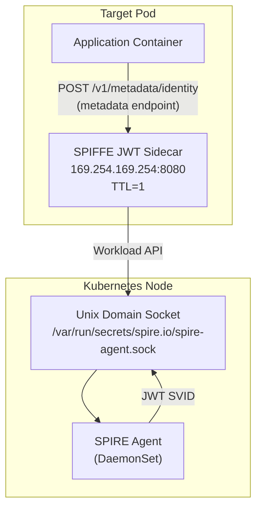

# SPIFFE JWT Sidecar Service Design

## Overview

HTTP service sidecar that provides SPIFFE JWT via localhost-only metadata endpoint with TTL=1. Attaches to pods via annotation using Kyverno admission controller.

## Architecture



## Components

### HTTP Metadata Service

- **Sidecar**: Runs as local sidecar to VM's pod, fetches JWTs via SPIRE Workload API over unix domain socket
- **Metadata Endpoint**: `POST http://169.254.169.254:8080/v1/metadata/identity` bound to custom network interface
- **Security**: IP packet TTL=1 prevents network forwarding, interface-specific binding prevents external access
- **Response**: JWT with expiration timestamp and SPIFFE ID

### Kyverno Auto-Injection

- **Trigger**: Annotation `spiffe.nvidia.com/inject-sidecar: "true"` on pods
- **Action**: Automatically injects sidecar container with required volumes and resource limits
- **VMI Enhancement**: For VMIs, also injects additional network interface providing 169.254.169.254 endpoint
- **Identity Validation**: SPIRE agent validates workload identity via Kubernetes PSAT

## API Specification

**Request**: POST to metadata endpoint with JSON payload containing audience

```bash
curl -X POST http://169.254.169.254:8080/v1/metadata/identity \
  -H "Content-Type: application/json" \
  -d '{"audience": "spiffe://sjc-1.k8s2-control.nvidia.com"}'
```

**Response**: JWT with expiration timestamp and SPIFFE ID

```json
{
  "token": "eyJhbGciOiJSUzI1NiIs...",
  "expires_at": "2025-09-18T15:30:00Z",
  "spiffe_id": "spiffe://sjc-1.k8s2-control.nvidia.com/default/pod/demo-app"
}
```

## SPIRE Integration

### Multi-Cluster Key Management

SPIRE servers in k2 clusters use shared private keys from k1 to simplify JWKS management and scaling. Private keys are generated in k1 and distributed to all k2 SPIRE servers, enabling:

- **Single JWKS Endpoint**: Only k1 serves public JWKS externally, eliminating need to configure multiple endpoints in Vault/OpenBao
- **Simplified Scaling**: New k2 clusters automatically use existing keyset without additional configuration
- **Reduced Exposure**: k2 SPIRE servers don't require public JWKS endpoints
  - services in k2 can still read the endpoint from their local k2 SPIRE server if desired
- **Native K8s Auth**: k2 maintains local SPIRE servers for native Kubernetes attestation and scaling

## Usage

### Sidecar Injection

Annotation triggers automatic sidecar injection:

```yaml
apiVersion: v1
kind: Pod
metadata:
  name: demo-app
  annotations:
    spiffe.nvidia.com/inject-sidecar: "true"
spec:
  containers:
  - name: app
    image: my-app:latest
```

### Kyverno Policy

Policy configuration for sidecar injection:

```yaml
apiVersion: kyverno.io/v1
kind: ClusterPolicy
metadata:
  name: inject-spiffe-jwt-sidecar
spec:
  rules:
  - name: add-spiffe-sidecar
    match:
      any:
      - resources:
          kinds: [Pod]
          selector:
            matchExpressions:
            - key: spiffe.nvidia.com/inject-sidecar
              operator: In
              values: ["true"]
    mutate:
      patchStrategicMerge:
        spec:
          containers:
          - name: spiffe-jwt-service
            image: spiffe-jwt-service:latest
            ports:
            - containerPort: 8080
            resources:
              requests:
                cpu: 50m
                memory: 64Mi
              limits:
                cpu: 50m
                memory: 64Mi
            volumeMounts:
            - name: spiffe-csi
              mountPath: /var/run/secrets/spire.io
              readOnly: true
          volumes:
          - name: spiffe-csi
            csi:
              driver: csi.spiffe.io
              readOnly: true
```
