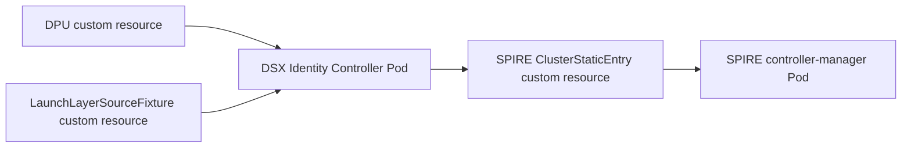

# DSX Identity Controller

`dsx-identity-controller` watches DPU and LaunchLayer source objects in one
management cluster and reconciles the corresponding SPIRE
`ClusterStaticEntry` objects. It derives SPIFFE IDs, parent IDs, selectors,
holder selectors, and workload hints from each local source. The source objects
remain read-only.



The `LaunchLayerSourceFixture` input is an E2E stand-in for the externally
owned LaunchLayer source API. The controller runs in the Data Hall management
cluster through `charts/dsx-identity/templates/identity-controller.yaml`.

## Flags

| Flag | Default | Purpose |
| --- | --- | --- |
| `--trust-domain` | required | Local SPIRE trust domain |
| `--operator-tenant` | required | Tenant used for DPU identities |
| `--class-name` | required | SPIRE controller-manager class name |
| `--dpu-holder-namespace` | required | Namespace selected for the DPU token holder |
| `--dpu-holder-service-account` | required | Service account selected for the DPU token holder |
| `--metrics-bind-address` | `:8080` | Controller metrics address |
| `--health-probe-bind-address` | `:8081` | `/healthz` and `/readyz` address |
| `--leader-elect` | `true` | Enable Kubernetes leader election |

The command uses the active Kubernetes client configuration and requires the
SPIRE CRDs plus the external source APIs.

## Testing

```bash
go test ./cmd/dsx-identity-controller ./internal/identitycontroller
```

The focused tests cover DPU and LaunchLayer reconciliation, updates, invalid
source handling, and cleanup.
