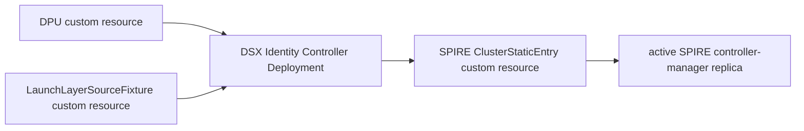

# DSX Identity Controller

`dsx-identity-controller` watches DPU and LaunchLayer source objects in one
management cluster and reconciles the corresponding SPIRE
`ClusterStaticEntry` objects. It derives SPIFFE IDs, parent IDs, selectors,
and workload hints from each local source. Separate configuration supplies the
DPU token-fetcher and DPU metadata selectors. A VM source supplies its holder
namespace, service account, and optional Pod UID. A host source has no holder.
The source objects remain read-only.

The Identity Controller owns non-Pod registration fields. The official SPIRE
controller-manager owns Pod registrations. The controller rejects duplicate
child SPIFFE IDs and overlapping VM holders, removes stale entries for invalid
sources, and reconciles again when the source or conflicting entry changes.

Every DPU source is operator-owned and uses the configured operator tenant. A
standalone tenant-facing host source uses the tenant supplied by LaunchLayer. A
VM source uses its LaunchLayer tenant only for the VM identity and parents that
identity to the configured operator tenant's `dsx_imds` agent for the holder's
worker host. The worker host and its virt-launcher Pod remain operator-owned.
LaunchLayer is the source of a tenant ID, not a tenant itself.

The official controller-manager registers each Kubernetes Pod beneath its
worker's `dsx_imds`-attested agent. Its registration uses the configured
operator tenant, Kubernetes node name, and Pod UID, and the Kubernetes
WorkloadAttestor serves it. The base DPU registration is instead parented to
the external `dpu_hw`-attested agent identified by the DPU serial number.



The `LaunchLayerSourceFixture` input is an E2E stand-in for the externally
owned LaunchLayer source API. The controller runs in the regular management
cluster that owns the identity shard's source CRs through
`charts/dsx-identity/templates/identity-controller.yaml`.

## Flags

| Flag | Default | Purpose |
| --- | --- | --- |
| `--trust-domain` | required | Local SPIRE trust domain |
| `--operator-tenant` | required | Configured tenant for operator identities |
| `--class-name` | required | SPIRE controller-manager class name |
| `--dpu-token-fetcher-selector` | required, repeatable | Unix WorkloadAttestor selector for the `dsx-token-fetcher` process that calls the DPU Workload API |
| `--dpu-metadata-selector` | required, repeatable | External DPU runtime selector for DSX IMDS when it selects a host identity |
| `--metrics-bind-address` | `:8080` | Controller metrics address |
| `--health-probe-bind-address` | `:8081` | `/healthz` and `/readyz` address |
| `--leader-elect` | `true` | Enable Kubernetes leader election |

The command uses the active Kubernetes client configuration and requires the
SPIRE CRDs plus the external source APIs.

## Testing

```bash
go test ./cmd/dsx-identity-controller ./internal/identitycontroller
```

The focused tests cover DPU and LaunchLayer reconciliation, conflicts, recovery,
invalid source handling, and cleanup.
