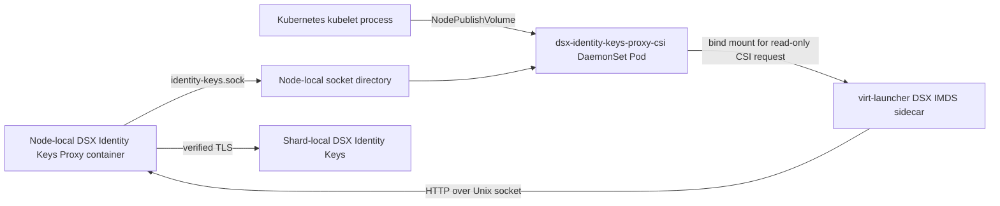

# DSX Identity Keys Proxy CSI Driver

`dsx-identity-keys-proxy-csi` is a node-local CSI driver for read-only
ephemeral inline volumes. It bind mounts the directory containing the local
DSX Identity Keys Proxy Unix socket into a consumer Pod.



The identity chart deploys the driver, node-driver-registrar, and proxy in
`charts/dsx-identity/templates/vm-support.yaml`. The VM DSX IMDS sidecar uses
the mounted socket to reach its local DSX Identity Keys.

## Flags

| Flag | Default | Purpose |
| --- | --- | --- |
| `--node-id` | empty | Explicit CSI node ID |
| `--csi-socket-path` | `/dsx-identity-keys-proxy-csi/csi.sock` | CSI gRPC Unix socket |
| `--socket-dir` | `/run/dsx` | Directory exposed to ephemeral volumes |
| `--log-level` | `info` | JSON log level: `debug`, `info`, `warn`, or `error` |

The driver supports only read-only ephemeral volumes. It requires Linux bind
mount access to kubelet's Pod volume tree and runs privileged in the supplied
DaemonSet.

## Testing

```bash
go test ./cmd/dsx-identity-keys-proxy-csi
```

The focused tests cover idempotent publish and unpublish calls plus serialized
mount transitions. The KubeVirt E2E path validates CSI registration, socket
mounting, and metadata-service access to DSX Identity Keys.
