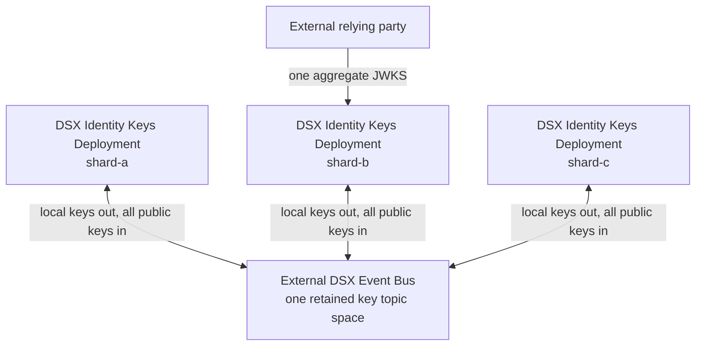
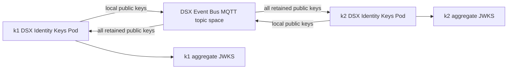

# DSX Identity Keys

`dsx-identity-keys` is the DSX Identity Keys process installed in each identity
shard. It validates only local SPIRE JWT-SVIDs, transforms their SPIFFE subject
to the DSX identity contract, preserves validated claims except `sub` and
`iss`, and signs the exchanged DSX JWT with the shard's active key. It has no
tenant configuration or tenant-specific authorization policy. SPIRE
registration determines the tenant in the local subject, and DSX Identity Keys
preserves it while validating the common identity grammar. It obtains local
JWT verification bundles through the node-local SPIFFE Workload API.

Each DSX Identity Keys instance publishes only its local public keys to the shared Event Bus and
subscribes to all shard key publications. It retains one aggregate keyed by
globally unique `kid`, and its JWKS endpoint serves every valid local and remote
public key. Initial and later Event Bus connection failures leave DSX Identity Keys live
but not ready while it reconnects. DSX Identity Keys instances in the same Event Bus topic space
converge on the same aggregate, so relying parties can use the JWKS from any
reachable DSX Identity Keys.

## Flat key distribution

Every DSX Identity Keys instance publishes only its local public keys and consumes every valid
publication in the Event Bus topic space. Signing keys remain local to their
shard, while every DSX Identity Keys instance serves the same aggregate JWKS.



The local E2E fixture uses two DSX Identity Keys instances in the same topic space:



Public keys use retained QoS 1 topics of the form
`dsx-identity-keys/v1/pub-keys/shard/<shard-id>/kid/<kid>`. Publications carry a
lease expiry and are refreshed every quarter of the configured lease lifetime,
leaving three further publish opportunities before lease expiry. Each valid
publication replaces the globally unique `kid` it addresses. The process
obtains MQTT credentials from the configured OAuth2 client-credentials
endpoint. Those credentials are restricted to `dsx-identity-keys.>` publish and
subscribe access.

The retained JSON payload contains `published_at`, `lease_expires_at`, and one
public `jwk`. The topic supplies the shard ID and `kid`, and the payload JWK
must carry that same `kid`. Private, malformed, unsupported, and expired keys
do not replace a valid aggregate entry.

The identity chart deploys two active replicas per shard through
`charts/dsx-identity/templates/identity-keys-deployment.yaml`, with a unique MQTT
client ID for each Pod. Both replicas load the same shard-local static private
keyset. Only public keys are published, so private signing keys never leave the
shard.

Rotation introduces a new globally unique `kid`. New replicas publish that key,
while replaced replicas stop refreshing the previous key. The previous public
key remains in aggregate JWKS responses until its publication lease expires.

## HTTP API

| Endpoint | Purpose |
| --- | --- |
| `POST /v1/exchange` | Unauthenticated RFC 8693 exchange of a local SPIRE JWT-SVID |
| `GET /.well-known/jwks.json` | Aggregate JWKS for all valid public keys |
| `GET /.well-known/openid-configuration` | Issuer, JWKS URL, and aggregate signing algorithms |
| `GET /live` | Process liveness |
| `GET /ready` | MQTT connection, subscription, and public-key cache readiness |

The exchange endpoint is intentionally unauthenticated because the submitted
local SPIRE JWT-SVID is the credential being exchanged.

The exchange form requires `grant_type`, `subject_token`, and
`subject_token_type`. It accepts the optional `requested_token_type`, caps
request bodies at 1 MiB.
Audience is preserved from the validated SVID. DSX Identity Keys does not accept an
audience override or apply a relying-party audience allowlist. Error responses
do not expose parser or verifier details.

## Flags

| Flag | Default | Purpose |
| --- | --- | --- |
| `--listen` | `:8080` | HTTP listen address |
| `--socket` | Workload API default | Local SPIFFE Workload API socket URL |
| `--jwks-url` | required | Absolute public JWKS URL advertised by discovery |
| `--signing-jwks` | `/run/secrets/dsx-identity-keys/signing-jwks.json` | Private signing JWKS file |
| `--active-kid` | `/run/secrets/dsx-identity-keys/active-kid` | File containing the active signing `kid` |
| `--shard-id` | required | Globally unique shard ID in the Event Bus topic space |
| `--mqtt-broker` | required | MQTT 3.1.1 broker URL |
| `--mqtt-client-id` | `dsx-identity-keys-<shard-id>` | Unique MQTT client ID |
| `--public-key-lease-ttl` | `10m` | Public key publication lease lifetime |
| `--mqtt-oauth-token-url` | required | OAuth2 token endpoint for MQTT credentials |
| `--mqtt-oauth-client-id` | required | OAuth2 client ID |
| `--mqtt-oauth-client-secret` | required | File containing the OAuth2 client secret |
| `--log-level` | `info` | JSON log level: `debug`, `info`, `warn`, or `error` |

## Testing

```bash
go test ./cmd/dsx-identity-keys
```

The focused tests cover signing configuration, RFC 8693 behavior, flat `kid`
aggregation, deterministic publication lease expiry, rotation overlap,
MQTT retained synchronization, OAuth2 credentials, and discovery. Live MQTT
and deployed aggregate checks are enabled by the `DSX_E2E_MQTT_*` and
`DSX_E2E_VERIFY_*` environment variables used by the E2E scripts.
