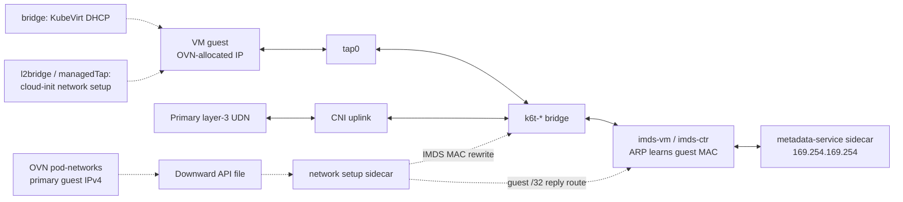

# DSX IMDS Network Setup

`dsx-imds-network-setup` runs as a sidecar in a KubeVirt `virt-launcher` Pod. It
configures that Pod network namespace so the KubeVirt VM can reach the
DSX IMDS (`metadata-service`) sidecar at `169.254.169.254`.

The KubeVirt VM connects through a tap interface and a `k6t-*` Linux bridge in
the `virt-launcher` Pod. The metadata-service shares the Pod network namespace,
but it is not a port on that bridge. Assigning the IMDS address in the namespace
is therefore insufficient. Requests carry the default gateway MAC and would
leave through the bridge uplink. Replies can also conflict with a local route
when the replacement UDN interface retains the VM IP.

The program creates a veth path from the bridge to the metadata-service,
redirects IMDS request frames into that path, and installs an explicit return
path to the VM.

## Chart integration

Enable `vmSupport` in the [identity chart](../../charts/dsx-identity/README.md).
Its admission policy injects the network setup and metadata-service sidecars
into KubeVirt launcher Pods whose VM template has this annotation:

```yaml
spec:
  template:
    metadata:
      annotations:
        spiffe.nvidia.com/inject-dsx-imds: "true"
```

The chart mounts OVN pod-networks through the Downward API. The network setup
container runs as root with `NET_ADMIN` in the launcher network namespace.
KubeVirt creates the guest bridge and tap. This sidecar adds only the IMDS path.
Injection is defined in `charts/dsx-identity/templates/vm-injection-policy.yaml`.

## Network layout



Each VM uses one guest configuration branch. The tap, bridge, uplink, veth, and
both sidecars share the virt-launcher Pod network namespace. Solid arrows carry
packets. Dotted arrows configure networking. The Downward API supplies the
guest address for the reply route. ARP learns the guest MAC on that path.

## VM bindings

- Built-in `bridge` moves the CNI link behind a Linux bridge and tap. KubeVirt
  supplies DHCP so the guest receives the CNI-assigned address.
- `l2bridge` uses KubeVirt's `managedTap` attachment for the same Ethernet path.
  It supplies no DHCP server. Cloud-init or another guest network setup path
  configures the CNI-assigned address and gateway on the matching guest MAC.

These are VM interface bindings. Both can use an OVN-Kubernetes layer-3 UDN.
Both replace the original CNI interface with a dummy. Its current address and
MAC need not identify the guest, and a separate `eth0` can belong to the
infrastructure network.

The command waits up to 60 seconds for the `k6t-*` bridge, its `tap0` port, and
KubeVirt's replacement dummy interface. It also waits for tap carrier, which
returns when QEMU opens the tap after network preparation. The dummy alone
appears before address updates finish. This ordering keeps IMDS route changes
out of KubeVirt's network handoff.

The Downward API file supplies the guest IPv4 reply destination for the `/32`
route. The guest MAC is learned through ARP, including when KubeVirt overrides
the OVN allocation MAC. The sidecar
reads the single entry with `role: primary` in OVN's `pod-networks` annotation,
which describes the network attached to `tap0`. Infrastructure and secondary
entries are excluded. The chart mounts
`metadata.annotations['k8s.ovn.org/pod-networks']` through the Downward API at
`/var/run/dsx-imds/pod-networks`. The mount receives annotation updates
and needs no Kubernetes API credentials. Discovery fails if the primary
entry is missing or ambiguous, or its IPv4 CIDR is invalid. OVN must
publish the primary network role and allocation for both bindings.

The process stays alive after setup until shutdown.

## Manual reproduction

Run as root in the launcher Pod network namespace, with access to the network
setup sidecar's `/var/run/dsx-imds/pod-networks` file.

### Identify the KubeVirt interfaces

```bash
BRIDGE=$(ip -j link show dev tap0 | jq -er '.[0].master')
VM_IP=$(python3 - <<'PYTHON'
import ipaddress
import json

with open("/var/run/dsx-imds/pod-networks") as source:
    primary, = (n for n in json.load(source).values() if n.get("role") == "primary")
addresses = map(ipaddress.ip_interface, primary["ip_addresses"])
ip, = (address.ip for address in addresses if address.version == 4)
print(ip)
PYTHON
)
```

`BRIDGE` is the KubeVirt primary bridge. The extraction requires one primary
OVN entry, valid CIDRs, and one IPv4 address. It preserves that address's host
bits and stops on invalid or ambiguous data.

### Create the veth path

```bash
ip link add imds-vm type veth peer name imds-ctr
ip link set imds-vm master "$BRIDGE"
ip link set imds-vm up
ip link set imds-ctr up
```

`imds-vm` joins the KubeVirt bridge. Its peer, `imds-ctr`, delivers frames to
metadata-service. The command reuses an existing pair.

### Assign the IMDS address

```bash
ip addr replace 169.254.169.254/32 dev imds-ctr
```

Metadata-service listens on port 80 at this address.

### Redirect request frames

```bash
IMDS_MAC=$(cat /sys/class/net/imds-ctr/address)
nft add table bridge nat
nft 'add chain bridge nat PREROUTING { type filter hook prerouting priority dstnat; policy accept; }'
nft add rule bridge nat PREROUTING ip daddr 169.254.169.254 ether daddr set "$IMDS_MAC"
```

The VM treats `169.254.169.254` as a routed destination and sends the packet to
its default gateway MAC. A bridge forwards by destination MAC, so without this
rule it selects the uplink instead of `imds-vm`.

The `bridge` nftables family sees the Ethernet frame before the bridge makes
that forwarding decision. The `PREROUTING` rule matches the IMDS IPv4
destination and replaces the gateway MAC with the `imds-ctr` MAC. The bridge
then forwards the frame through `imds-vm`, and the peer delivers it on
`imds-ctr` to the metadata-service.

### Remove the conflicting local route

```bash
# Delete only when this local route exists.
ip route del local "$VM_IP" table local
```

If the replacement interface retains the VM IP, it has a local-table route that
makes the kernel treat the VM IP as local. A metadata-service reply to that IP
would terminate in the Pod namespace instead of crossing the bridge to the VM.

Deleting only the local-table route preserves the UDN interface address while
allowing the explicit route below to control replies.

### Add the reply route

```bash
ip route replace "$VM_IP"/32 dev imds-ctr
```

This host route sends every reply for the VM IP through `imds-ctr`. A frame
transmitted there emerges from `imds-vm`, enters the KubeVirt bridge, and can
reach the VM tap interface.

### Clear the old VM neighbor entry

```bash
# Delete when an entry for this guest exists.
ip neigh del "$VM_IP" dev imds-ctr
```

A previous setup may have left a permanent neighbor using OVN's allocation MAC.
KubeVirt can give the guest a different MAC. Clear that mapping so the kernel
resolves the actual guest MAC through ARP.

The `/32` route sends ARP through `imds-ctr`, `imds-vm`, and the bridge to the
VM tap. The guest answers for its IP, and the bridge learns its MAC on the tap.
KubeVirt's `arp_ignore=1` prevents its dummy address from answering this request.
OVN port security blocks the IMDS veth's sender on the uplink.

## Packet flow

Request path:

```text
KubeVirt VM -> tap interface -> KubeVirt bridge -> nftables destination MAC rewrite
  -> imds-vm -> imds-ctr -> DSX IMDS sidecar
```

The nftables rewrite is the request-path decision that keeps the frame from
following the gateway MAC to the bridge uplink.

Reply path:

```text
DSX IMDS sidecar -> VM /32 route and ARP-resolved neighbor -> imds-ctr
  -> imds-vm -> KubeVirt bridge -> tap interface -> KubeVirt VM
```

The local-route deletion allows the `/32` route to win. The route chooses the
veth path and ARP supplies the guest MAC used by the bridge.

## Flags

| Flag | Default | Purpose |
| --- | --- | --- |
| `--pod-networks-file` | `/var/run/dsx-imds/pod-networks` | Downward API file containing OVN pod-networks |
| `--log-level` | `info` | JSON log level: `debug`, `info`, `warn`, or `error` |

Linux netlink, bridge nftables, an OVN-Kubernetes layer-3 UDN, and the KubeVirt
bridge are runtime dependencies.
