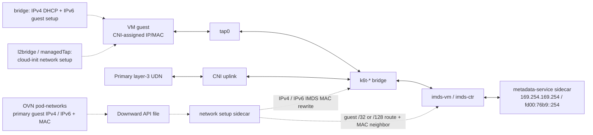

# DSX IMDS Network Setup

`dsx-imds-network-setup` runs as a sidecar in a KubeVirt `virt-launcher` Pod. It
configures that Pod network namespace so the KubeVirt VM can reach the DSX IMDS
(`metadata-service`) sidecar at `169.254.169.254` over IPv4 and `fd00:76b9::254`
over IPv6.

The KubeVirt VM connects through a tap interface and a `k6t-*` Linux bridge in
the `virt-launcher` Pod. The metadata-service shares the Pod network namespace,
but it is not a port on that bridge. Assigning the IMDS address in the namespace
is therefore insufficient. Requests carry the default gateway MAC and would
leave through the bridge uplink. Replies can also conflict with a local route
when the replacement UDN interface retains the VM IP.

The program creates a veth path from the bridge to the metadata-service,
redirects IMDS request frames into that path, and installs an explicit return
path to the VM.

## Chart integration

Enable `vmSupport` in the [identity chart](../../charts/dsx-identity/README.md).
Its admission policy injects the network setup and metadata-service sidecars
into KubeVirt launcher Pods whose VM template has this annotation:

```yaml
spec:
  template:
    metadata:
      annotations:
        spiffe.nvidia.com/inject-dsx-imds: "true"
```

The chart mounts OVN pod-networks through the Downward API. The network setup
container runs as root with `NET_ADMIN` in the launcher network namespace.
KubeVirt creates the guest bridge and tap. This sidecar adds only the IMDS path.
Injection is defined in `charts/dsx-identity/templates/vm-injection-policy.yaml`.

## Network layout



Each VM uses one guest configuration branch. The tap, bridge, uplink, veth, and
both sidecars share the virt-launcher Pod network namespace. Solid arrows carry
packets. Dotted arrows configure networking. The Downward API supplies the
guest address for the reply route and the guest MAC for its neighbor entry.

## VM bindings

- Built-in `bridge` moves the CNI link behind a Linux bridge and tap. KubeVirt
  supplies IPv4 DHCP so the guest receives the CNI-assigned IPv4 address.
- `l2bridge` uses KubeVirt's `managedTap` attachment for the same Ethernet path.
  It supplies no DHCP server. Cloud-init or another guest network setup path
  configures the CNI-assigned addresses and gateways on the matching guest MAC.

For IPv6, both bindings need guest network configuration with the exact address
allocated by OVN and an IPv6 route to `fd00:76b9::254`, such as a default route
through the primary network gateway. KubeVirt bridge DHCP supplies IPv4
configuration.

These are VM interface bindings. Both can use an OVN-Kubernetes layer-3 UDN.
Both rename the CNI interface and attach it to the bridge. A dummy takes the
original interface name and retains the Pod address configuration. The dummy's
current address and MAC need not identify the guest, and a separate `eth0` can
belong to the infrastructure network.

The command waits up to 60 seconds for the `k6t-*` bridge, its `tap0` port, and
KubeVirt's replacement dummy interface. It also waits for tap carrier, which
returns when QEMU opens the tap after network preparation. The dummy alone
appears before address updates finish. This ordering keeps IMDS route changes
out of KubeVirt's network handoff.

The Downward API file supplies the guest reply destinations and MAC. The sidecar
uses them for the guest `/32` IPv4 or `/128` IPv6 route and permanent neighbor
entry. It reads the single entry with `role: primary` in OVN's `pod-networks`
annotation, which describes the network attached to `tap0`. Infrastructure and
secondary entries are excluded. The chart mounts
`metadata.annotations['k8s.ovn.org/pod-networks']` through the Downward API at
`/var/run/dsx-imds/pod-networks`. The mount receives annotation updates and
needs no Kubernetes API credentials. Discovery fails if the primary entry is
missing or ambiguous, or its CIDRs or MAC are invalid. It accepts one address
per family, including IPv4-only, IPv6-only, and dual-stack allocations. OVN must
publish the primary network role and allocation for both bindings.

The guest must use the MAC in that allocation. Set any VMI `macAddress` to the
same value or leave it unset. A different guest MAC is unsupported because IMDS
replies use a permanent neighbor entry, bypassing ARP and IPv6 neighbor
discovery.

The sidecar configures each address family present in the primary allocation.
IPv6 must be enabled in the Pod network namespace when the allocation includes
IPv6. The process stays alive after setup until shutdown.

## Manual reproduction

Run these commands as root in the launcher Pod network namespace. Use only the
IPv4 commands for an IPv4-only guest, only the IPv6 commands for an IPv6-only
guest, and both for a dual-stack guest.

### Identify the KubeVirt interfaces

Inspect the guest tap and the OVN allocation:

```bash
ip link show tap0
cat /var/run/dsx-imds/pod-networks
```

Replace the angle-bracket placeholders below with values from these outputs.
Use the tap's `master` as `<bridge>`. In the OVN entry with `role: primary`,
use `ip_addresses` for `<vm-ipv4>` and `<vm-ipv6>`, without their CIDR suffixes,
and `mac_address` for `<vm-mac>`.

### Create the veth path

```bash
ip link add imds-vm type veth peer name imds-ctr
ip link set imds-vm master <bridge>
ip link set imds-vm up
ip link set imds-ctr up
ip link show imds-ctr
```

`imds-vm` joins the KubeVirt bridge. Its peer, `imds-ctr`, delivers frames to
metadata-service. Use the `link/ether` address of `imds-ctr` as `<imds-mac>`.
The sidecar reuses an existing veth pair.

### Assign the IMDS address

| Family | Command |
| --- | --- |
| IPv4 | `ip addr replace 169.254.169.254/32 dev imds-ctr` |
| IPv6 | `ip -6 addr replace fd00:76b9::254/128 dev imds-ctr nodad` |

Metadata-service listens on port 80. The fixed IPv6 service address uses
`nodad` so it is available immediately.

### Redirect request frames

Create the bridge table and chain:

```bash
nft add table bridge nat
nft 'add chain bridge nat PREROUTING { type filter hook prerouting priority dstnat; policy accept; }'
```

Add the rule for each allocated family:

| Family | Command |
| --- | --- |
| IPv4 | `nft add rule bridge nat PREROUTING iifname tap0 ip daddr 169.254.169.254 ether daddr set <imds-mac>` |
| IPv6 | `nft add rule bridge nat PREROUTING iifname tap0 ip6 daddr fd00:76b9::254 ether daddr set <imds-mac>` |

The VM treats the IMDS address as a routed destination and sends the packet to
its default gateway MAC. A bridge forwards by destination MAC, so without this
rule it selects the uplink instead of `imds-vm`.

The `bridge` nftables family sees the Ethernet frame before the bridge makes
that forwarding decision. The `PREROUTING` rule matches IMDS frames arriving
from the guest tap and replaces the gateway MAC with the `imds-ctr` MAC. The
bridge then forwards the frame through `imds-vm`, and the peer delivers it on
`imds-ctr` to metadata-service.

### Remove the conflicting local route

Check whether the guest address has a local-table route:

| Family | Command |
| --- | --- |
| IPv4 | `ip route show table local type local exact <vm-ipv4>/32` |
| IPv6 | `ip -6 route show table local type local exact <vm-ipv6>/128` |

Delete only a route that exists:

| Family | Command |
| --- | --- |
| IPv4 | `ip route del local <vm-ipv4> table local` |
| IPv6 | `ip -6 route del local <vm-ipv6> table local` |

If the replacement interface retains the VM IP, its local-table route makes
the kernel treat that address as local. A metadata-service reply would terminate
in the Pod namespace instead of crossing the bridge to the VM. Deleting only
the route preserves the interface address and lets the reply route below take
effect.

### Add the reply route

| Family | Command |
| --- | --- |
| IPv4 | `ip route replace <vm-ipv4>/32 dev imds-ctr` |
| IPv6 | `ip -6 route replace <vm-ipv6>/128 dev imds-ctr` |

This host route sends every reply for the VM IP through `imds-ctr`. A frame
transmitted there emerges from `imds-vm`, enters the KubeVirt bridge, and can
reach the VM tap interface.

### Add the VM neighbor entry

| Family | Command |
| --- | --- |
| IPv4 | `ip neigh replace <vm-ipv4> lladdr <vm-mac> dev imds-ctr nud permanent` |
| IPv6 | `ip -6 neigh replace <vm-ipv6> lladdr <vm-mac> dev imds-ctr nud permanent` |

The host route is directly connected, so the kernel still needs a destination
MAC before it can create each Ethernet reply frame. The permanent neighbor entry
supplies the guest MAC from OVN pod-networks and avoids ARP or IPv6 neighbor
discovery on the point-to-point veth path.

## Packet flow

Request path:

```text
KubeVirt VM -> tap interface -> KubeVirt bridge -> nftables destination MAC rewrite
  -> imds-vm -> imds-ctr -> DSX IMDS sidecar
```

The nftables rewrite is the request-path decision that keeps the frame from
following the gateway MAC to the bridge uplink.

Reply path:

```text
DSX IMDS sidecar -> VM /32 or /128 route and permanent neighbor -> imds-ctr
  -> imds-vm -> KubeVirt bridge -> tap interface -> KubeVirt VM
```

The local-route deletion allows the host route to win. The route chooses the
veth path and the neighbor entry supplies the VM MAC used by the bridge.

## Flags

| Flag | Default | Purpose |
| --- | --- | --- |
| `--pod-networks-file` | `/var/run/dsx-imds/pod-networks` | Downward API file containing OVN pod-networks |
| `--log-level` | `info` | JSON log level: `debug`, `info`, `warn`, or `error` |

Linux netlink, bridge nftables, an OVN-Kubernetes layer-3 UDN, and the KubeVirt
bridge are runtime dependencies.
