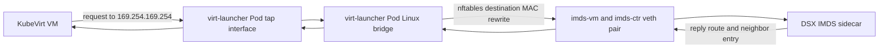

# DSX IMDS Network Setup

`dsx-imds-network-setup` runs as a sidecar in a KubeVirt `virt-launcher` Pod. It
configures that Pod network namespace so the KubeVirt VM can reach the
DSX IMDS (`metadata-service`) sidecar at `169.254.169.254`.

The KubeVirt VM connects through a tap interface and a `k6t-*` Linux bridge in
the `virt-launcher` Pod. The metadata-service shares the Pod network namespace,
but it is not a port on that bridge. Assigning the IMDS address in the namespace
is therefore insufficient. Requests carry the default gateway MAC and would
leave through the bridge uplink. Replies can also conflict with a local route
when the replacement UDN interface retains the VM IP.

The program creates a veth path from the bridge to the metadata-service,
redirects IMDS request frames into that path, and installs an explicit return
path to the VM.



The command supports KubeVirt's built-in `bridge` binding and a `l2bridge`
binding with `managedTap` attachment. It waits up to 60 seconds for the `k6t-*`
bridge, its `tap0` port, and KubeVirt's replacement dummy interface before
changing routes. This avoids interfering with KubeVirt's network handoff.

The guest IPv4 address and MAC come from the CNI `network-status` entry whose
interface name matches the bridge name without `k6t-`. The chart mounts
`metadata.annotations['k8s.v1.cni.cncf.io/network-status']` through the Downward
API at `/var/run/dsx-imds/network-status`. The mount receives annotation updates
and needs no Kubernetes API credentials. Discovery fails if the matching entry
has no IPv4 address or its address or MAC is invalid or ambiguous.

This works when the replacement interface has no IPv4 address or has a different
MAC. An infrastructure interface such as `eth0` is not used when the guest's
bridge belongs to `ovn-udn1`. The process stays alive after setup until shutdown.

## Manual reproduction

Run these commands as root in the same network namespace as the
`metadata-service` sidecar. Read the guest address from the mounted CNI
network-status file.

### Identify the KubeVirt interfaces

```bash
BRIDGE=$(ip -o link show type bridge | awk -F': ' '$2 ~ /^k6t-/ { print $2; exit }')
UDN_IF=${BRIDGE#k6t-}
VM_IP=$(jq -r --arg iface "$UDN_IF" 'map(select(.interface == $iface))[0].ips[] | select(contains(":") | not)' /var/run/dsx-imds/network-status)
VM_MAC=$(jq -r --arg iface "$UDN_IF" 'map(select(.interface == $iface))[0].mac' /var/run/dsx-imds/network-status)
```

`BRIDGE` is the KubeVirt bridge. `VM_IP` and `VM_MAC` belong to its matching
CNI network-status entry.

### Create the veth path

```bash
ip link add imds-vm type veth peer name imds-ctr
ip link set imds-vm master "$BRIDGE"
ip link set imds-vm up
ip link set imds-ctr up
```

`imds-vm` is the bridge-facing end. Attaching it to the KubeVirt bridge gives
the bridge a port for IMDS frames. `imds-ctr` is the metadata-service end in the
same network namespace. Enabling both ends allows frames to cross the pair. The
Go command reuses the pair when it already exists.

### Assign the IMDS address

```bash
ip addr replace 169.254.169.254/32 dev imds-ctr
```

This assigns the IMDS address to the container-facing end of the veth pair.
The metadata-service listening on port 80 can then accept packets delivered to
that address. `replace` matches the netlink address replacement used by the
command.

### Redirect request frames

```bash
IMDS_MAC=$(cat /sys/class/net/imds-ctr/address)
nft add table bridge nat
nft 'add chain bridge nat PREROUTING { type filter hook prerouting priority dstnat; policy accept; }'
nft add rule bridge nat PREROUTING ip daddr 169.254.169.254 ether daddr set "$IMDS_MAC"
```

The VM treats `169.254.169.254` as a routed destination and sends the packet to
its default gateway MAC. A bridge forwards by destination MAC, so without this
rule it selects the uplink instead of `imds-vm`.

The `bridge` nftables family sees the Ethernet frame before the bridge makes
that forwarding decision. The `PREROUTING` rule matches the IMDS IPv4
destination and replaces the gateway MAC with the `imds-ctr` MAC. The bridge
then forwards the frame through `imds-vm`, and the peer delivers it on
`imds-ctr` to the metadata-service.

The rule uses names instead of unexplained packet constants:

- `ip daddr` selects IPv4 EtherType `0x0800`, then reads the four-byte IPv4
  destination address at byte offset 16 of the IPv4 header.
- `ether daddr set` writes the six-byte Ethernet destination MAC at byte offset
  0 of the Ethernet header.
- `dstnat` names the destination NAT chain priority.

These are the same protocol value, offsets, and field widths encoded by the Go
nftables expressions.

### Remove the conflicting local route

```bash
ip route del local "$VM_IP" table local
```

OVN-Kubernetes assigns the VM IP to the bridged UDN interface in the
`virt-launcher` namespace. This creates a local-table route that makes the
kernel treat the VM IP as local. A metadata-service reply to that IP would
terminate in the Pod namespace instead of crossing the bridge to the VM.

Deleting only the local-table route preserves the UDN interface address while
allowing the explicit route below to control replies.

### Add the reply route

```bash
ip route replace "$VM_IP"/32 dev imds-ctr
```

This host route sends every reply for the VM IP through `imds-ctr`. A frame
transmitted there emerges from `imds-vm`, enters the KubeVirt bridge, and can
reach the VM tap interface.

### Add the VM neighbor entry

```bash
ip neigh replace "$VM_IP" lladdr "$VM_MAC" dev imds-ctr nud permanent
```

The host route is directly connected, so the kernel still needs a destination
MAC before it can create each Ethernet reply frame. The permanent neighbor
entry supplies the actual VM MAC read from the UDN interface and avoids ARP on
the point-to-point veth path.

## Packet flow

Request path:

```text
KubeVirt VM -> tap interface -> KubeVirt bridge -> nftables destination MAC rewrite
  -> imds-vm -> imds-ctr -> DSX IMDS sidecar
```

The nftables rewrite is the request-path decision that keeps the frame from
following the gateway MAC to the bridge uplink.

Reply path:

```text
DSX IMDS sidecar -> imds-ctr -> VM /32 route and permanent neighbor
  -> imds-vm -> KubeVirt bridge -> tap interface -> KubeVirt VM
```

The local-route deletion allows the `/32` route to win. The route chooses the
veth path and the neighbor entry supplies the VM MAC used by the bridge.

The identity chart injects the sidecar through
`charts/dsx-identity/templates/vm-support.yaml`.

## Flags

| Flag | Default | Purpose |
| --- | --- | --- |
| `--network-status-file` | `/var/run/dsx-imds/network-status` | Downward API file containing CNI network-status |
| `--log-level` | `info` | JSON log level: `debug`, `info`, `warn`, or `error` |

The container must run as root with `NET_ADMIN` in the `virt-launcher` Pod
network namespace. Linux netlink, bridge nftables, an OVN-Kubernetes layer-3
UDN, and the KubeVirt bridge are runtime dependencies.

## Testing

```bash
go test ./cmd/dsx-imds-network-setup
```

The focused tests cover setup completion, setup failure, and cancellation. The
KubeVirt E2E path validates the resulting VM request flow.
