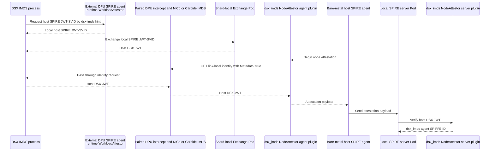

# DSX IMDS NodeAttestor Agent Plugin

`dsx-imds-node-attestor-agent` is the agent half of SPIRE's custom `dsx_imds`
NodeAttestor. It requests a host DSX JWT through the paired DPU intercept and
NICo or Carbide IMDS passthrough, then sends that token as the SPIRE
node-attestation payload.



SPIRE starts the binary through the plugin SDK. The plugin has no application
CLI flags. Configure it in the SPIRE agent HCL:

```hcl
plugin_data {
  endpoint = "http://169.254.169.254"
  audience = "spiffe://k2.sjc-1.nvidia.com/spire/server"
}
```

`endpoint` defaults to `http://169.254.169.254`. `audience` is required. The
HTTP client connects directly, ignores ambient proxy settings, and rejects
redirects. The local E2E fixture stages the plugin through
`scripts/dsx-imds-host-agent-values.yaml` plus its shard override.

## Testing

```bash
go test ./cmd/dsx-imds-node-attestor-agent ./internal/dsximds
```

The focused tests cover configuration, IMDS token retrieval, proxy and redirect
handling, and the complete agent-to-server attestation exchange.
