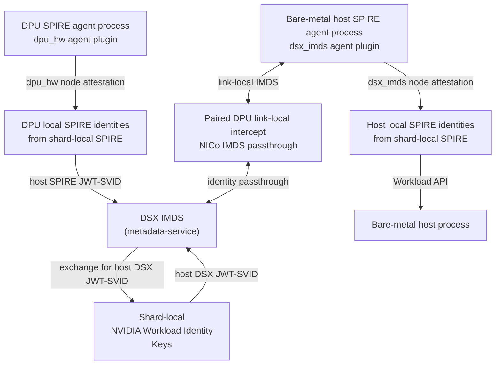
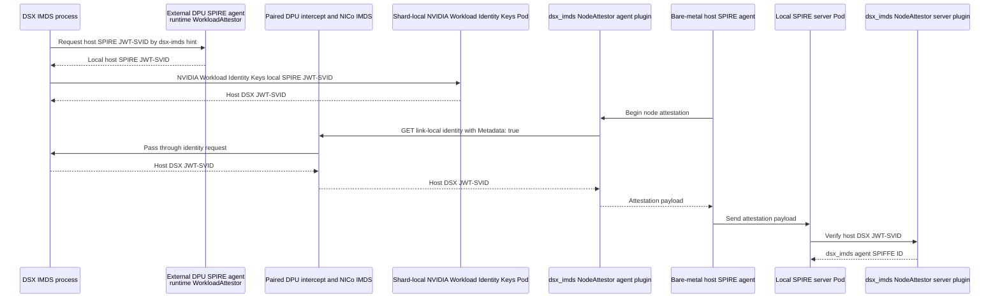

# DSX IMDS NodeAttestor Agent Plugin

`dsx-imds-node-attestor-agent` is the agent half of [SPIRE](https://spiffe.io/docs/latest/spire-about/)'s custom `dsx_imds`
NodeAttestor. It requests a host DSX JWT-SVID through the paired DPU intercept and
[NICo](https://docs.nvidia.com/infra-controller/) IMDS passthrough, then sends that token as the SPIRE
node-attestation payload.

The external DPU establishes the first local SPIRE identities through
`dpu_hw`. DSX IMDS selects the host identity beneath that DPU agent and
exchanges it for the DSX JWT-SVID used by this plugin. The bare-metal host agent must
complete `dsx_imds` node attestation before it can serve host processes through
the Unix WorkloadAttestor or provide identities to VMs.

## Host identity trust path

The external `dpu_hw` NodeAttestor agent and server plugins attest the DPU
agent. Its runtime WorkloadAttestor makes the registered host identity
available to DSX IMDS. The repository-owned `dsx_imds` NodeAttestor agent and
server plugins then attest the host agent, whose Unix WorkloadAttestor serves
host processes.



## Node attestation exchange



SPIRE starts the binary through the plugin SDK. The plugin has no application
CLI flags. Configure it in the SPIRE agent HCL:

```hcl
plugin_data {
  endpoint = "http://169.254.169.254"
  audience = "spiffe://k2.sjc-1.nvidia.com/spire/server"
}
```

`endpoint` defaults to `http://169.254.169.254`. `audience` is required. The
HTTP client connects directly, ignores ambient proxy settings, and rejects
redirects. `Dockerfile.spire` embeds the plugin in the DSX SPIRE agent image.
The local E2E fixture selects that image through
`local-e2e-tests/dsx-imds-host-agent-values.yaml` plus its shard override.
