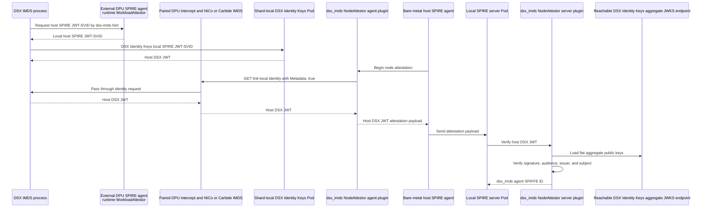

# DSX IMDS NodeAttestor Server Plugin

`dsx-imds-node-attestor-server` is the server half of SPIRE's custom
`dsx_imds` NodeAttestor. It verifies the host DSX JWT received from the agent
plugin and returns the DSX subject as a reattestable SPIRE agent ID.



SPIRE starts the binary through the plugin SDK. The plugin has no application
CLI flags. Configure it in the SPIRE server HCL:

```hcl
plugin_data {
  jwks_url = "https://identity-keys.shard.example.com/.well-known/jwks.json"
  audience = "spiffe://k2.sjc-1.nvidia.com/spire/server"
  trust_domain = "k2.sjc-1.nvidia.com"
}
```

All three fields are required. `jwks_url` may name any reachable DSX Identity Keys instance's
flat aggregate JWKS. The standard OIDC remote key set caches keys and refreshes
when it encounters an unknown `kid`. `Dockerfile.spire` embeds the plugin in
the DSX SPIRE server image. The local E2E configuration selects that image in
`scripts/identity-e2e-values.yaml` and supplies each shard's plugin data in its
shard values file.

## Testing

```bash
go test ./cmd/dsx-imds-node-attestor-server ./internal/dsximds
```

The focused tests cover configuration, signature and claim verification,
remote JWKS behavior, and the complete agent-to-server attestation exchange.
