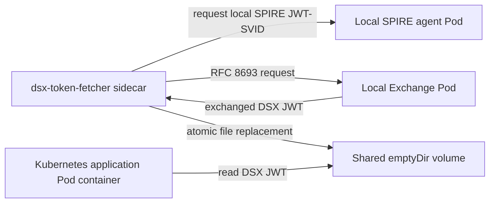

# DSX Token Fetcher

`dsx-token-fetcher` obtains a local SPIRE JWT-SVID from the Workload API,
submits it to the local Exchange, and writes the exchanged DSX JWT to a shared
file. In long-running mode it refreshes the token before expiry and reports
readiness at `/healthz`.



The umbrella chart injects the sidecar and shared volume through
`charts/dsx-identity/templates/pod-token-fetcher.yaml`.

## Flags

| Flag | Default | Purpose |
| --- | --- | --- |
| `--socket` | `unix:///var/run/secrets/spire.io/spire-agent.sock` | SPIRE Workload API socket URL |
| `--audience` | `spiffe://example.org` | Audience requested in the local SPIRE JWT-SVID |
| `--svid-hint` | empty | Optional exact JWT-SVID hint override. Without it, use the Workload API default |
| `--exchange-service-url` | required | Base HTTP URL of the local Exchange |
| `--output` | `/var/run/secrets/nvidia.com/dsx/token` | DSX JWT output file |
| `--retries` | `3` | Attempts for each Workload API fetch and token exchange |
| `--exit-after-fetch` | `false` | Exit after the first successful write |
| `--health-port` | `8080` | Port for `/healthz` |
| `--verbose` | `true` | Enable operational logging |

The output directory is mode `0700` and the token file is atomically replaced
with mode `0600`. A failed refresh keeps an unexpired token available. An
expired token is removed and readiness returns HTTP 503.

## Testing

```bash
go test ./cmd/dsx-token-fetcher
```

The focused tests cover identity selection, retries and cancellation, refresh
timing, atomic file permissions, expiry handling, and readiness. The optional
live Workload API test uses `DSX_E2E_SPIFFE_ENDPOINT_SOCKET`,
`DSX_E2E_SPIRE_JWT_AUDIENCE`, and `DSX_E2E_SPIRE_JWT_ID`.
