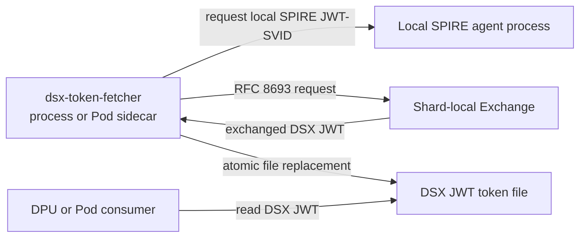

# DSX Token Fetcher

`dsx-token-fetcher` obtains a local SPIRE JWT-SVID from the Workload API,
submits it to the local Exchange, and writes the exchanged DSX JWT to a shared
file. In long-running mode it refreshes the token before expiry and reports
readiness at `/healthz`.



The identity chart injects the sidecar and shared volume through
`charts/dsx-identity/templates/pod-token-fetcher.yaml`.
An external DPU supervisor can run the same binary against its local Workload
API socket and token-file path. The fetcher is the Workload API caller and is
therefore the process selected by the DPU registration. The protected token
file is the capability consumed by the DPU process. That integration is outside
the identity chart. Host-process-specific integration is not part of the
current repository scope.

## Flags

| Flag | Default | Purpose |
| --- | --- | --- |
| `--socket` | `unix:///var/run/secrets/spire.io/spire-agent.sock` | SPIRE Workload API socket URL |
| `--audience` | `spiffe://example.org` | Audience requested in the local SPIRE JWT-SVID |
| `--svid-hint` | empty | Optional exact JWT-SVID hint override. Without it, use the Workload API default |
| `--exchange-service-url` | required | RFC 8693 endpoint of the reachable Exchange |
| `--output` | `/run/secrets/nvidia.com/dsx/token` | DSX JWT output file |
| `--health-port` | `8080` | Port for `/healthz` |
| `--log-level` | `info` | Log level: debug, info, warn, or error |

The runtime owns access to the output directory. The fetcher atomically replaces
the consumer-readable token file. A failed refresh keeps an unexpired token
available. An expired token is removed and readiness returns HTTP 503.
Long-running fetchers refresh after 80 percent of the remaining lifetime. The
fetcher retries failed refreshes once per second.

## Testing

```bash
go test ./cmd/dsx-token-fetcher
```

The focused tests cover identity selection, refresh timing, atomic writes,
expiry handling, and readiness. The optional
live Workload API test uses `DSX_E2E_SPIFFE_ENDPOINT_SOCKET`,
`DSX_E2E_SPIRE_JWT_AUDIENCE`, and `DSX_E2E_SPIRE_JWT_ID`.
