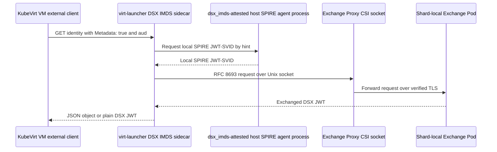
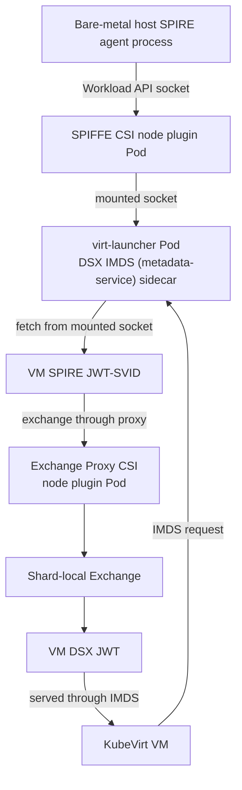
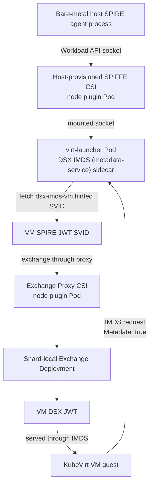

# DSX IMDS

`metadata-service` implements DSX IMDS. It serves DSX identity through the
link-local IMDS v1 API, selects a local SPIRE JWT-SVID by hint, exchanges it,
and returns the DSX JWT. KubeVirt uses Exchange Proxy CSI. Paired-DPU placement
uses a direct URL to its reachable shard-local Exchange. Each process configures
exactly one `--exchange-service-url`, whose scheme selects the transport.



The same binary serves the `dsx-imds` host identity behind the paired DPU
intercept and NICo or Carbide IMDS passthrough, and serves the `dsx-imds-vm`
identity as a KubeVirt sidecar. The identity chart injects that sidecar through
`charts/dsx-identity/templates/vm-support.yaml`.

For KubeVirt, the guest initiates the metadata request. The operator-owned
virt-launcher Pod and tenant-facing VM identities use the same operator worker
host's Workload API. The Pod keeps the configured operator tenant while the VM
identity uses the tenant supplied by its LaunchLayer source. The exact
`dsx-imds-vm` hint selects the VM identity. It does not select a separate SPIRE
agent path. The Kubernetes WorkloadAttestor serves the operator virt-launcher
Pod identity, SPIFFE CSI exposes the same host agent socket to the sidecar, and
Exchange Proxy CSI carries the exchange request to the shard-local Exchange.

## VM identity trust path

The VM SPIRE JWT-SVID remains inside the virt-launcher Pod. DSX IMDS exchanges
it through the proxy and serves only the resulting DSX JWT to the VM.



## VM IMDS request path

The guest supplies the metadata header. The exact `dsx-imds-vm` hint selects
the VM SPIRE JWT-SVID before the proxy carries the exchange request.



## HTTP API

The supported identity endpoints are:

```text
GET /latest/meta-data/identity?aud=<audience>
GET /2009-04-04/meta-data/identity?aud=<audience>
```

```http
GET /latest/meta-data/identity?aud=<audience>
Metadata: true
Accept: application/json
```

Requests require `Metadata: true`, reject proxy forwarding headers, and may
repeat `aud`. `Accept` supports `application/json` and `text/plain`. An absent
header defaults to JSON. Plain text returns only the DSX JWT. JSON returns
`token`, `expires_in`, and `spiffe_id`. Successful identity responses use
`Cache-Control: no-store`. Response connections use IPv4 TTL 1 or IPv6 hop
limit 1. Dependency failures return sanitized HTTP errors. `GET /health`
reports process health.

The API is intentionally tokenless. The paired DPU intercept and NICo or
Carbide enforce physical source binding, network isolation, and response hop
limits. `Metadata: true` and proxy-header rejection are additional request
checks, not a replacement for that network boundary.

## Flags

| Flag | Default | Purpose |
| --- | --- | --- |
| `--listen` | `:80` | HTTP listen address |
| `--exchange-service-url` | required | RFC 8693 HTTP endpoint, or `unix:///path/to/socket` for Exchange Proxy CSI |
| `--spire-socket` | `/var/run/secrets/spire.io/spire-agent.sock` | SPIRE Workload API socket path |
| `--svid-hint` | `dsx-imds` | Exact identity hint, either `dsx-imds` or `dsx-imds-vm` |
| `--log-level` | `info` | JSON log level: `debug`, `info`, `warn`, or `error` |

## Testing

```bash
go test ./cmd/metadata-service
```

The focused tests cover request validation, response format, response TTL,
identity selection, and Exchange transport.
