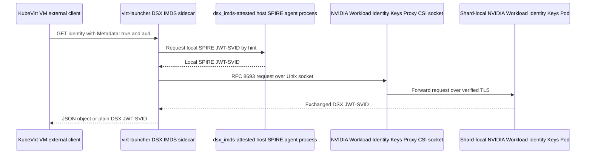
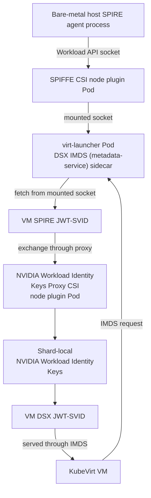
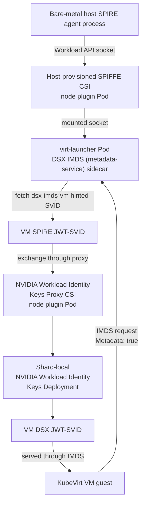

# DSX IMDS

`metadata-service` implements DSX IMDS. It serves DSX JWT-SVIDs through the
IMDS v1 API, selects a local SPIRE JWT-SVID by hint, exchanges it,
and returns the DSX JWT-SVID. KubeVirt uses NVIDIA Workload Identity Keys Proxy
CSI. Paired-DPU placement uses a direct URL to its reachable shard-local
NVIDIA Workload Identity Keys. Each process configures exactly one
`--identity-keys-url`, whose scheme selects the transport. For a Unix proxy to
an HTTPS virtual host, set `--identity-keys-host` to that route's DNS name so
the exchange request carries the matching HTTP Host header.



The same binary serves the `dsx-imds` host identity behind the paired DPU
intercept and NICo IMDS passthrough, and serves the `dsx-imds-vm`
identity as a KubeVirt sidecar. The identity chart injects that sidecar through
`charts/dsx-identity/templates/vm-support.yaml`. DPF deploys the same binary on
DPU nodes through `charts/dsx-imds`.

For KubeVirt, the guest initiates the metadata request. The operator-owned
virt-launcher Pod and tenant-facing VM identities use the same operator worker
host's Workload API. The Pod keeps the configured operator tenant while the VM
identity uses the tenant supplied by its LaunchLayer source. The exact
`dsx-imds-vm` hint selects the VM identity. It does not select a separate
SPIRE agent path. The Kubernetes WorkloadAttestor serves the operator
virt-launcher Pod identity, SPIFFE CSI exposes the same host agent socket to
the sidecar, and NVIDIA Workload Identity Keys Proxy CSI carries the exchange
request to the shard-local NVIDIA Workload Identity Keys.

## VM identity trust path

The VM SPIRE JWT-SVID remains inside the virt-launcher Pod. DSX IMDS exchanges
it through the proxy and serves only the resulting DSX JWT-SVID to the VM.



## VM IMDS request path

The guest supplies the metadata header. The exact `dsx-imds-vm` hint selects
the VM SPIRE JWT-SVID before the proxy carries the exchange request.



## HTTP API

The supported identity endpoints are:

```text
GET /latest/meta-data/identity?aud=<audience>
GET /2009-04-04/meta-data/identity?aud=<audience>
```

```http
GET /latest/meta-data/identity?aud=<audience>
Metadata: true
Accept: application/json
```

Requests require `Metadata: true`, reject proxy forwarding headers, and may
repeat `aud`. `Accept` supports `application/json` and `text/plain`. An absent
header defaults to JSON. Plain text returns only the DSX JWT-SVID. JSON returns
`token`, `expires_in`, and `spiffe_id`. Successful identity responses use
`Cache-Control: no-store`. Response connections use IPv4 TTL 1 or IPv6 hop
limit 1. Dependency failures return sanitized HTTP errors. `GET /health`
reports process health.

KubeVirt guests reach DSX IMDS at `169.254.169.254` over IPv4 and
`fd00:76b9::254` over IPv6. The network setup sidecar configures the endpoints
for the address families in the primary OVN allocation. Both `bridge` and
`l2bridge` bindings require the OVN-allocated guest address and MAC. See the
[network setup README](../dsx-imds-network-setup/README.md) for guest routing.

```bash
curl --noproxy '*' -g -H 'Metadata: true' \
  'http://[fd00:76b9::254]/latest/meta-data/identity?aud=spiffe://ds9.dsx.nvid.id/openbao'
```

```json
{"token":"<DSX JWT-SVID>","expires_in":300,"spiffe_id":"spiffe://tenant-2.ds9.dsx.nvid.id/vm/vm-1234"}
```

The identity API accepts requests without a bearer token. For paired hosts, the
DPU intercept and NICo enforce physical source binding and network isolation.
For KubeVirt VMs, the [network setup sidecar](../dsx-imds-network-setup/README.md)
connects the guest to DSX IMDS in its virt-launcher Pod.

DSX IMDS sets response IPv4 TTL or IPv6 hop limit to 1, requires `Metadata: true`,
and rejects proxy forwarding headers. These request checks depend on the network
boundary for source isolation.

## Flags

| Flag | Default | Purpose |
| --- | --- | --- |
| `--listen` | `:80` | HTTP listen address |
| `--identity-keys-url` | required | RFC 8693 HTTP endpoint, or `unix:///path/to/socket` for NVIDIA Workload Identity Keys Proxy CSI |
| `--spire-socket` | `/var/run/secrets/spire.io/spire-agent.sock` | SPIRE Workload API socket path |
| `--svid-hint` | `dsx-imds` | Exact identity hint, either `dsx-imds` or `dsx-imds-vm` |
| `--log-level` | `info` | JSON log level: `debug`, `info`, `warn`, or `error` |
