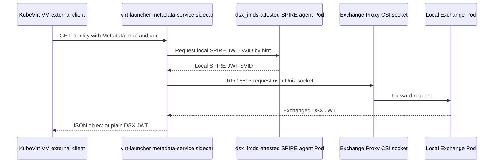

# Metadata Service

`metadata-service` serves DSX identity through the link-local IMDS v1 API. It
selects a local SPIRE JWT-SVID by hint, exchanges it through the Exchange Proxy
CSI Unix socket, and returns the exchanged DSX JWT to a direct client.



The same binary supports the DPU metadata-service host flow with the
`dsx-imds` hint and the KubeVirt VM flow with the `dsx-imds-vm` hint. The
umbrella chart injects the KubeVirt sidecar through
`charts/dsx-identity/templates/vm-support.yaml`.

## HTTP API

The supported identity endpoints are:

```text
GET /latest/meta-data/identity?aud=<audience>
GET /2009-04-04/meta-data/identity?aud=<audience>
```

Requests require `Metadata: true`, reject proxy forwarding headers, and may
repeat `aud`. `Accept: text/plain` returns only the DSX JWT. Other accepted
formats return JSON with `token`, `expires_in`, and `spiffe_id`. `GET /health`
reports process health. Response connections use IP TTL 1.

## Flags

| Flag | Default | Purpose |
| --- | --- | --- |
| `--listen` | `:80` | HTTP listen address |
| `--exchange-socket` | required | Exchange Proxy CSI Unix socket path |
| `--spire-socket` | `/var/run/secrets/spire.io/spire-agent.sock` | SPIRE Workload API socket path |
| `--svid-hint` | `dsx-imds` | Exact identity hint, either `dsx-imds` or `dsx-imds-vm` |
| `--log-level` | `info` | JSON log level: `debug`, `info`, `warn`, or `error` |

## Testing

```bash
go test ./cmd/metadata-service
```

The focused tests cover request validation, direct-client enforcement, content
negotiation, identity selection, Unix socket exchange, and response TTL.
