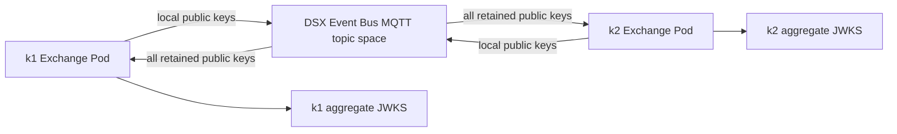

# SPIFFE Exchange Service

`spiffe-exchange-service` is the Exchange process installed in each identity
shard. It validates only local SPIRE JWT-SVIDs, transforms their SPIFFE subject
to the DSX identity contract, preserves validated claims except `sub` and
`iss`, and signs the exchanged DSX JWT with the shard's active key.

Each Exchange publishes only its local public keys to the shared Event Bus and
subscribes to all shard key publications. It retains one aggregate keyed by
globally unique `kid`, and its JWKS endpoint serves every valid local and remote
public key.



Public keys use retained QoS 1 topics of the form
`spiffe-exchange/v1/pub-keys/shard/<shard-id>/kid/<kid>`. Publications carry a
lease expiry and are refreshed every quarter of the configured lease lifetime,
leaving three further publish opportunities before lease expiry. Each valid publication
replaces the globally unique `kid` it addresses. The process obtains MQTT
credentials from the configured OAuth2 client-credentials endpoint.

The umbrella chart deploys two replicas per shard through
`charts/dsx-identity/templates/exchange-deployment.yaml`, with a unique MQTT
client ID for each Pod.

## HTTP API

| Endpoint | Purpose |
| --- | --- |
| `POST /v1/exchange` | Unauthenticated RFC 8693 exchange of a local SPIRE JWT-SVID |
| `GET /.well-known/jwks.json` | Aggregate JWKS for all valid public keys |
| `GET /.well-known/openid-configuration` | Issuer, JWKS URL, and aggregate signing algorithms |
| `GET /live` | Process liveness |
| `GET /ready` | MQTT connection, subscription, and public-key cache readiness |

## Flags

| Flag | Default | Purpose |
| --- | --- | --- |
| `--listen` | `:8080` | HTTP listen address |
| `--socket` | Workload API default | Local SPIRE Workload API socket URL |
| `--jwks-url` | required | Absolute public JWKS URL advertised by discovery |
| `--signing-jwks` | `/run/secrets/spiffe-exchange/signing-jwks.json` | Private signing JWKS file |
| `--active-kid` | `/run/secrets/spiffe-exchange/active-kid` | File containing the active signing `kid` |
| `--shard-id` | required | Globally unique shard ID in the Event Bus topic space |
| `--mqtt-broker` | required | MQTT 3.1.1 broker URL |
| `--mqtt-client-id` | `spiffe-exchange-<shard-id>` | Unique MQTT client ID |
| `--public-key-lease-ttl` | `10m` | Public key publication lease lifetime, at least 2 seconds |
| `--mqtt-oauth-token-url` | required | OAuth2 token endpoint for MQTT credentials |
| `--mqtt-oauth-client-id` | required | OAuth2 client ID |
| `--mqtt-oauth-client-secret` | required | File containing the OAuth2 client secret |
| `--log-level` | `info` | JSON log level: `debug`, `info`, `warn`, or `error` |

## Testing

```bash
go test ./cmd/spiffe-exchange-service
```

The focused tests cover signing configuration, RFC 8693 behavior, flat `kid`
aggregation, deterministic publication lease expiry, rotation overlap,
MQTT retained synchronization, OAuth2 credentials, and discovery. Live MQTT
and deployed aggregate checks are enabled by the `DSX_E2E_MQTT_*` and
`DSX_E2E_VERIFY_*` environment variables used by the E2E scripts.
