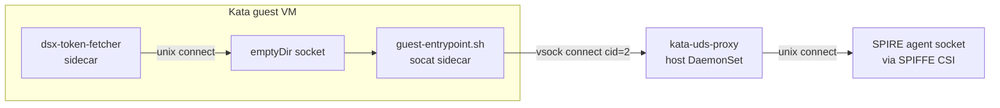

# Kata UDS Proxy

`kata-uds-proxy` exposes a host unix socket to workloads inside a Kata
Containers guest. It exists because a Kata Pod runs in a VM: the SPIFFE CSI
driver delivers the SPIRE Workload API socket as a host bind mount, and a bind
mount cannot cross the VM boundary. Without it, a Kata Pod has no path to the
node's SPIRE agent and cannot obtain an SVID.

The proxy uses two containers, which share the same image.
One container runs inside the Kata pod. This container exposes
a unix socket to the existing `dsx-token-fetcher` container but
serves the unix socket by forwarding connections to the host vsock.

The second container runs with runc and has access to some host interfaces.
This container listens on the host vsock and forwards connections from it
to the SPIRE workload API socket.
Furthermore, the host side of the proxy adds the handlers it spawns for
each connection to the pod cgroup so that the SPIRE Kubernetes workload attestor
resolves the proxied connections to the appropriate pod.

This requires no changes to the workload attestor or to Kata, but it does have some
requirements described below.

## Requirements

The host proxy is privileged and node-scoped. It needs `hostPID` to resolve QEMU
PIDs and to write `cgroup.procs` in the host's PID namespace, write access to the
host cgroup hierarchy, and `CAP_SYS_ADMIN` to enter the host cgroup namespace.
`host-entrypoint.sh` re-execs the binary under
`nsenter --cgroup=/proc/1/ns/cgroup` because the CRI places the Pod in a private
cgroup namespace, where a QEMU process outside that namespace resolves to a
`../..` relative path that does not exist under `/sys/fs/cgroup`.

Nodes must use cgroup v2 with the systemd cgroup driver, and Kata must set
`sandbox_cgroup_only = true`.

The SPIRE agent must set `disable_container_selectors = true` on its Kubernetes
workload attestor.
The proxy cannot distinguish guest processes or containers. SPIRE can use
Pod-level and node-level selectors, but not selectors for individual containers.

## Deployment

The identity chart owns both halves and ships them disabled. Enable
`kataSupport` and list every Kata RuntimeClass in use. See the
[identity chart configuration](../charts/dsx-identity/README.md#configuration).
The host DaemonSet renders from
`charts/dsx-identity/templates/kata-support.yaml`, and the guest sidecar is
injected by the `add-kata-guest-proxy` rule in
`charts/dsx-identity/templates/pod-token-fetcher.yaml`, which also replaces the
unusable CSI volume with an `emptyDir`.

Both halves must agree on `kataSupport.vsockPort`. The guest connects to context
ID 2, which always means the host.

The proxy exposes the host UDS to the host CID, which is accessible to any guest with vsock enabled.
That said, the proxy filters out requests that do not come from a Kata guest or something
with a similar QEMU commandline and cgroup layout.

The vsock will be accessible to all Kata guests and all containers within the podvm.
Do not use the proxy for any sockets that should not be accessible to all guests.
In the case of SPIRE, the workload API is designed to be exposed to workloads.

Kata randomly assigns guest CIDs at runtime, so the proxy identifies guests by
their QEMU process and cgroup.

The host proxy caps concurrent connections at 1024.
