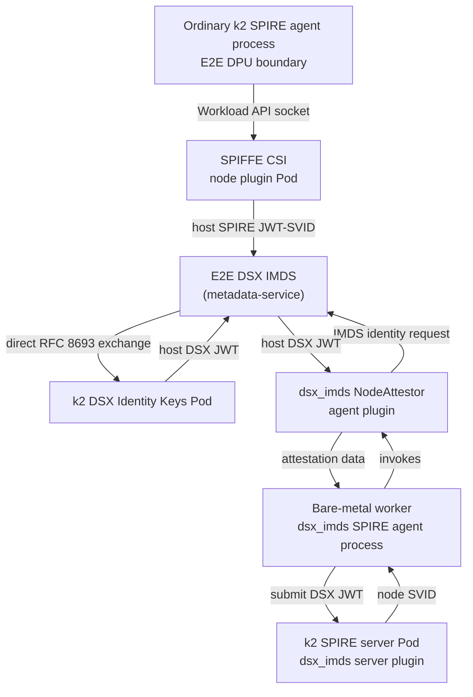
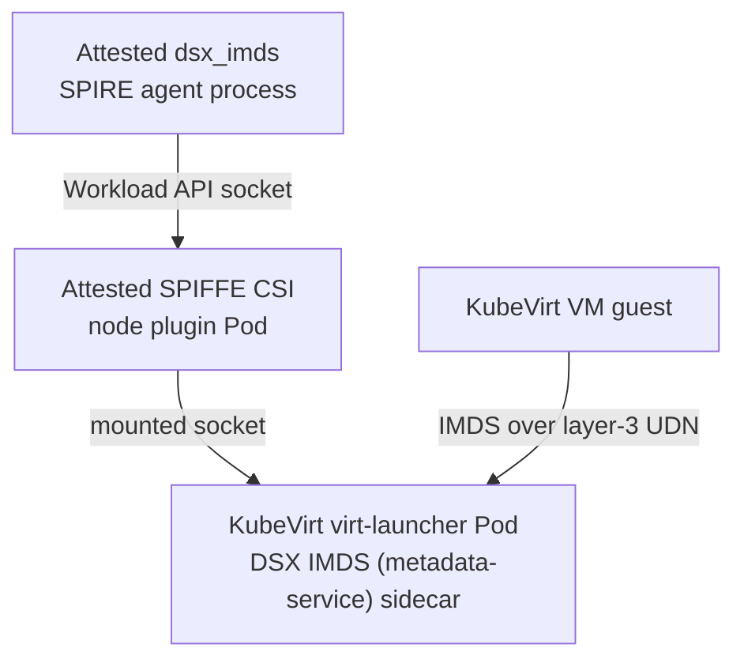
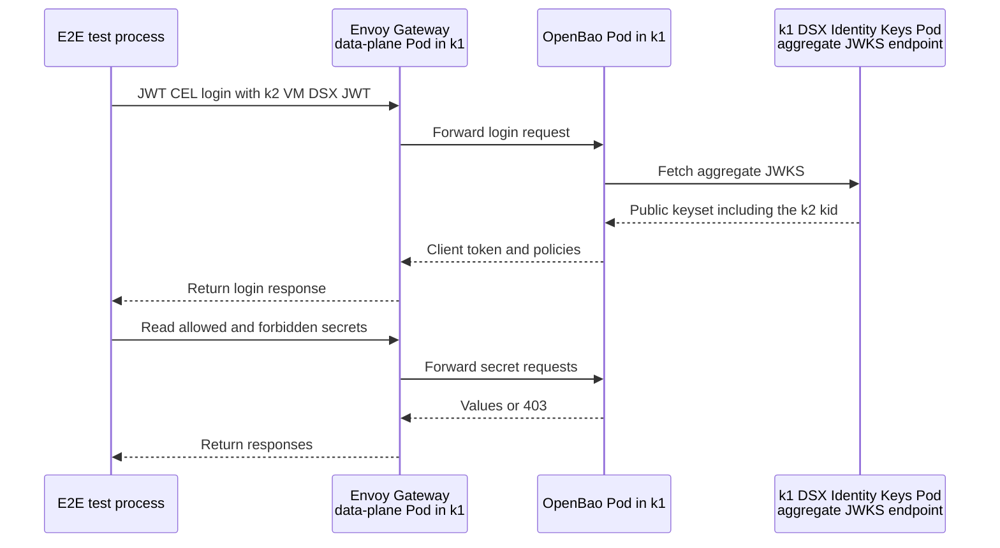

# Local E2E

Run commands from the repository root.

The repository validates the architecture with two Kind clusters. k1 hosts a
Common Services identity shard, one unauthenticated NATS server with in-memory
JetStream for KV, and the
OpenBao relying party. k2 hosts a Data Hall identity shard, the Identity
Controller, OVN-Kubernetes layer-3 UDN, and KubeVirt VMs using `bridge` and
`l2bridge` bindings. The k1 and k2 names
describe only this fixture and do not define a trust hierarchy. Local identity
components use one replica and SPIRE uses its SQLite default.

The identity chart is installed independently in both clusters. The remaining
components are separate Skaffold modules. Shared fixture settings and the
shard-specific overrides are in:

- `scripts/identity-e2e-values.yaml`
- `scripts/k1-values.yaml`
- `scripts/k2-values.yaml`

## E2E-only `dsx_imds` bootstrap

Kind starts without an external DPU or an attested worker agent. Before the
worker agent is available, the control-plane node represents the Phase 0 seed
host. Each identity chart is installed once. Its normal DSX Identity Keys Pod runs on
the seed node and uses the ordinary operator-Pod registration there while the
worker's `dsx_imds` agent attests. DSX Identity Keys has no bootstrap-specific identity
or deployment path.

Both local shards must exercise host attestation without physical DPU hardware.
Each therefore runs an official SPIRE agent DaemonSet constrained to its worker
as the external host-agent fixture. The ordinary shard agent remains on the
control-plane node as the emulated external DPU boundary. One SPIFFE CSI driver
exposes each node's canonical Workload API socket. The worker agent's
`dsx_imds` plugin obtains a DSX JWT from DSX IMDS and submits it to the
repository-owned `dsx_imds` server plugin for node attestation. k2 then reuses
that worker agent for its KubeVirt VM path.

The local fixture exposes the real DSX IMDS implementation directly at the
external intercept and passthrough boundary. E2E sends the IMDS request,
exchanges the selected SPIRE JWT-SVID, and uses the returned DSX JWT for
`dsx_imds` node attestation. It does not test physical link-local routing or
NICo or Carbide integration.

The ordinary-agent entry is the permitted fixture at the external `dsx_dpu`
boundary. E2E requests the operator-host identity from IMDS and attests the
worker's `dsx_imds` SPIRE agent with it. The fixture derives the operator host
ID from the worker name without creating a controller input for that worker.

This external-agent fixture uses the shared
`scripts/dsx-imds-host-agent-values.yaml` values and a shard override under
`scripts/k1` or `scripts/k2`. It is not part of the identity chart release.





The KubeVirt VM contains no SPIRE agent. SPIFFE CSI exposes the attested second
agent's Workload API socket to the virt-launcher Pod, and DSX IMDS uses that
socket to fetch the VM SPIRE JWT-SVID.

## VM network bindings

Both VMs use the same primary layer-3 UDN and real DSX IMDS sidecars. The binding
name describes the guest's Ethernet attachment, not the UDN topology.

| VM | Binding | Guest network configuration |
| --- | --- | --- |
| `e2e-debian-vm` | Built-in `bridge` | KubeVirt DHCP supplies the CNI-assigned address |
| `e2e-debian-vm-l2bridge` | `l2bridge` with `managedTap` | Cloud-init hook supplies the CNI-assigned address, MAC match, and gateway |

Both bindings create a `k6t-*` bridge and tap, then replace the original CNI
interface with a dummy. IMDS setup reads the matching CNI network-status entry
through the Downward API, so it works even when the dummy has no guest IPv4.
It installs the guest reply route and neighbor through the IMDS veth path.

The l2bridge fixture registers `managedTap` in KubeVirt and enables its upstream
cloud-init hook. An E2E-only admission policy projects the Pod's OVN allocation
into that hook. The hook configures guest networking because `managedTap`
supplies no DHCP server.

For each binding, the external client SSHes to the CNI-assigned guest address,
requests a VM identity from `169.254.169.254`, and authenticates the returned
token through OpenBao. The checks verify the VM subject, signature, and allowed
and forbidden secret access. See the [network setup README](../cmd/dsx-imds-network-setup/README.md)
for the packet path.

## Cross-shard OpenBao validation

The local E2E topology deploys OpenBao in k1 as an external relying party. A VM
DSX JWT issued in k2 is accepted because the k2 DSX Identity Keys public key propagates
through the Event Bus and appears in the k1 DSX Identity Keys aggregate JWKS.



## Workflow

Repository validation requires Git, mise, Make, `curl`, and a supported Linux
host. `make validate` builds Linux-only nftables code and exercises Unix socket
paths that exceed macOS limits. macOS and WSL are unsupported. Mise installs
the repository-pinned tools. The full E2E lifecycle also requires Docker with
Buildx, OpenSSL, OpenSSH, and the kernel features needed by OVN-Kubernetes and
KubeVirt.

```bash
git submodule update --init --recursive
make validate
```

The DPF submodule supplies the `dpu-hw-server` source embedded by
`Dockerfile.spire`. Keep the submodule initialized when building the SPIRE
server image.

One root Skaffold workflow deploys both Kind clusters.

```bash
make -j install
make test
make clean
```

The E2E suite verifies operator-host IMDS through both `dsx_imds` plugin halves,
DPU file delivery, Pod and VM identity delivery through both bindings, shard isolation, NATS KV
propagation, aggregate JWKS behavior, OpenBao authorization, restart recovery,
and signing-key rotation. External DPU and standalone-host hardware is not
modeled as Kubernetes Nodes.

## Network setup tests

```bash
go test ./cmd/dsx-imds-network-setup
```

The focused tests cover guest metadata selection, invalid or ambiguous metadata,
published annotation updates, setup completion, failure, and cancellation. The
Linux E2E suite boots one VM per binding. Each guest requests its IMDS identity
and authenticates the returned token through OpenBao.
