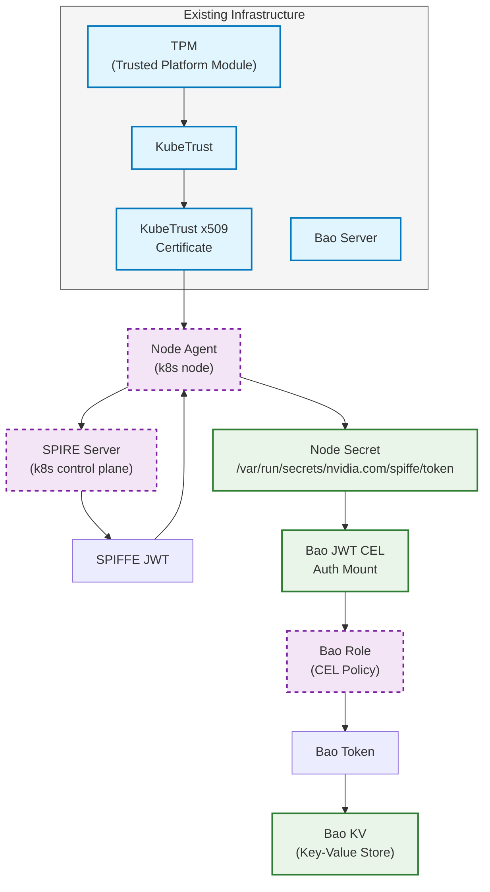

# SPIFFE/SPIRE Authentication Flow - MVP Architecture

## Overview

This document outlines the proposed MVP (Minimum Viable Product) architecture for implementing SPIFFE/SPIRE authentication flow that integrates with Bao (OpenBao) key-value storage in a Kubernetes environment.

## Architecture Diagram



## Component Status

### Currently Present (Existing Infrastructure)
- **TPM (Trusted Platform Module)**: Hardware-based root of trust
- **KubeTrust**: Kubernetes trust management system
- **KubeTrust x509**: X.509 certificates generated by KubeTrust

### Will Create (New Components)
- **Node Agent**: Agent deployed on each Kubernetes node to handle certificate exchange
- **SPIRE Server**: To be deployed in Kubernetes control plane
- **Bao Role with CEL Policy**: New authentication role to accept SPIFFE JWTs

### Endpoints (Key Integration Points)
- **Node Secret Path**: `/var/run/secrets/nvidia.com/spiffe/token`
- **Bao KV Store**: Final destination for secure key-value storage

## Authentication Flow

### Step 1: Foundation Trust Chain
```
TPM → KubeTrust → KubeTrust x509 Certificate
```
- TPM provides hardware-based root of trust
- KubeTrust leverages TPM to establish Kubernetes trust
- X.509 certificates are generated for downstream authentication

### Step 2: Node Agent Certificate Exchange (New)
```
KubeTrust x509 → Node Agent → SPIRE Server
```
- Node Agent deployed on each Kubernetes node
- Node Agent reads KubeTrust x509 certificates
- Node Agent authenticates to SPIRE Server using x509 certificates

### Step 3: SPIFFE JWT Generation and Placement (New)
```
SPIRE Server → SPIFFE JWT → Node Agent → /var/run/secrets/nvidia.com/spiffe/token
```
- SPIRE Server issues SPIFFE JWTs for workload identity
- Node Agent receives SPIFFE JWTs from SPIRE Server
- Node Agent writes SPIFFE JWTs to the node secret mount path
- This provides workloads with SPIFFE identity tokens

### Step 4: Bao Authentication (New Role)
```
SPIFFE JWT → Bao JWT CEL Auth Mount → Bao Token
```
- SPIFFE JWT authenticates against Bao's JWT authentication mount
- CEL (Common Expression Language) policy validates the JWT
- Successful authentication returns a Bao token

### Step 5: Secret Access
```
Bao Token → Bao KV Store
```
- Bao token provides access to the key-value store
- Workloads can now securely retrieve secrets

## Implementation Plan

### Phase 1: SPIRE Infrastructure Deployment
1. Deploy SPIRE Server in Kubernetes control plane
2. Deploy Node Agent on each Kubernetes node
3. Configure SPIRE to accept KubeTrust x509 certificates
4. Configure Node Agent to read KubeTrust x509 certificates
5. Configure Node Agent to write JWTs to `/var/run/secrets/nvidia.com/spiffe/token`

### Phase 2: Bao Integration
1. Create new JWT authentication mount in existing Bao server
2. Implement CEL policy for SPIFFE JWT validation
3. Create Bao role with appropriate permissions
4. Test end-to-end authentication flow

### Phase 3: Testing & Validation
1. Verify TPM → KubeTrust → Node Agent flow
2. Test Node Agent → SPIRE Server certificate exchange
3. Validate SPIFFE JWT generation and placement by Node Agent
4. Test Bao authentication with SPIFFE JWTs
5. Confirm access to Bao KV store

## Security Considerations

- **Hardware Root of Trust**: TPM provides tamper-resistant foundation
- **Certificate Chain Validation**: Each step validates the previous component
- **JWT Expiration**: SPIFFE JWTs have limited lifetime for security
- **CEL Policy Enforcement**: Granular control over JWT acceptance criteria
- **Least Privilege**: Bao tokens have minimal required permissions

## Benefits

1. **Zero-Trust Architecture**: Each workload has verifiable identity
2. **Hardware-Backed Security**: TPM provides strong root of trust
3. **Kubernetes Native**: Integrates with existing Kubernetes infrastructure
4. **Scalable**: SPIFFE/SPIRE designed for large-scale deployments
5. **Policy-Driven**: CEL policies provide flexible authentication rules

## Next Steps

1. Review and approve architecture design
2. Set up development/testing environment
3. Begin SPIRE Server deployment in control plane
4. Implement and test CEL policy for Bao authentication
5. Validate complete authentication flow
6. Document operational procedures

---

*This document serves as the technical specification for implementing SPIFFE/SPIRE authentication flow MVP in the Kubernetes environment with Bao integration.*
